# 2026-10-23 화면 검토

Playwright로 현재 프론트엔드를 390×844(모바일), 1280×900(데스크톱), 라이트·다크로 캡처한 기록입니다. API는 Playwright route mock으로 채웠고, 실제 백엔드 데이터는 사용하지 않았습니다.

## 캡처

| 화면 | 파일 |
|---|---|
| 모바일 홈 | 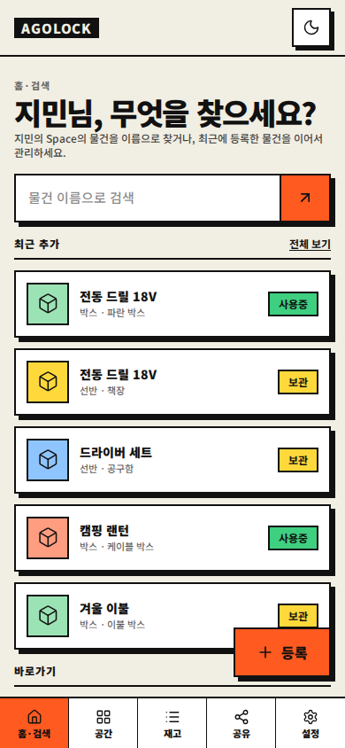 |
| 모바일 검색 결과 | 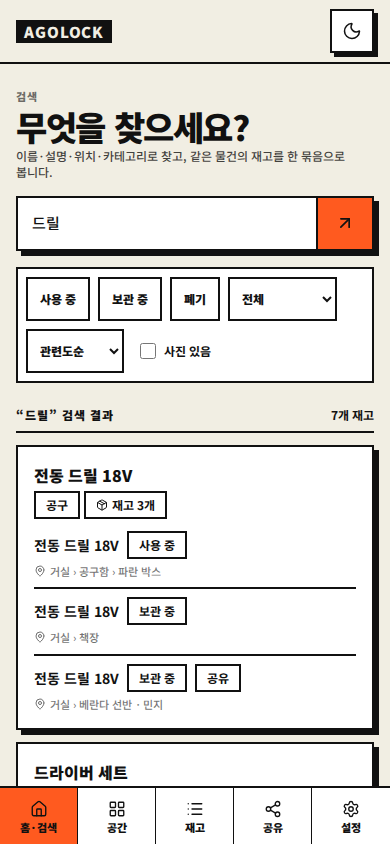 |
| 모바일 재고 상세 | 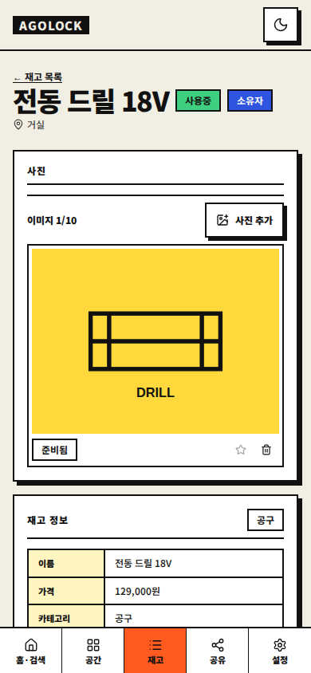 |
| 모바일 공간 지도 | 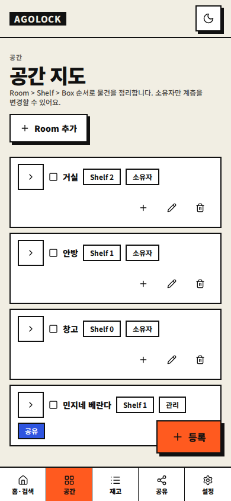 |
| 모바일 Room 상세 | 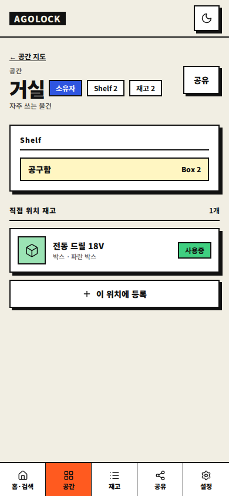 |
| 모바일 카테고리 | 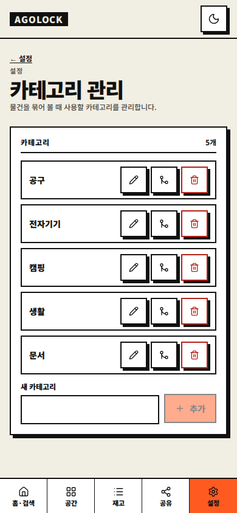 |
| 모바일 등록 시트 | 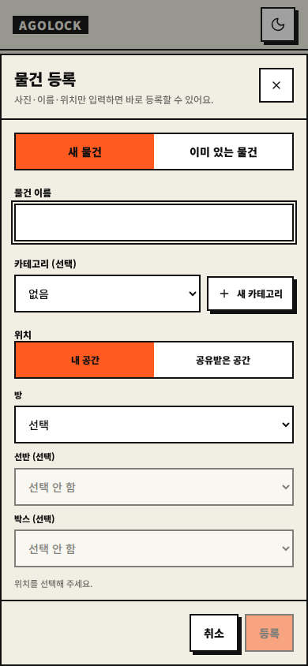 |
| 모바일 토스트 | 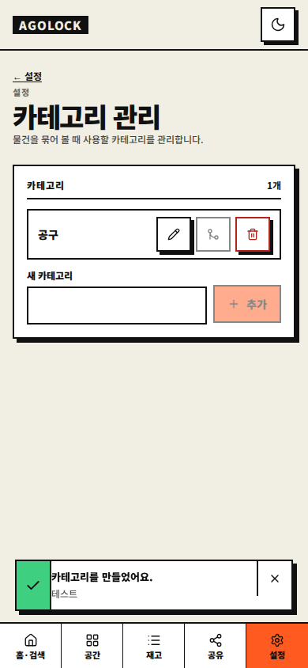 |
| 데스크톱 검색 결과 | 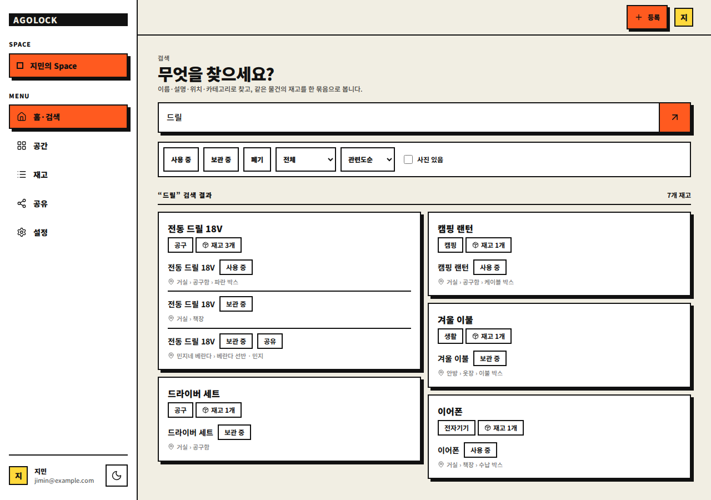 |
| 데스크톱 재고 편집 | 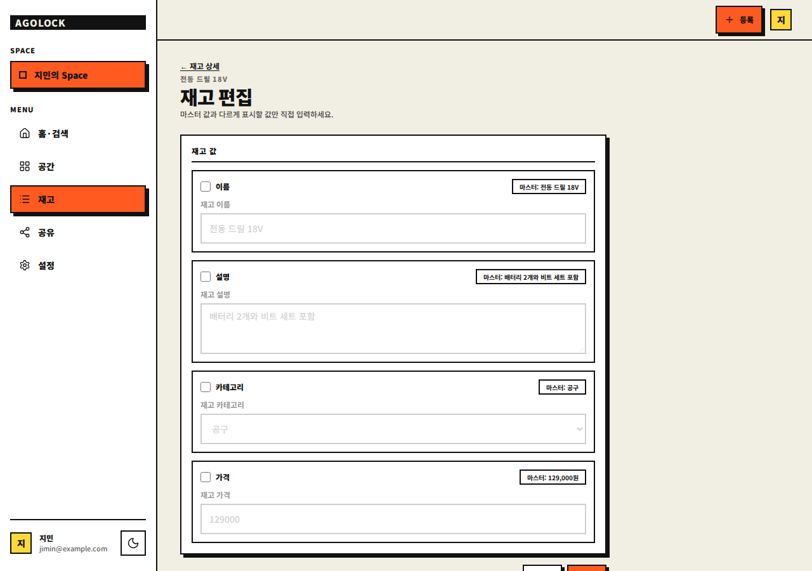 |
| 데스크톱 재고 상세 | 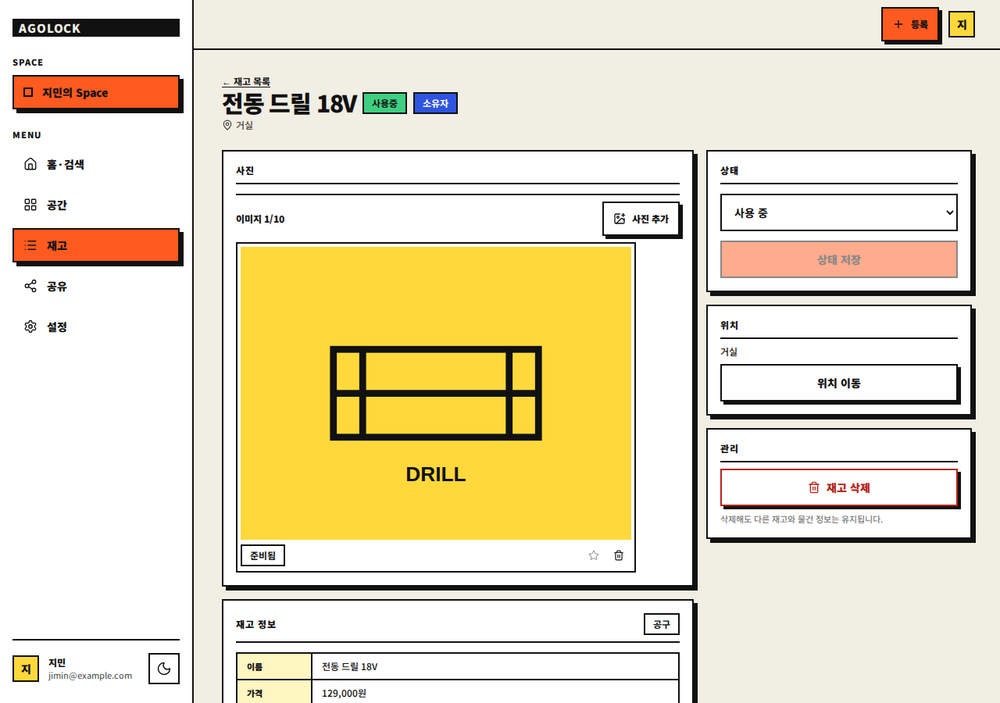 |
| 데스크톱 Room 상세 | 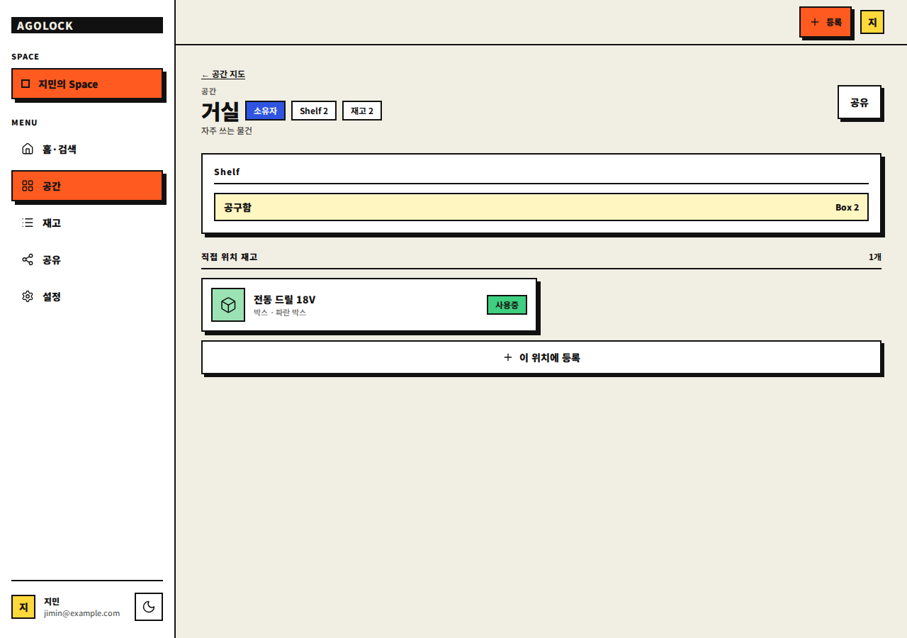 |
| 데스크톱 설정 | 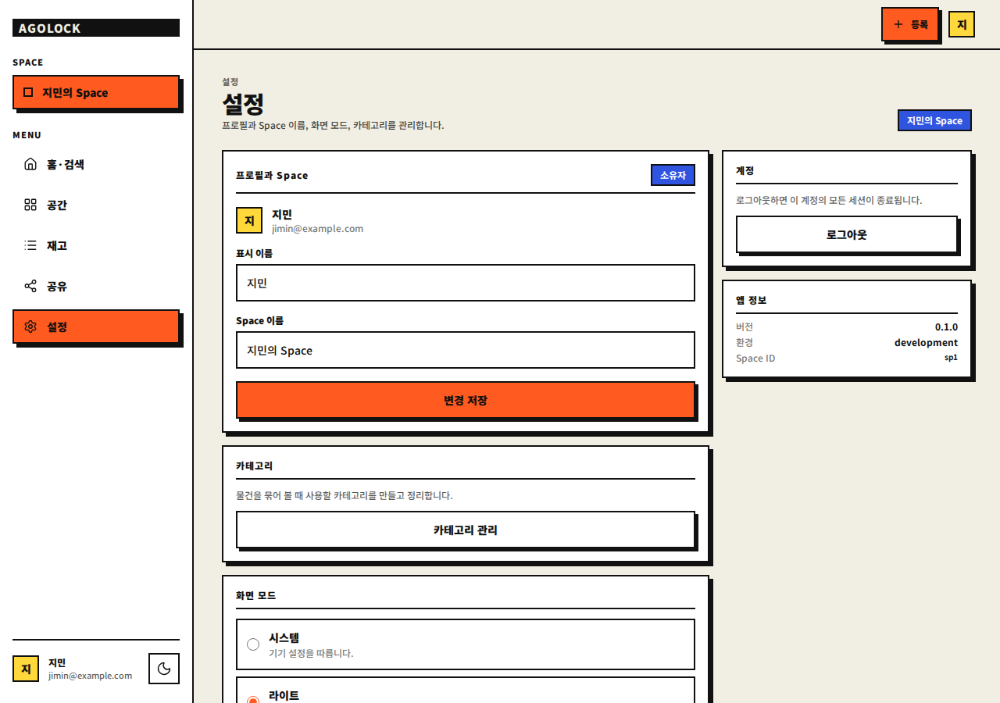 |
| 데스크톱 토스트 | 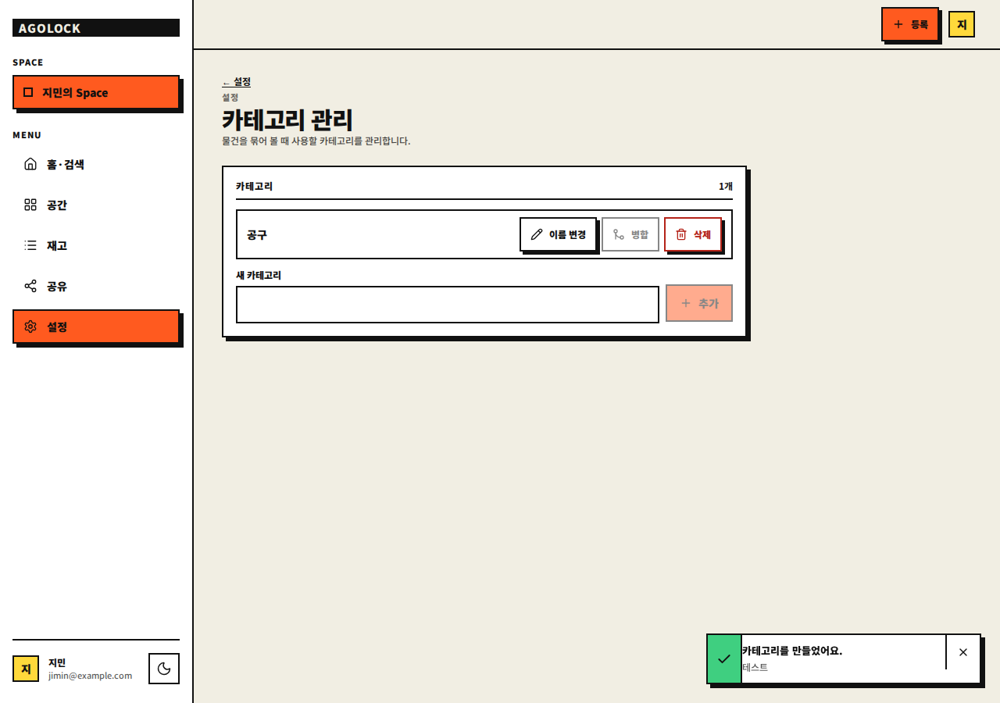 |
| 다크 재고 상세 | 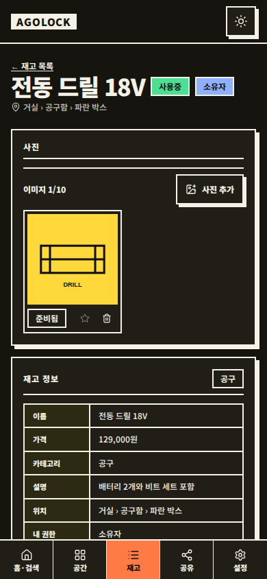 |

## 검토에서 고친 것

- 36px·28px로 섞여 있던 보조 버튼·필터·닫기 버튼을 44px로, 기본 버튼·입력을 48px로, FAB를 56px로 통일했습니다.
- 페이지 루트 간격을 24px, 카드 본문 패딩을 16px로 통일했습니다.
- 데스크톱 편집 폼을 672px로 제한하고, 검색 필터를 하나의 테두리 툴바로 묶었습니다.
- 검색 결과를 데스크톱 masonry 2열로 배치하고, 결과 카드의 장식용 검색 아이콘을 제거했습니다.
- 검색·공유·설정·카테고리 화면에서 FAB를 숨겼습니다.
- 재고 상세의 상태·위치·관리 카드를 이동 이력보다 위로 옮겨 모바일 동작 우선순위를 맞췄습니다.
- 카테고리 행의 액션을 모바일에서 44px 아이콘 버튼으로 표시해 줄바꿈을 없앴습니다.
- 이미지가 1장일 때 갤러리 카드를 4:3 대형 이미지로 키워 빈 공간을 줄였습니다.
- Room·Shelf 상세의 “공유” 버튼을 헤더 우측으로 옮겨 제목·배지와 같은 줄에 맞췄습니다.
- 404 문구에서 “M0” 표현을 제거했습니다.

## 검토에서 남긴 것

- 데스크톱 검색 masonry는 빈 공간을 줄이지만 읽기 순서가 열 기준이 되므로 사용성 테스트가 필요합니다.
- 토스트 퇴장은 120ms `toast-out`으로 처리하고, 닫힌 뒤 DOM에서 제거합니다.

## 검증

- Vitest 36개 통과
- Playwright E2E 24개 통과(axe WCAG 2 A/AA 접근성 12개 포함)
- `tsc --noEmit`, ESLint, Prettier, `vite build` 통과
- 버튼 hover/active, focus ring, 시트·토스트 등장/퇴장, `prefers-reduced-motion` 정지 확인
- 실제 백엔드 연동·스크린리더 수동 검증은 별도 단계입니다.
