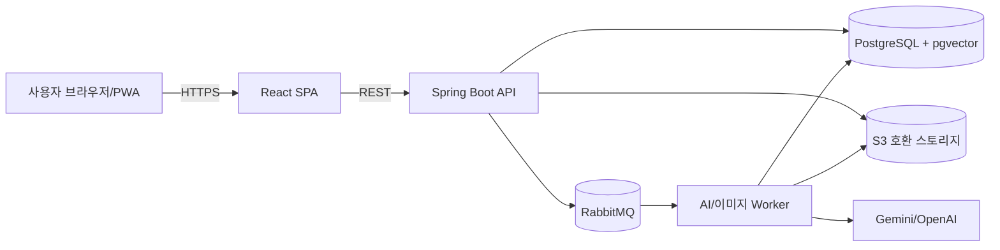
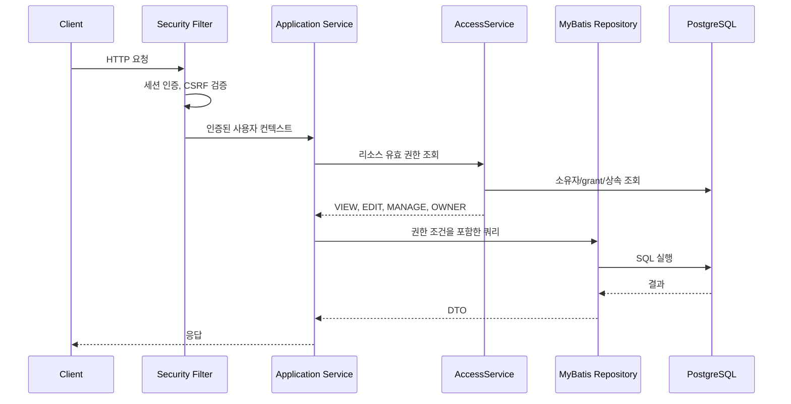

# 아키텍처

> 상태: 확정
> 역할: 시스템 경계, 모듈 구조, 테넌트 격리, 인증 개요, 보안 불변식의 단일 원본
> 관련 문서: [제품 사양](product-spec.md), [도메인](domain.md), [공유](sharing.md), [미디어·AI](media-ai.md), [운영](operations.md)

## 1. 시스템 경계

AGO Lock은 개인 물품 관리 앱입니다. 사용자는 웹 또는 PWA에서 재고를 관리하고, 공유받은 방·선반을 통해 다른 사용자의 재고에 접근합니다.



- 단일 배포 단위의 모듈형 모놀리식입니다.
- API와 Worker는 같은 코드베이스에서 실행 단위만 분리합니다.
- PostgreSQL이 핵심 데이터와 벡터를 함께 저장합니다.
- RabbitMQ는 AI 인식, 임베딩, 이미지 후처리, 알림을 비동기로 처리합니다.
- S3 호환 스토리지는 이미지 원본과 썸네일을 저장합니다.

## 2. 모듈 구조

| 모듈 | 책임 | 주요 의존 |
|---|---|---|
| identity | 사용자, 세션, 초대코드 | 공통 보안 |
| tenancy | Space, 소유권, 테넌트 컨텍스트 | identity |
| hierarchy | Room, Shelf, Box | tenancy |
| inventory | Item, Inventory, Category, 상태, 이동 | hierarchy |
| sharing | Share, Grant, 초대, 권한 계산 | tenancy, hierarchy |
| search | 키워드 검색, 추천, 인덱스 | inventory, sharing |
| media | 이미지 메타데이터, presigned URL, 후처리 | inventory |
| ai | 인식, 임베딩, AI job | media, messaging |
| messaging | Outbox, RabbitMQ, 재시도, DLQ | 공통 인프라 |
| notification | 이메일 알림, 3차 인앱 알림 | identity, sharing |

### 의존 규칙

- 도메인 모듈은 외부 인프라 구현에 직접 의존하지 않습니다.
- 외부 연동은 포트와 어댑터로 분리합니다.
- `sharing`은 다른 모듈의 데이터를 직접 수정하지 않고 권한 판정만 제공합니다.
- `search`는 검색 인덱스와 조회 모델을 소유합니다.
- `ai`는 결과를 제안으로 저장하고, 재고 반영은 사용자 확인 후 `inventory`가 수행합니다.

## 3. 저장소 구조

```text
backend/        Kotlin + Spring Boot
frontend/       React + TypeScript
infra/          Docker Compose, 배포 설정
scripts/        문서 생성·검사, 운영 보조
docs/           제품 사양과 설계 문서
```

- monorepo로 운영합니다.
- 백엔드는 Gradle 멀티 프로젝트를 사용할 수 있습니다.
- 프론트엔드는 pnpm 워크스페이스를 사용합니다.
- 인프라는 Docker Compose로 로컬 환경을 재현합니다.
- 공통 기반은 `backend/src/main/kotlin/com/agolock/common`에 두고 UUIDv7, Clock, `request_id`, problem+json 오류 응답, 설정 검증, 로그 마스킹을 제공합니다.

## 4. 테넌트 격리

Space를 테넌트 경계로 사용합니다.

- 사용자 가입 시 개인 Space를 생성합니다.
- 테넌트 데이터는 모두 `space_id`를 가집니다.
- 같은 Space 안에서만 FK 참조가 가능하도록 복합 FK를 사용합니다.
- 예: `inventory(space_id, item_id) -> item(space_id, id)`
- 예: `shelf(space_id, room_id) -> room(space_id, id)`
- 모든 주요 인덱스는 `space_id`를 선두에 둡니다.
- 애플리케이션은 `AccessService`로 유효 권한을 판정합니다.
- 1차 방어선은 애플리케이션 ACL과 복합 FK입니다.
- PostgreSQL RLS는 2차 방어선으로 추가할 수 있습니다.

공유는 테넌트 경계를 넘는 예외 접근입니다. `share`는 Space 소유 리소스와 초대받은 사용자를 연결하고, 접근 범위는 [공유](sharing.md)가 정의합니다. 1차 공유는 초대 수락 후 Grant가 생성되는 방식만 사용합니다.

## 5. 인증과 세션

- 이메일과 비밀번호로 가입·로그인합니다.
- 스테이징 환경은 초대코드로 가입을 제한하며, 운영에서는 설정으로 켜고 끕니다.
- 비밀번호는 Argon2id로 해시합니다.
- 세션은 서버 세션과 HttpOnly, SameSite=Lax 쿠키를 사용합니다. 운영에서는 Secure를 필수로 합니다.
- 세션 저장소는 Spring Session JDBC를 사용합니다.
- 상태 변경 요청은 CSRF 토큰으로 보호합니다. 토큰은 `GET /auth/csrf` 또는 `XSRF-TOKEN` 쿠키로 발급합니다.
- 로그인 성공 시 세션 ID를 회전하고, 로그아웃·비밀번호 재설정 시 전체 세션을 무효화합니다.
- 로그인과 초대코드 검증에는 레이트리밋을 적용합니다.
- OAuth는 3차 이후 확장 후보입니다.

상세 내용은 [운영](operations.md)과 [ADR-006](decisions/ADR-006-session-auth.md)을 따릅니다.

## 6. 요청 처리 흐름



- 권한 판정은 서비스 계층에서 수행합니다.
- 조회 쿼리에도 접근 가능한 Space와 리소스 조건을 포함합니다.
- 클라이언트가 보낸 `space_id`를 신뢰하지 않습니다.
- 교차 테넌트 접근은 통합 테스트로 검증합니다.

## 7. 비동기 처리

- DB 변경과 `outbox_event` 저장을 같은 트랜잭션으로 처리합니다.
- Outbox 릴레이가 `agolock.events` topic exchange로 이벤트를 발행하며 routing key는 `eventType`입니다.
- publisher confirm으로 발행 결과를 확인합니다.
- 소비자는 멱등하게 동작합니다.
- 실패는 지수 백오프로 재시도하고, 최대 횟수 초과 시 큐별 DLQ로 보냅니다.
- AI job 상태는 `PENDING`, `PROCESSING`, `COMPLETED`, `FAILED`, `CANCELLED`로 관리합니다.
- AI 인식과 임베딩은 비동기 job으로 처리합니다.
- 이미지 검색만 예외적으로 동기 임베딩과 5초 타임아웃을 사용합니다.
- 임베딩 provider 장애 시 모델 간 fallback을 하지 않습니다.
- UI는 폴링으로 상태를 확인하고, 필요하면 SSE로 확장합니다.

상세 내용은 [미디어·AI](media-ai.md)와 [ADR-005](decisions/ADR-005-rabbitmq-outbox.md)를 따릅니다.

## 8. 보안 불변식

- 모든 테넌트 테이블은 `space_id`를 가집니다.
- 다른 Space의 리소스를 참조할 수 없습니다.
- 이미지 버킷은 비공개이며 공개 ACL을 사용하지 않습니다.
- 이미지 접근은 권한 확인 후 짧은 TTL의 presigned URL로 허용합니다.
- Item 이미지는 OWNER, Inventory 이미지는 EDIT 이상만 수정합니다.
- presign 시 `UPLOADING` 이미지 행을 만들고 업로드 완료 후 검증합니다.
- 업로드 이미지는 서버에서 재인코딩하고 EXIF를 제거합니다.
- AI 인식 결과는 제안이며 자동 저장하지 않습니다.
- AI provider에 전달되는 이미지와 텍스트는 개인정보 처리 방침에 명시합니다.
- 세션 쿠키는 HttpOnly, Secure, SameSite=Lax를 사용합니다.
- 로그에 비밀번호, 초대코드 원문, presigned URL, AI 원본 응답을 남기지 않습니다.
- 파일 크기·형식·매직 바이트를 검증합니다.
- 공유 철회 후 새 요청은 즉시 차단합니다. 이미 발급된 presigned URL은 TTL까지만 유효합니다.

## 9. 장애와 일관성

- 일반 CRUD는 동기 트랜잭션으로 처리합니다.
- 외부 AI 장애가 재고 저장을 막지 않도록 AI는 비동기로 분리합니다.
- AI 결과가 없어도 사용자는 수동으로 입력하고 저장할 수 있습니다.
- 생성 요청 멱등성은 `idempotency_record`로 관리합니다.
- Outbox 발행 실패는 재시도하며, DB 커밋과 메시지 발행의 이중 쓰기를 피합니다.
- 소비자는 at-least-once 전달을 전제로 멱등하게 작성합니다.
- 이미지 후처리 실패 시 원본은 격리 상태로 두고 노출하지 않습니다.
- 미완료·DRAFT 이미지는 만료 후 정리합니다.
- 검색 인덱스나 임베딩이 오래되면 재생성 job으로 복구합니다.

## 10. 관측과 운영

- 구조화 로그에 `request_id`, `space_id`, `user_id`, `job_id`를 포함합니다.
- 메트릭은 API 지연, 오류율, 큐 적체, AI 실패율, 임베딩 지연을 수집합니다.
- Sentry로 프론트엔드와 백엔드 예외를 수집합니다.
- 헬스 체크는 API, DB, RabbitMQ, S3, AI provider 설정을 확인합니다.
- 배포와 백업은 [운영](operations.md)을 따릅니다.
