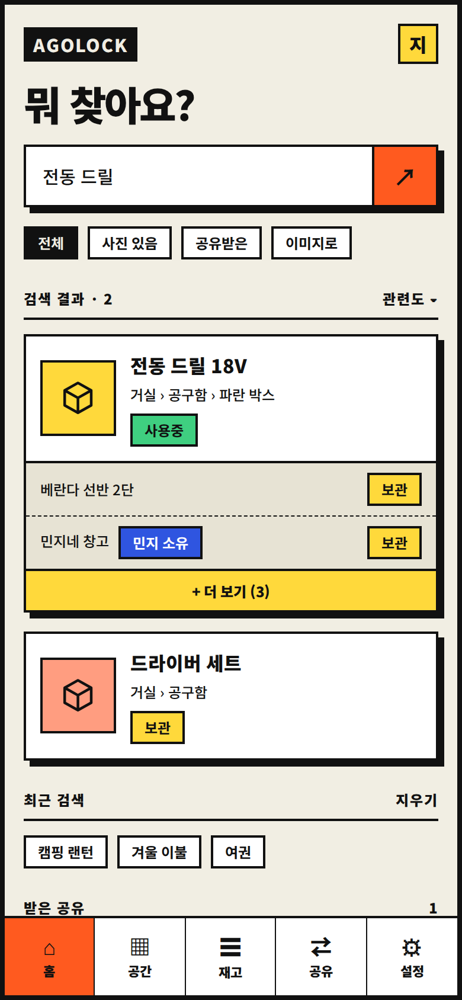
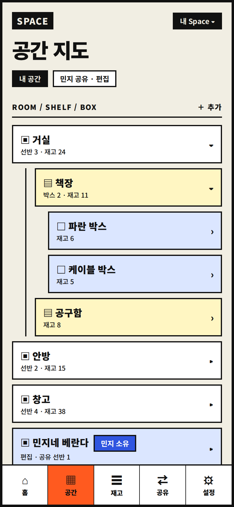
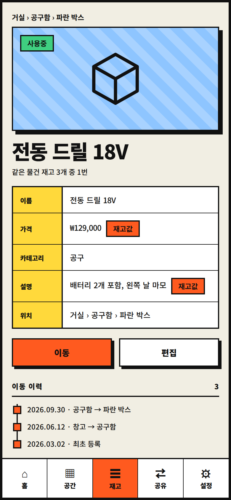
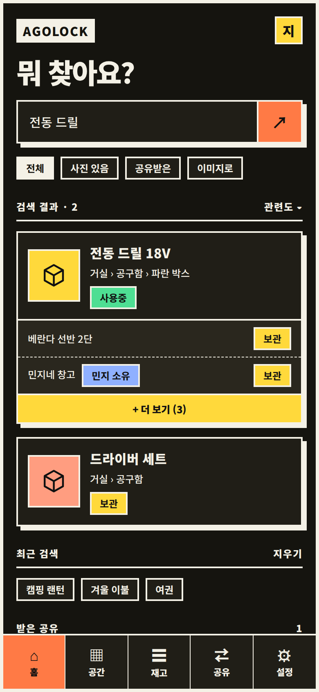
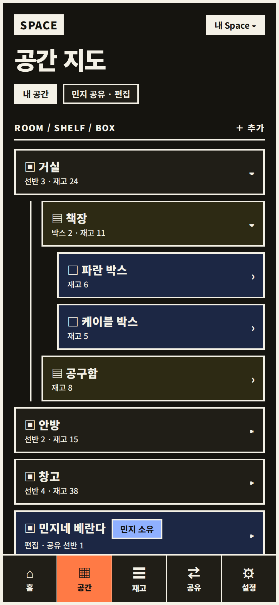
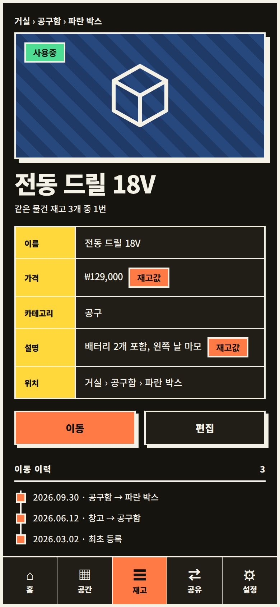
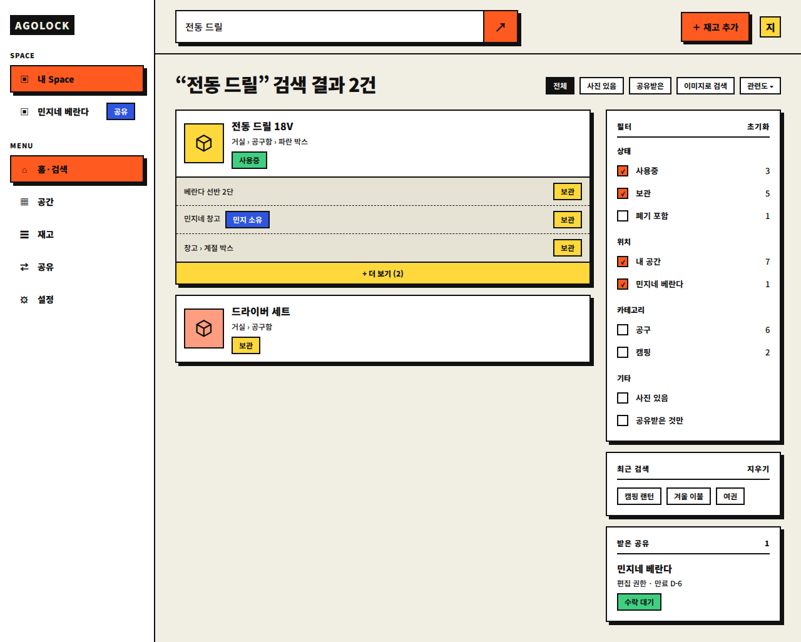
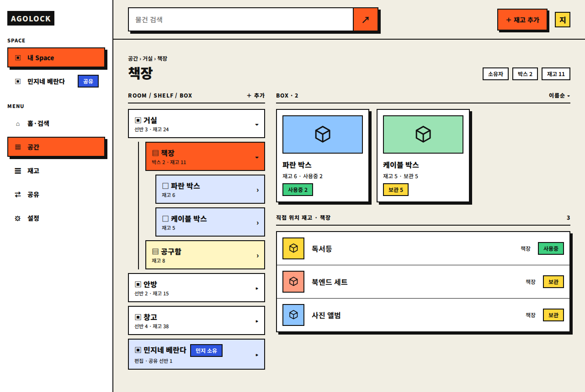
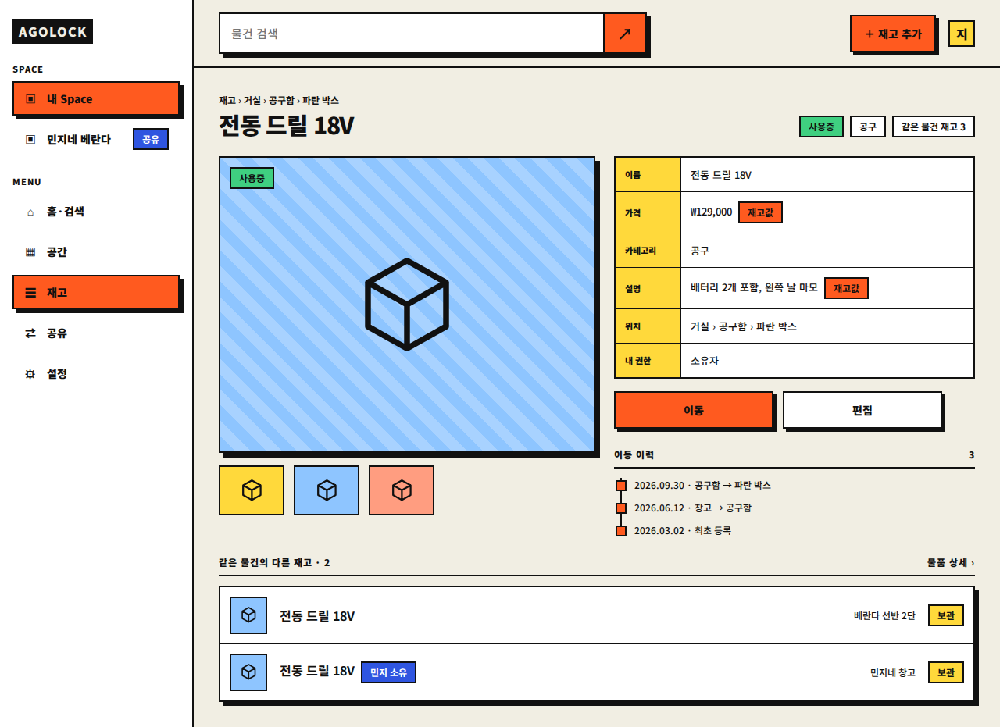

# 디자인 시스템: E안 Neo-Brutal

> 상태: 확정
> 역할: 채택된 시각 디자인의 규칙, 제약, 토큰, 컴포넌트, 화면별 요소의 기록
> 범위: 화면 목록과 흐름은 [화면과 흐름](frontend.md)이 단일 원본이며, 이 문서는 그 화면의 시각 표현만 다룹니다.
> 관련 문서: [화면과 흐름](frontend.md), [도메인](domain.md), [공유](sharing.md), [구현 로드맵](implementation-roadmap.md), [ADR-016](decisions/ADR-016-neo-brutal-design-system.md)

## 1. 채택 결과 요약

| 항목 | 내용 |
|---|---|
| 컨셉 | 네오 브루탈리즘. 두꺼운 테두리, 블러 없는 하드 섀도, 평면색, 굵은 타이틀 |
| 서체 | Noto Sans KR 하나만 사용 (500, 700, 900) |
| 테마 | 라이트와 다크 (역할 토큰의 값만 교체) |
| 형태 | 모바일 390px 프레임, 데스크톱 1280px 프레임 |
| 대상 화면 | SCR-003 홈·검색, SCR-004 공간 트리, SCR-009 재고 상세 (3개 × 모바일 라이트·다크, 데스크톱 라이트) |
| 구현 스택 | React, Tailwind, shadcn/ui ([화면과 흐름 8번 항목](frontend.md)) |
| 원본 스타일시트 | [e/assets/e.css](../design/e/assets/e.css) |
| 시안 원본 | 캔버스 아티팩트의 "E안" 줄 (모바일 6장, 데스크톱 3장) |

채택하지 않은 안은 A(Archive, 모노스페이스 병용), B(Soft Home), C(Blueprint), D(shadcn 기본형)이며 [design/](../design/) 아래 HTML로 남아 있습니다.

## 2. 채택된 디자인 이미지

모바일 라이트입니다.

| 홈·검색 (SCR-003) | 공간 트리 (SCR-004) | 재고 상세 (SCR-009) |
|---|---|---|
|  |  |  |

모바일 다크입니다.

| 홈·검색 (SCR-003) | 공간 트리 (SCR-004) | 재고 상세 (SCR-009) |
|---|---|---|
|  |  |  |

데스크톱 라이트입니다.

미리보기용 정적 HTML은 [e/](../design/e/) 폴더의 `mobile-*.html`, `desktop-*.html`입니다.

## 3. 디자인 규칙

| ID | 규칙 |
|---|---|
| R-01 | 모든 면은 `border-color` 테두리를 가집니다. 카드와 입력은 2.5px, 태그는 2px, 화면 외곽은 4px입니다. |
| R-02 | 그림자는 블러 없는 하드 섀도만 사용합니다. 카드와 검색창 5px, 버튼 4px, 이미지 영역 6px입니다. |
| R-03 | 모서리는 둥글게 하지 않습니다. `border-radius`는 쓰지 않으며 아바타도 사각입니다. |
| R-04 | 서체는 Noto Sans KR 하나이며 모노스페이스를 쓰지 않습니다. 숫자는 `tabular-nums`로 정렬합니다. |
| R-05 | 색은 하드코딩하지 않고 역할 토큰만 참조합니다. 다크 전환은 토큰 값 교체로만 이루어집니다. |
| R-06 | 상태는 색만으로 구분하지 않고 반드시 텍스트 라벨(사용중, 보관, 폐기)을 함께 표시합니다. |
| R-07 | 칩, 상태, 뱃지, 오버라이드 표시는 모두 높이 28px, 12px/700, 좌우 10px, 테두리 2px의 단일 규격입니다. |
| R-08 | 간격은 4px 배수 스케일만 사용하고, 컴포넌트에 `margin`을 박지 않으며 부모 컨테이너의 `gap`으로만 배치합니다. |
| R-09 | 채도 높은 면(노랑, 오렌지, 연두) 위의 글자는 라이트와 다크 모두 검정(`--on-accent`)입니다. |
| R-10 | 이미지가 없을 때는 대각선 줄무늬 영역 또는 색 면 위 상자 아이콘을 플레이스홀더로 씁니다. |
| R-11 | 아이콘은 선 아이콘(stroke 1.2~1.6, 둥근 끝)만 쓰고, 이모지는 쓰지 않습니다. |
| R-12 | 권한이 없는 동작 버튼은 숨기거나 비활성화합니다. 공유받은 리소스에는 소유자 뱃지를 붙입니다 ([화면과 흐름 6번 항목](frontend.md)). |
| R-13 | 폐기(`DISPOSED`) 상태는 취소선으로 표시하고, 기본 목록과 기본 검색에서는 제외합니다 ([도메인 5번 항목](domain.md)). |

## 4. 제약

| ID | 제약 | 이유 |
|---|---|---|
| C-01 | 최소 터치 영역은 44px입니다. 칩은 보이는 크기 28px에 투명 확장 영역(`::after`)으로 맞춥니다. | 모바일 조작성, [화면과 흐름 7번 항목](frontend.md) |
| C-02 | 계층 노드, 태그, 카드는 하드 섀도가 레이아웃을 차지하지 않으므로 형제 사이 간격을 R-08 스케일로 확보합니다. | 그림자 겹침 방지 |
| C-03 | 다크에서 섀도 색은 크림색으로 뒤집습니다. 검은 섀도는 사용하지 않습니다. | 어두운 배경에서 섀도 소실 |
| C-04 | 상태 색은 3종(사용중 연두, 보관 노랑, 폐기 회색 + 취소선)으로 고정하고 새 상태 색을 추가하지 않습니다. | 상태는 3종, [도메인 5번 항목](domain.md) |
| C-05 | 폐기 전환과 공유 철회는 확인 대화상자를 거칩니다. 시안에는 대화상자 화면이 없으며 구현 시 `AlertDialog`로 만듭니다. | [화면과 흐름 5번 항목](frontend.md) |
| C-06 | 긴 위치 경로는 줄여서 보여주고 툴팁으로 전체 경로를 제공합니다. 시안은 짧은 데이터만 사용합니다. | [화면과 흐름 7번 항목](frontend.md) |
| C-07 | 시안의 이름, 가격, 위치 값은 모두 임의 데이터이며 제품 데이터가 아닙니다. | 시안 한계 |
| C-08 | 주요 토큰 조합의 WCAG AA 명암비를 측정했습니다. 본문 16.26:1, primary 6.06:1, success 9.39:1, info 6.01:1, danger 5.66:1, 다크 본문 16.31:1, 다크 primary 7.30:1, 다크 danger 10.84:1로 모두 4.5:1 이상입니다. | 검증 완료 |
| C-09 | 서체는 `@fontsource/noto-sans-kr`로 셀프 호스팅합니다. 한국어·라틴 서브셋과 500/700/900 가중치만 포함합니다. | 오프라인과 개인정보 |

## 5. 디자인 토큰

### 5.1 색 토큰

| 토큰 | 라이트 | 다크 | 용도 |
|---|---|---|---|
| `--background` | `#f1eee3` | `#15140f` | 화면 배경 |
| `--foreground` | `#111111` | `#f4f1e6` | 본문 글자 |
| `--card` | `#ffffff` | `#201e17` | 카드, 입력, 탭바 |
| `--sunken` | `#e7e3d4` | `#2a271e` | 카드 안 하위 목록, 폐기 배경 |
| `--border-color` | `#111111` | `#f4f1e6` | 모든 테두리 |
| `--shadow-color` | `#111111` | `#f4f1e6` | 하드 섀도 |
| `--primary` | `#ff5a1f` | `#ff7a45` | 주요 버튼, 활성 탭, 선택 상태, 오버라이드 |
| `--accent` | `#ffd93b` | `#ffd93b` | 보관 상태, 더 보기, 표 머리, 아바타 |
| `--success` | `#3fcf80` | `#4ede93` | 사용중 상태 |
| `--info` | `#2f55e0` | `#8fb0ff` | 공유·소유자 뱃지 |
| `--danger` | `#b42318` | `#ffb4a8` | 폼 오류, 경고, 세션 만료 |
| `--on-info` | `#ffffff` | `#111111` | 정보색 위 글자 |
| `--on-accent` | `#111111` | `#111111` | primary, accent, success 위 글자 |
| `--blue-soft` | `#dbe6ff` | `#1c2744` | Box 노드, 공유 노드 배경 |
| `--yellow-soft` | `#fff6c2` | `#2d2a14` | Shelf 노드 배경 |
| `--stripe-a`, `--stripe-b` | `#8ec5ff`, `#a8d2ff` | `#1f3a66`, `#27487c` | 이미지 플레이스홀더 줄무늬 |

이미지 썸네일 배경은 토큰이 아니라 고정색 4종입니다 (`c1` 노랑, `c2` 하늘, `c3` 살구, `c4` 연두).

### 5.2 간격 토큰

| 토큰 | 값 | 사용처 |
|---|---|---|
| `--sp-1` | 4px | 카드 안 제목과 위치 사이 |
| `--sp-2` | 8px | 위치와 태그 사이, 태그·칩 사이, 트리 노드 사이, 섹션 제목 아래 선 위 여백 |
| `--sp-3` | 12px | 카드 패딩, 썸네일과 텍스트 사이, 표 셀 패딩, 섹션 제목과 본문 사이 |
| `--sp-4` | 16px | 형제 컴포넌트 사이, 모바일 화면 좌우 여백, 컬럼 안 카드 사이 |
| `--sp-6` | 24px | 섹션 사이, 데스크톱 컬럼 사이, 사이드바 안쪽 |
| `--sp-8` | 32px | 데스크톱 본문 여백, 상단 바 좌우 여백 |

배치 규칙은 다음과 같습니다.

| 구분 | 규칙 |
|---|---|
| 컨테이너 | `.scroll`(모바일 본문), `.stack`, `.content`, `.cols > .l/.r`, `.panel`, `.tree`가 자식 간격을 `gap`으로 정함 |
| 섹션 제목 | 앞 블록과 24px(= gap 16 + 위 여백 8), 본문과 12px(= gap 16 − 4) |
| 카드 텍스트 | 제목, 위치, 태그를 4px 간격 컬럼으로 두고 태그만 위로 4px 추가 (총 8px) |
| 트리 | 노드 사이 항상 8px |

### 5.3 타이포그래피

| 역할 | 크기 | 굵기 | 비고 |
|---|---|---|---|
| 화면 타이틀 `h1` | 34px (데스크톱 30px) | 900 | 행간 1.05, 자간 -0.04em |
| 카드 제목 `h3` | 16px | 900 | |
| 본문, 위치 | 12~13px | 500 | |
| 섹션 제목 | 12px | 900 | 자간 0.08em |
| 태그류 | 12px | 700 | 행간 1 |
| 탭 라벨 | 11px | 900 | |
| 표 머리 | 11px | 900 | |

### 5.4 형태 토큰

| 토큰 | 값 |
|---|---|
| `--bw` | 2.5px |
| `--sh` | `5px 5px 0 var(--shadow-color)` |
| `--tag-h` | 28px |
| 화면 외곽 | 4px 테두리 |

## 6. 컴포넌트 카탈로그

shadcn/ui 대응은 구현 시 시작점이며, 모든 컴포넌트에 R-01~R-08을 추가로 적용합니다.

| 컴포넌트 | 클래스 | 규격 | 변형과 상태 | shadcn 대응 |
|---|---|---|---|---|
| 검색창 | `.search` | 테두리 2.5px, 하드 섀도 5px, 입력 패딩 14px, 오른쪽에 primary 버튼부 | 입력 중, 빈 상태(플레이스홀더) | `Input` + 버튼 |
| 칩 | `.chip` | 28px, 12px/700, 터치 영역 44px | 기본(흰 배경), `.on`(반전 배경) | `Badge`(outline) 또는 `ToggleGroup` |
| 상태 태그 | `.st` | 28px 단일 규격 | `use` 연두 / `sto` 노랑 / `dis` 회색 + 취소선 | `Badge` |
| 뱃지 | `.badge` | 28px, 파란색, 앞 간격 8px | 소유자(`민지 소유`), 공유 | `Badge` |
| 오버라이드 표시 | `.ov` | 28px, primary 배경 | `재고값` | `Badge` |
| 카드 | `.card` | 2.5px 테두리, 하드 섀도, 패딩 12px | 기본, 하위 목록 펼침(`.sub`) | `Card` |
| 썸네일 | `.ph` | 64px 정사각(데스크톱 목록 48px, 그리드 전폭 × 84px) | 색 4종, 상자 아이콘 | 직접 구성 |
| 하위 재고 목록 | `.sub` | 행 패딩 8×12, 점선 구분 | 마지막 행에 구분선 없음 | `Collapsible` |
| 더 보기 | `.more` | 노랑 배경, 12px/900 | 클릭 시 전체 조회 | `Button`(variant 추가) |
| 버튼 | `.btn` | 패딩 12px, 14px/900, 하드 섀도 4px | primary, `.w`(흰 배경 보조) | `Button` |
| 하단 탭 | `.tabs` | 5칸 격자, 활성 칸 primary | 홈, 공간, 재고, 공유, 설정 | 직접 구성 |
| 사이드바 | `.side`, `.nav` | 폭 248px, 항목 높이 44px | 활성 항목은 primary + 섀도, 공유 공간은 뱃지 | `Sidebar` |
| 상단 바 | `.bar` | 검색 + 재고 추가 버튼 + 아바타 | 폭이 좁으면 줄바꿈 | 직접 구성 |
| 아바타 | `.av` | 34px 사각, 노랑 | 사용자 첫 글자 | `Avatar`(사각) |
| 계층 노드 | `.node`, `.l2`, `.l3` | 패딩 10×12, 들여쓰기 14px 또는 36px | Room 흰색 / Shelf 노랑 계열 / Box 파랑 계열 / 공유 노드 파랑 | `Accordion` |
| 데스크톱 트리 | `.tree` | 노드 사이 8px | 선택된 노드는 primary 배경 | `Accordion` |
| 이미지 영역 | `.hero` | 높이 230px(데스크톱 380px), 줄무늬, 섀도 6px | 왼쪽 위에 상태 태그 | `AspectRatio` + 이미지 |
| 썸네일 줄 | `.thumbs` | 84×64px | 선택된 이미지 표시는 구현 시 추가 | 직접 구성 |
| 정보 표 | `table` | 머리 셀 84px, 노랑 배경 | 오버라이드 값은 `.ov` 동반 | `Table` |
| 이동 이력 | `.tl` | 왼쪽 선 + 사각 점, 항목 간격 12px | 최초 등록 포함 | 직접 구성 |
| 섹션 제목 | `.sec` | 12px/900, 아래 선 | 우측에 개수 또는 링크 | 직접 구성 |
| 필터 패널 | `.panel`, `.fg`, `.chk` | 패딩 16px, 체크 행 32px | 체크됨은 primary 칸에 체크 표시, 오른쪽 개수 | `Checkbox` |
| 박스 그리드 | `.grid` | 최소 200px 자동 채움, 간격 16px | 카드가 세로로 쌓임 | 직접 구성 |
| 목록 행 | `.list .li` | 48px 썸네일, 이름, 위치, 상태 | | `Table` 또는 목록 |
| 액션 그룹 | `.actions` | 2열, 간격 12px, 데스크톱 최대 420px | 이동 + 편집 | `Button` 그룹 |

## 7. 화면별 요소

### 7.1 SCR-003 홈·검색

모바일은 위에서 아래로 다음 순서입니다.

| 순서 | 요소 | 내용 |
|---|---|---|
| 1 | 상단 줄 | 로고, 아바타 |
| 2 | 타이틀 | "뭐 찾아요?" |
| 3 | 검색창 | 입력값, 검색 버튼 |
| 4 | 칩 줄 | 전체, 사진 있음, 공유받은, 이미지로 |
| 5 | 검색 결과 | 섹션 제목(개수, 정렬), 마스터 카드 (사용중 태그, 위치), 재고별 하위 행(위치, 소유자 뱃지, 상태), 더 보기 |
| 6 | 최근 검색 | 칩 목록, 지우기 |
| 7 | 받은 공유 | 초대 카드 (권한, 만료일, 수락 대기 태그) |
| 8 | 하단 탭 | 홈 활성 |

데스크톱은 사이드바(내 Space, 공유받은 공간, 메뉴), 상단 바(검색, 재고 추가, 아바타), 결과 영역과 오른쪽 필터 패널로 구성됩니다. 필터는 상태, 위치, 카테고리, 기타(사진 있음, 공유받은 것만)이며 정렬은 칩 줄 끝의 "관련도" 칩입니다. 오른쪽에 최근 검색과 받은 공유 패널이 이어집니다.

### 7.2 SCR-004 공간 트리

| 요소 | 내용 |
|---|---|
| 상단 | "SPACE" 로고, Space 전환 칩 |
| 타이틀과 칩 | "공간 지도", 내 공간 / 민지 공유 · 편집 |
| 트리 | Room(거실, 안방, 창고, 공유받은 민지네 베란다) > Shelf(책장, 공구함) > Box(파란 박스, 케이블 박스), 각 노드에 개수 |
| 직접 위치 재고 | 선택한 위치에 직접 놓인 재고 카드 |
| 데스크톱 | 왼쪽 트리, 오른쪽에 선택한 선반의 브레드크럼, 권한·개수 칩, Box 그리드, 직접 위치 재고 목록 |

### 7.3 SCR-009 재고 상세

| 요소 | 내용 |
|---|---|
| 브레드크럼 | 거실 › 공구함 › 파란 박스 |
| 이미지 영역 | 상태 태그가 얹힌 큰 이미지, 데스크톱은 썸네일 줄 추가 |
| 제목 | 물건 이름, 같은 물건 재고 개수 |
| 정보 표 | 이름, 가격, 카테고리, 설명, 위치 (데스크톱은 내 권한 추가), 재고 값으로 덮은 필드에 `재고값` 표시 |
| 액션 | 이동, 편집 |
| 이동 이력 | 날짜와 이전 → 이후 위치, 최초 등록 |
| 데스크톱 추가 | 같은 물건의 다른 재고 목록 (위치, 상태, 소유자 뱃지) |

### 7.4 SCR-011 등록 시트

등록은 목적지 화면이 아니라 모든 화면 위에 열리는 시트입니다.

| 요소 | 내용 |
|---|---|
| 트리거 | 데스크톱 상단 primary "등록" 버튼, 모바일 하단 탭 위 FAB, 위치 상세의 "이 위치에 등록", 물건 상세의 "재고 추가" |
| 컨테이너 | 데스크톱 중앙 560px, 모바일은 화면 폭을 거의 채우는 시트. 최대 높이 90dvh, 본문 스크롤, 하단 액션 고정 |
| 헤더 | "물건 등록", 닫기. 컨텍스트가 있으면 "거실 › 공구함에 등록" 같은 위치 경로 표시 |
| 모드 | "새 물건" / "이미 있는 물건" 2개 탭. 소유자가 아니면 "이미 있는 물건"만 표시 |
| 1순위 입력 | 사진 자리(M5), 이름, 위치. 이름과 위치는 필수 |
| 위치 | Room → Shelf(선택) → Box(선택) 3단 선택. 현재 위치가 있으면 미리 선택하고, 선택한 위치의 권한을 표시 |
| 2순위 입력 | 카테고리 선택(검색형 콤보박스, 소유자는 인라인 생성), 상태(보관 기본, 사용 중), 가격·설명은 "상세 입력" 접기 |
| 재고별 예외 | "이 재고만 다르게" 접기. 이름·설명·카테고리·가격 오버라이드 |
| 하단 | primary "등록", secondary "취소". 저장 중 비활성화 |
| 완료 | 위치 경로, "계속 등록", "물건 보기" |
| 금지 | Item/Inventory, ROOM/SHELF/BOX, VIEW/EDIT/MANAGE 원문 노출 |

- 재고 상세·물건 상세·Room/Shelf/Box 상세처럼 문맥형 등록 버튼이 있는 화면에서는 전역 FAB를 숨깁니다.
- 모바일 시트는 하단에서 올라오고, 본문만 스크롤하며 하단 액션은 고정합니다.

### 7.5 SCR-008 재고 목록

| 요소 | 내용 |
|---|---|
| 헤더 | "재고", 전체 개수, "등록" 버튼 |
| 필터 | 전체, 사용 중, 보관, 폐기 칩. 기본은 폐기 제외 |
| 행 | 48px 썸네일 자리, 이름, 위치 경로, 상태 태그, 오버라이드 배지. 행 전체가 상세 링크 |
| 빈 상태 | "아직 등록한 물건이 없어요" + "첫 물건 등록" 버튼 |
| 더 보기 | `nextCursor`가 있으면 목록 아래 secondary 버튼 |

### 7.6 위치 상세 재고 섹션

| 요소 | 내용 |
|---|---|
| 제목 | "직접 위치 재고"와 개수 |
| 목록 | 해당 Room/Shelf/Box에 직접 놓인 재고 카드. 하위 위치의 재고는 포함하지 않음 |
| 액션 | `MANAGE` 이상이면 "이 위치에 등록" primary 버튼 |
| 빈 상태 | "이 위치에 아직 물건이 없어요" + 등록 버튼 |
| 권한 | 소유자·공유 배지, 권한은 한국어 라벨로 표시 |

## 8. 반응형과 다크 모드

| 항목 | 규칙 |
|---|---|
| 기준 폭 | 모바일 390px, 데스크톱 1280px |
| 모바일 | 하단 탭, 본문 좌우 16px, 세로 한 줄 흐름 |
| 데스크톱 | 사이드바 248px + 상단 검색, 본문 여백 32px, 컬럼 `.l`(유연)과 `.r`(최소 260px) |
| 좁아질 때 | 데스크톱 컬럼과 사이드바는 줄바꿈으로 아래로 쌓입니다 (`flex-wrap`) |
| 다크 | `<html class="dark">`에서 5.1번 항목의 다크 열 값으로 덮음 |
| 전환 방식 | 시스템 설정을 기본값으로 하고, 상단 테마 토글로 수동 전환합니다. 설정 화면(SCR-017)의 모드 선택은 M1에서 연결합니다. |

## 9. 구현 매핑

| 시안 | 구현 |
|---|---|
| `.phone.dark`, `.desk.dark` | `<html class="dark">`, Tailwind 4 `@custom-variant dark` |
| 색 토큰 | `frontend/src/styles/globals.css`의 `:root`, `.dark` 변수 + Tailwind 4 `@theme inline` |
| 간격 토큰 | Tailwind 기본 스케일 `gap-1`, `gap-2`, `gap-3`, `gap-4`, `gap-6`, `gap-8`이 4px 단위로 1:1 대응 |
| 하드 섀도 | `@theme`의 `--shadow-brutal`, `--shadow-brutal-sm`, `--shadow-brutal-lg` |
| 테두리 두께 | `border-[2.5px]` 임의값과 공통 `surface` 클래스 |
| 서체 | `@fontsource/noto-sans-kr` 500/700/900, 한국어·라틴 서브셋 |
| 반경 | `--radius: 0` |
| 태그 | 단일 `Badge` 컴포넌트의 `variant`(use, sto, dis, info, override, chipOn)로 크기를 고정 |
| 컨테이너 | `flex flex-col gap-4`를 기본 래퍼로 사용 |
| 미리보기 | `/design-preview` 라우트에서 3개 시안을 목데이터로 재현 |

## 10. 알려진 한계

| 항목 | 내용 |
|---|---|
| 화면 수 | 3개 화면만 시안이 있으며 로그인, 재고 목록, 재고 편집, AI 결과 확인, 공유 관리, 설정, 오류 화면은 없습니다. |
| 상태 화면 | 로딩, 빈 목록, 오류, 업로드 중, 충돌 등 [UI 상태](frontend.md)의 시안이 없습니다. |
| 데스크톱 다크 | 토큰은 정의돼 있으나 데스크톱 다크 시안은 만들지 않았습니다. |
| 아이콘 | 정적 시안은 유니코드 기호를 쓰지만 React 구현은 `lucide-react` 선 아이콘으로 교체했습니다. |
| 모바일 하단 | 정적 HTML 시안은 고정 높이 프레임이라 긴 내용이 잘립니다. React 미리보기와 실제 앱은 스크롤됩니다. |
| 이미지 | 사진은 상자 아이콘 플레이스홀더입니다. |
| 검증 | 주요 토큰의 WCAG AA 명암비는 측정했습니다. 실제 브라우저·스크린리더 호환성은 M8 접근성 점검에서 확인합니다. |
| 문서 연동 | `docs/index.yaml`에 `DESIGN`으로 등록했습니다. 시안 HTML과 스크린샷은 `design/`에 원본으로 둡니다. |

## 11. 파일 목록

| 경로 | 설명 |
|---|---|
| [docs/design-system.md](design-system.md) | 이 문서 |
| [design/e/assets/e.css](../design/e/assets/e.css) | 토큰과 컴포넌트 스타일 (모바일, 데스크톱 공용) |
| [design/e/screens/](../design/e/screens/) | 스크린샷 9장 (PNG) |
| [design/e/](../design/e/) | 정적 미리보기 HTML 9개 |
| [design/index.html](../design/index.html) | 초기 A, B, C안 비교 갤러리 (E안은 [design/e/](../design/e/)와 이 문서) |

## 12. M0-M1 구현 상태

| 항목 | 결과 |
|---|---|
| 토큰 | `frontend/src/styles/globals.css`에 라이트·다크 변수와 Tailwind 4 `@theme`로 구현 |
| 컴포넌트 | `Badge`, `Button`, `Card`, `SearchField`, `StatusTag`, `Thumbnail`, `NavList`, `BottomTabs`, `ThemeToggle` 구현 |
| 서체 | Noto Sans KR 500/700/900을 Fontsource로 셀프 호스팅 |
| 테마 | 시스템 설정을 기본값으로 하고 `localStorage`에 수동 선택을 저장 |
| 미리보기 | `/design-preview`에서 SCR-003, SCR-004, SCR-009를 모바일·데스크톱, 라이트·다크로 확인 |
| M1 화면 | SCR-001 로그인·재설정, SCR-002 회원가입, SCR-017 설정을 실제 세션 API와 연결 |
| M1 컴포넌트 | `TextField`, `PasswordField`, `Alert`, `AuthLayout`, `LoadingScreen` 추가 |
| M2 화면 | `/space` 트리와 SCR-005~007 상세. Room 흰색, Shelf 노랑, Box 파랑 계열, 권한 배지 |
| M2 컴포넌트 | Radix Dialog 기반 생성·수정·이동·삭제 대화상자, 트리 행, 빈 상태 |
| 검증 | Vitest 라우팅·테스트, Playwright 스모크, 프로덕션 빌드 통과 |
| 남은 디자인 | 재고 목록·편집, AI 결과 확인, 공유 관리·초대, 오류 상세 화면은 M3 이후 확장 |

- 미리보기는 실제 API를 호출하지 않으며 제품 데이터가 아닙니다.
- 모바일 하단 탭에는 safe-area 여백을 적용했습니다.
- 디자인 토큰의 주요 조합은 WCAG AA를 충족합니다.
