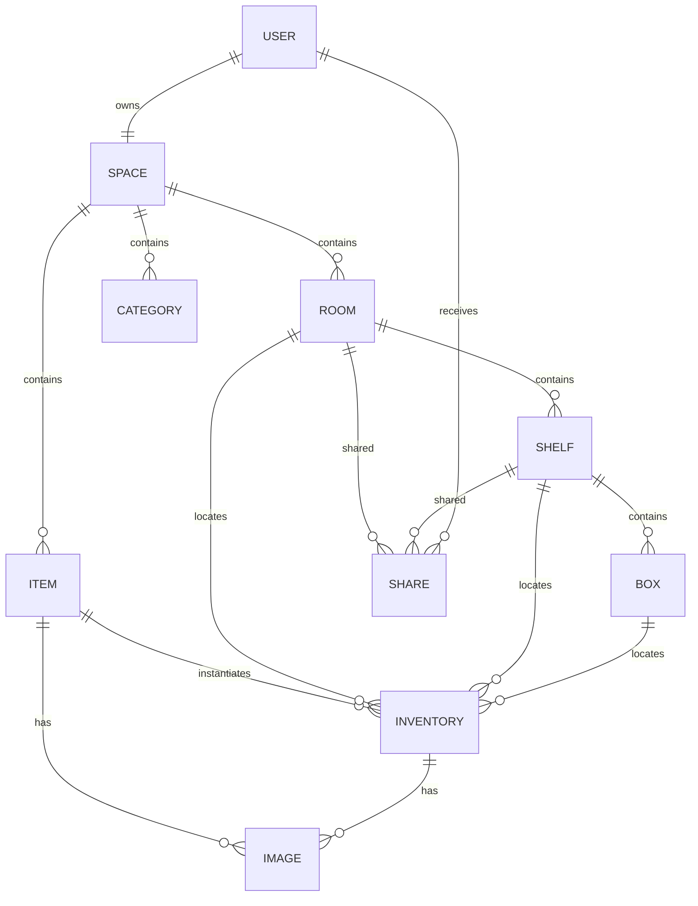
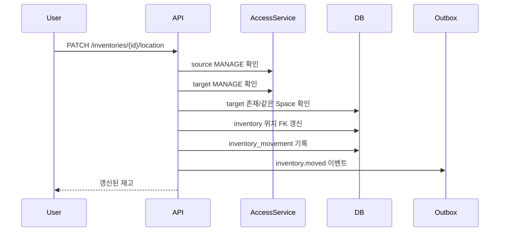

# 도메인

> 상태: 확정
> 역할: 계층·위치·이동, 마스터·재고·오버라이드, 상태, 카테고리, 생명주기의 단일 원본
> 관련 문서: [제품 사양](product-spec.md), [아키텍처](architecture.md), [공유](sharing.md), [검색](search.md), [데이터 사전](generated/data-dictionary.md), [ADR-010](decisions/ADR-010-item-creation-permissions.md), [ADR-011](decisions/ADR-011-image-upload-lifecycle.md)

## 1. 도메인 개요



- Space는 테넌트 경계입니다.
- Room, Shelf, Box는 위치 계층입니다.
- Item은 마스터, Inventory는 개별 재고입니다.
- Image는 Item 또는 Inventory에 속합니다.
- Share는 Room 또는 Shelf에 부여됩니다.

## 2. 애그리거트와 불변식

| 애그리거트 | 루트 | 불변식 |
|---|---|---|
| Space | Space | Space의 모든 데이터는 같은 `space_id`를 가짐 |
| Hierarchy | Room | Shelf는 Room에, Box는 Shelf에 속함 |
| Inventory | Inventory | 위치는 Room, Shelf, Box 중 정확히 하나 |
| Item | Item | Inventory가 참조하는 Item은 같은 Space에 속함 |
| Category | Category | 같은 Space 안에서 정규화된 이름이 유일 |
| Share | Share | Room 또는 Shelf 중 정확히 하나에 부여 |

- Inventory는 Item과 위치를 반드시 가집니다.
- Item은 Inventory 없이 존재할 수 있습니다.
- Inventory는 Item 없이 존재할 수 없습니다.
- Category는 Item과 Inventory에서 참조할 수 있습니다.
- Image는 Item, Inventory, 또는 임시 DRAFT 중 하나에 속합니다.
- 1차에서 새 Item 마스터는 소유자만 생성합니다.
- 공유 사용자는 접근 가능한 기존 Item에 Inventory만 추가할 수 있습니다.

## 3. 계층과 위치

### 3.1 고정 깊이

```text
Space
└── Room
    └── Shelf
        └── Box
```

- 계층 깊이는 3단계로 고정합니다.
- Room은 Space에 직접 속합니다.
- Shelf는 반드시 Room에 속합니다.
- Box는 반드시 Shelf에 속합니다.
- Inventory는 Room, Shelf, Box 중 어디에든 직접 위치할 수 있습니다.

### 3.2 Inventory 위치

Inventory는 다음 중 정확히 하나를 가집니다.

- `room_id`
- `shelf_id`
- `box_id`

```sql
CHECK (num_nonnulls(room_id, shelf_id, box_id) = 1)
```

- 위치 FK는 같은 Space의 리소스만 참조합니다.
- 복합 FK 예: `(shelf_id, space_id) -> shelf(id, space_id)`
- 방 전체 재고 조회는 직접 위치한 재고와 하위 Shelf, Box의 재고를 합쳐 계산합니다.
- 위치 이름 검색은 계층 조인으로 처리합니다.
- 위치가 바뀌어도 Item, 상태, 임베딩은 바뀌지 않습니다.
- `roomId` 필터는 하위 Shelf와 Box를 포함합니다.
- `shelfId` 필터는 하위 Box를 포함합니다.
- `boxId` 필터는 해당 Box만 대상으로 합니다.

### 3.3 위치 삭제

- 하위 Shelf나 Box가 있으면 Room을 삭제할 수 없습니다.
- 하위 Box가 있으면 Shelf를 삭제할 수 없습니다.
- Inventory가 있으면 Room, Shelf, Box를 삭제할 수 없습니다.
- 삭제 차단은 삭제되지 않은 하위 리소스와 Inventory를 기준으로 합니다.
- 삭제 전에 이동 또는 재고 정리가 필요합니다.
- 삭제는 soft delete로 처리하고 기본 목록에서 제외합니다.
- 하위 리소스나 Inventory를 cascade로 삭제하지 않습니다.
- `DISPOSED` 상태는 삭제가 아니며 이력으로 유지합니다.

## 4. Item과 Inventory

### 4.1 마스터와 오버라이드

| 필드 | Item | Inventory 오버라이드 | Effective field |
|---|---|---|---|
| 이름 | `name` | `name_override` | `COALESCE(inventory.name_override, item.name)` |
| 설명 | `description` | `description_override` | `COALESCE(inventory.description_override, item.description)` |
| 카테고리 | `category_id` | `category_id_override` | `COALESCE(inventory.category_id_override, item.category_id)` |
| 가격 | `price_amount`, `currency` | `price_amount_override` | `COALESCE(inventory.price_amount_override, item.price_amount)` |
| 사진 | Item Image | Inventory Image | Inventory 대표 사진이 있으면 재고 사진 |

- 오버라이드 값이 `NULL`이면 마스터 값을 사용합니다.
- 명시적으로 상속으로 되돌리려면 오버라이드 값을 `NULL`로 설정합니다.
- 빈 문자열과 `NULL`을 구분합니다.
- 가격 `0`은 명시적 값이며 상속이 아닙니다.
- 마스터 수정은 오버라이드가 없는 재고에 즉시 반영됩니다.
- 마스터 공통 필드와 Item 대표 사진 수정은 소유자만 가능합니다.
- 마스터 수정 전에 영향받는 Inventory 수를 사용자에게 보여줍니다.
- 가격 통화는 KRW로 고정하며 Inventory 통화 오버라이드는 사용하지 않습니다.

### 4.2 생성 흐름

- 기본 흐름은 Item과 첫 Inventory를 한 화면에서 생성합니다.
- 신규 Item 생성은 소유자만 수행합니다.
- 공유 사용자는 접근 가능한 기존 Item을 선택해 새 Inventory를 추가할 수 있습니다.
- 재고 추가 권한은 `MANAGE`입니다.
- 공유받은 Room/Shelf에서 추가한 Inventory의 Item과 Category는 Space 소유자에게 귀속됩니다.
- 같은 Item에 여러 Inventory를 만들 수 있습니다.
- Inventory 이름은 유니크하지 않습니다.
- 신규 Item과 첫 Inventory는 하나의 트랜잭션으로 생성합니다.
- 공유 사용자는 새 Category를 만들 수 없고 기존 Category만 선택합니다.

### 4.3 가격

- 통화는 KRW로 고정합니다.
- 금액은 정수로 저장합니다.
- `currency` 코드는 ISO 4217 형식을 사용합니다.
- MVP는 단일 통화만 허용하며 통화 오버라이드를 지원하지 않습니다.

## 5. 상태와 생명주기

| 상태 | 한글 라벨 | 의미 |
|---|---|---|
| `IN_USE` | 사용중 | 현재 사용 중 |
| `STORED` | 보관 | 보관 중 |
| `DISPOSED` | 폐기 | 폐기됨 |

- 상태는 Inventory에만 존재합니다.
- 기본값은 `STORED`입니다.
- 모든 상태 간 전이를 허용합니다.
- `DISPOSED`로 변경할 때 확인을 받습니다.
- `DISPOSED` 전환 요청은 `confirmDisposal=true`를 요구합니다.
- `DISPOSED`에서 다른 상태로 복구할 수 있습니다.
- `DISPOSED`는 기본 목록과 기본 검색에서 제외합니다.
- 상태 변경은 `EDIT` 권한에 포함됩니다.
- 상태 변경 이력을 남기는 것은 3차 범위입니다.

## 6. 카테고리

- Space 소유의 평면 카테고리입니다.
- 같은 Space 안에서 정규화된 이름이 유일합니다.
- 정규화는 Unicode NFKC, 앞뒤 공백 제거, 연속 공백 축소, 대소문자 통일을 사용합니다.
- Item은 기본 카테고리를 가집니다.
- Inventory는 카테고리를 오버라이드할 수 있습니다.
- Group By와 필터는 effective category를 사용합니다.
- 카테고리 없는 항목은 `미분류`로 집계합니다.
- 카테고리 생성·수정·삭제·병합은 소유자만 가능합니다.
- 공유 사용자는 접근 가능한 항목이 참조하는 기존 Category만 조회하고 선택할 수 있습니다.
- 사용 중인 카테고리는 삭제를 차단하고 병합을 제공합니다.
- 병합은 한 트랜잭션에서 Item의 `category_id`와 Inventory의 `category_id_override`를 대상 Category로 갱신하고 원본을 soft delete합니다.
- 자기 자신이나 존재하지 않는 Category로 병합할 수 없습니다.
- AI는 카테고리를 제안할 수 있지만 자동 생성하지 않습니다.

## 7. 재고 이동

### 7.1 허용 범위

- 같은 Space 안에서만 이동합니다.
- 다른 Space로의 이동은 지원하지 않습니다.
- 다른 Space로 옮기려면 3차에서 "내 Space로 복사"를 사용합니다.
- Room, Shelf, Box 사이를 이동할 수 있습니다.
- 같은 위치로의 이동은 200 no-op으로 처리하고 이동 이력과 이벤트를 만들지 않습니다.
- Shelf와 Box의 부모 이동은 소유자만 수행할 수 있습니다.
- Shelf 이동은 같은 Space의 Room 사이에서만 허용합니다.
- Box 이동은 같은 Space의 Shelf 사이에서만 허용합니다.

### 7.2 권한

- 소유자는 Space 전체에서 이동할 수 있습니다.
- 공유 사용자는 source와 target 모두에 `MANAGE`가 있어야 합니다.
- `EDIT`만 있는 사용자는 이동할 수 없습니다.
- target이 공유 범위 밖이면 이동할 수 없습니다.
- 공유 범위 밖으로 이동하면 해당 사용자는 더 이상 재고를 볼 수 없습니다.
- Shelf 또는 Box 이동은 소유자만 수행하며, 이동 후 공유 가시성을 다시 계산합니다.

### 7.3 처리



- 위치 FK 하나만 갱신합니다.
- `room_id`, `shelf_id`, `box_id` 중 정확히 하나를 유지합니다.
- 낙관적 잠금 `version`으로 동시 이동을 감지합니다.
- 이동 이력은 `inventory_movement`에 기록합니다.
- 이동 후 검색 위치는 FK 조인으로 자동 반영됩니다.
- materialized view를 사용하면 위치 컬럼을 갱신합니다.
- 임베딩과 상태는 변경하지 않습니다.
- Shelf/Box 이동은 `audit_log`에 기록하고 검색 경로를 갱신합니다.

## 8. 삭제와 복구

- 삭제는 soft delete로 처리합니다.
- soft delete된 리소스는 기본 조회와 검색에서 제외합니다.
- Inventory 삭제는 `MANAGE` 권한이 필요합니다.
- Item은 연결된 Inventory가 모두 삭제된 뒤에만 삭제할 수 있습니다.
- Room, Shelf, Box는 삭제되지 않은 하위 리소스나 Inventory가 있으면 삭제할 수 없습니다.
- 이미지 삭제는 soft delete 후 30일 뒤 물리 삭제합니다.
- 미완료 업로드와 DRAFT 이미지는 24시간, 실패 이미지는 7일 뒤 정리합니다.
- 계정 삭제는 3차 범위이며, Space와 데이터의 soft delete 후 purge job으로 처리합니다.

## 9. 검색과의 연결

- effective name, description, category, location을 검색 대상으로 사용합니다.
- `DISPOSED`는 기본 검색에서 제외합니다.
- 위치 검색은 하위 위치를 포함합니다.
- 검색 결과는 Inventory를 마스터로 그룹핑합니다.
- 검색 결과는 Item 그룹 단위로 페이지네이션합니다.

상세 내용은 [검색](search.md)을 따릅니다.

## 10. 데이터 사전

테이블, 컬럼, 인덱스, 제약의 단일 원본은 [데이터 사전](generated/data-dictionary.md)입니다. 이 문서에서 DDL을 재정의하지 않습니다.
