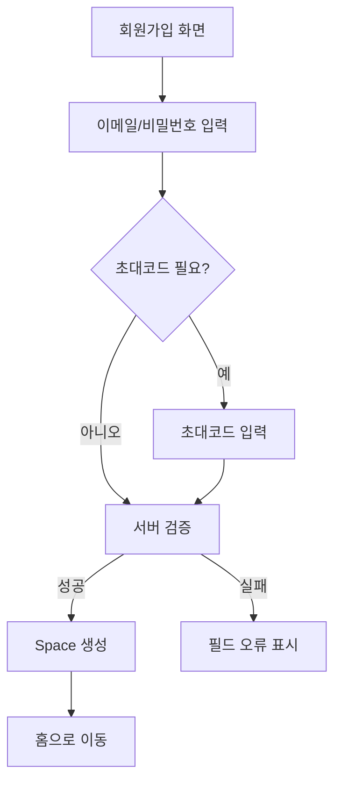
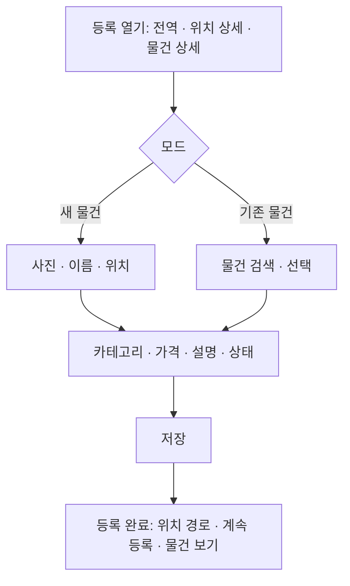
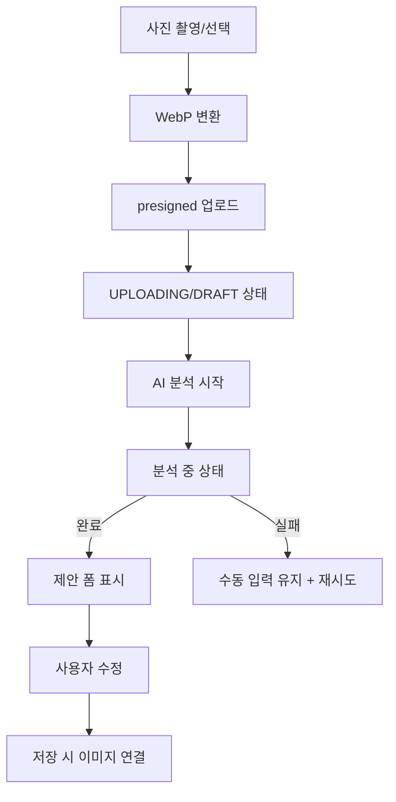

# 화면과 흐름

> 상태: 확정
> 역할: 화면 목록, 내비게이션, 주요 사용자 흐름, UI 상태의 단일 원본
> 관련 문서: [제품 사양](product-spec.md), [디자인 시스템](design-system.md), [검색](search.md), [미디어·AI](media-ai.md), [API 계약](contracts.md), [ADR-010](decisions/ADR-010-item-creation-permissions.md), [ADR-013](decisions/ADR-013-invitation-only-sharing.md), [ADR-016](decisions/ADR-016-neo-brutal-design-system.md)

## 1. 제품 형태

- React 기반 웹 앱입니다.
- PWA 설치와 홈 화면 추가를 지원합니다.
- 모바일 우선 반응형으로 설계합니다.
- 카메라 촬영과 사진 업로드를 지원합니다.
- 오프라인 편집은 MVP에서 지원하지 않습니다.
- 네트워크 복구 또는 포커스 시 데이터를 재조회합니다.

## 2. 내비게이션

```text
로그인/가입
└── 앱 셸
    ├── 홈·검색
    ├── 공간
    │   └── Room > Shelf > Box
    ├── 재고
    │   ├── 재고 상세
    │   └── 물건 상세
    ├── 공유
    ├── 설정
    │   └── 카테고리 관리
    └── 등록 (전역 시트, 모든 화면에서 열 수 있음)
```

- 모바일은 5개 하단 탭(홈·검색, 공간, 재고, 공유, 설정)과 등록 FAB를 사용합니다.
- 데스크톱은 좌측 사이드바와 상단 검색·등록 버튼을 사용합니다.
- 등록은 별도 목적지가 아니라 어디서나 열 수 있는 시트입니다. Room·Shelf·Box 상세에서는 위치가 미리 채워집니다.
- 재고 상세와 물건 상세는 등록 후 확인·이동·상태 변경·재등록의 허브입니다.
- 내 Space와 공유받은 Room/Shelf를 전환할 수 있습니다. M1에서는 내 Space만 표시하고 공유 공간 전환은 M4에서 연결합니다.
- 공유받은 리소스에는 소유자 배지를 표시합니다.
- 1차에는 인앱 알림 센터를 제공하지 않습니다.
- 화면 ID(SCR-*)는 구현 추적용이며 사용자 화면에 노출하지 않습니다.

## 3. 화면 목록

| ID | 화면 | 역할 |
|---|---|---|
| SCR-001 | 로그인 | 이메일·비밀번호 로그인, 비밀번호 재설정 |
| SCR-002 | 회원가입 | 이메일·비밀번호·초대코드 가입 |
| SCR-003 | 홈·검색 | 검색, 최근 추가, 최근 검색, 자주 본 물건 |
| SCR-004 | 공간 트리 | Room, Shelf, Box 계층 탐색과 관리 |
| SCR-005 | Room 상세 | Room 정보, Shelf 목록, 직접 위치 재고, 이 위치에 등록 |
| SCR-006 | Shelf 상세 | Shelf 정보, Box 목록, 직접 위치 재고, 이 위치에 등록 |
| SCR-007 | Box 상세 | Box 정보와 직접 위치 재고, 이 위치에 등록 |
| SCR-008 | 재고 목록 | 상태 필터, 위치·이름·상태 표시, 등록 진입 |
| SCR-009 | 재고 상세 | 사진, effective field, 위치, 상태, 이동, 삭제 |
| SCR-010 | 재고 편집 | 오버라이드, 사진, 상태 수정 |
| SCR-011 | 등록 시트 | 새 물건 + 첫 Inventory, 기존 물건에 Inventory 추가 |
| SCR-012 | 물건 상세 | 마스터 정보, 연결 재고 목록, 재고 추가 |
| SCR-013 | 이미지 검색 | 이미지 업로드와 유사 재고 결과 |
| SCR-014 | AI 결과 확인 | 인식 제안 검토·수정·저장 |
| SCR-015 | 공유 관리 | Grant 목록, 권한 변경, 철회 |
| SCR-016 | 공유 초대 | 이메일 초대, 대기·수락·거절·만료 상태 |
| SCR-017 | 설정 | 프로필, Space 이름, 카테고리 관리, 앱 정보 |
| SCR-018 | 오류·권한 없음 | 404, 403, 네트워크 오류 |
| SCR-019 | 받은 초대 | 받은 초대 수락·거절 |
| SCR-020 | 카테고리 관리 | 카테고리 생성·이름 변경·병합·삭제 |

## 4. 주요 흐름

### 4.1 회원가입



- 초대코드는 설정이 켜진 환경에서 필수입니다.
- 비밀번호 정책과 중복 이메일을 검증합니다.
- 가입 성공 시 개인 Space가 생성됩니다.

### 4.2 재고 생성



- 등록은 화면이 아니라 모든 화면에서 열 수 있는 시트입니다. Room·Shelf·Box 상세의 "이 위치에 등록"은 위치를 미리 채웁니다.
- 새 물건과 첫 Inventory를 한 번의 저장으로 생성합니다. 서버의 `newItem` 통합 생성 전까지는 클라이언트가 Item 생성 후 Inventory 생성을 순서대로 호출하고, 두 번째 호출이 실패하면 생성된 Item을 유지한 채 재시도 안내를 표시합니다.
- 신규 물건 생성은 소유자에게만 노출합니다. 공유 `MANAGE` 사용자는 접근 가능한 기존 물건에만 재고를 추가할 수 있습니다.
- 공유 사용자는 새 Category를 만들 수 없고 기존 Category만 선택합니다. 소유자는 등록 시트에서 Category를 즉시 만들 수 있습니다.
- 위치는 Room, Shelf, Box 중 하나를 선택합니다. 위치를 선택하지 않으면 저장할 수 없습니다.
- 공유 사용자는 접근 가능하고 `MANAGE`가 있는 위치만 선택할 수 있습니다.
- 사진과 AI 제안은 같은 시트의 앞 단계에 추가합니다. M5·M7 전까지는 사진 없이 이름·위치·카테고리·가격·설명·상태를 입력합니다.
- 재고 오버라이드와 상태는 "이 재고만 다르게" 영역으로 접어 두고, 필요한 사용자만 펼칩니다.
- 저장 후 위치 경로와 함께 "계속 등록", "물건 보기"를 제공합니다. "계속 등록"은 위치를 유지한 채 폼을 비웁니다.
- 마스터 공통 필드와 Item 이미지 수정은 소유자에게만 노출합니다.
- 마스터 수정 저장 전에 `GET /items/{itemId}/update-impact`로 영향받는 Inventory 수를 표시합니다.

### 4.3 AI 사진 입력



- AI 입력은 저장 전 DRAFT 이미지를 사용합니다.
- 분석 중에도 수동 입력을 계속할 수 있습니다.
- 제안은 자동 저장하지 않습니다.
- 실패해도 저장을 막지 않습니다.
- 카테고리는 기존 카테고리 후보 또는 새 카테고리 제안만 표시합니다.
- 새 카테고리 생성은 소유자만 확정할 수 있습니다.

### 4.4 검색

- 홈은 검색과 최근 추가를 우선합니다. 검색어가 비어 있으면 최근 추가, 최근 검색, 자주 본 물건, 받은 공유를 보여줍니다.
- 검색 결과는 마스터 카드로 그룹핑합니다.
- 카드를 펼치면 재고별 위치·상태·공유 배지를 보여줍니다.
- 그룹당 재고는 최대 5개를 먼저 보여주고 “더 보기”로 전체를 조회합니다.
- 위치와 상태, 카테고리, 공유 범위, 사진 유무 필터를 제공합니다.
- 정렬은 관련도, 최근 수정순, 이름순, 최근 조회순, 상태순을 제공합니다.
- 이미지 검색은 업로드 후 결과를 같은 카드 UI로 보여줍니다.
- 이미지 검색 타임아웃 시 재시도 안내를 표시합니다.
- M6 전체 검색 전까지 홈 검색은 `GET /items?q=`의 이름 검색과 최근 추가로 동작하고, 결과에서 물건 상세로 이동합니다.

### 4.5 재고 이동

- 재고 상세 또는 목록에서 "이동"을 선택합니다.
- 서버가 반환한 이동 가능한 위치만 트리로 보여줍니다.
- 공유 범위 밖으로 이동할 때 경고합니다.
- 이동 후 목록과 상세를 갱신합니다.
- 이동 권한이 없으면 버튼을 숨기거나 비활성화합니다.
- 같은 위치를 선택하면 아무 변경 없이 닫습니다.

### 4.6 공유

- 소유자는 Room 또는 Shelf 상세에서 바로 초대를 생성합니다. 전역 `/sharing`은 받은 초대·보낸 초대·공유받은 공간을 모아 보는 관리 화면입니다.
- 초대는 이메일로 발송되고 수락 후 효력이 발생합니다.
- 받은 초대 화면에서 수락 또는 거절할 수 있습니다.
- 권한 변경과 철회는 즉시 반영됩니다.
- 공유받은 사용자는 소유자와 자신의 권한을 확인할 수 있습니다.
- 권한은 `VIEW`, `EDIT`, `MANAGE` 원문 대신 "보기", "편집", "관리"와 한 줄 설명으로 표시합니다.
- 재공유 버튼은 제공하지 않습니다.
- 1차에는 직접 공유 버튼을 제공하지 않습니다.

## 5. UI 상태

| 상태 | 처리 |
|---|---|
| 로딩 | 스켈레톤 또는 짧은 스피너 |
| 빈 목록 | 다음 행동을 안내하는 빈 상태 |
| 오류 | 재시도 버튼과 오류 코드 표시 |
| 권한 없음 | 읽기 전용 또는 403 안내 |
| 세션 만료 | 로그인 화면으로 이동 |
| 버전 충돌 | 최신 데이터를 다시 불러오고 재시도 안내 |
| 등록 위치 없음 | 위치 선택을 요구하고 저장 버튼을 비활성화 |
| 등록 저장 중 | 저장 버튼 비활성화와 진행 상태, 중복 제출 차단 |
| 새 물건 부분 실패 | Item은 생성되었음을 알리고 Inventory 생성만 재시도 |
| 등록 완료 | 위치 경로와 "계속 등록", "물건 보기" 표시 |
| 업로드 중 | `UPLOADING` 진행 상태와 취소 |
| 업로드 만료 | 24시간 경과 안내와 재업로드 |
| AI 분석 중 | 진행 상태와 취소 버튼 |
| AI 실패 | 수동 입력 유지, 재시도 안내 |
| 이미지 검색 중 | 진행 상태와 5초 타임아웃 안내 |
| 이미지 검색 실패 | 키워드 검색으로 전환 안내 |
| 업로드 실패 | 파일 크기·형식 안내와 재시도 |
| 네트워크 오류 | 오프라인 안내, 온라인 복구 시 재조회 |

- 파괴적 작업은 확인 대화상자를 사용합니다.
- `DISPOSED` 전환과 공유 철회는 확인을 받습니다.
- 저장 중 중복 제출을 막습니다.
- 성공·실패 토스트를 제공합니다.
- 등록 시트는 닫아도 입력값을 유지하지 않으며, 실수로 닫았을 때를 위해 확인을 받습니다.

## 6. 권한별 UI

- `VIEW`: 조회와 다운로드만 표시합니다. UI 라벨은 "보기"입니다.
- `EDIT`: 재고 오버라이드, Inventory 사진, 상태 수정 버튼을 표시합니다. UI 라벨은 "편집"입니다.
- `MANAGE`: 기존 물건에 재고 추가·삭제·이동 버튼을 추가로 표시합니다. UI 라벨은 "관리"입니다.
- `OWNER`: 신규 물건, Item 이미지, 마스터, 계층, 카테고리, 공유 관리 버튼을 표시합니다. UI 라벨은 "소유자"입니다.
- 공유 사용자에게 신규 물건 생성 버튼을 표시하지 않습니다. 등록 시트는 "이미 있는 물건" 모드만 엽니다.
- 위치 상세의 등록 버튼은 `MANAGE` 이상에서만 표시합니다.
- UI 숨김은 편의일 뿐이며 서버가 최종 권한을 판정합니다.
- 권한이 없으면 API 오류를 사용자 친화적 메시지로 변환합니다.
- 계층 노드의 `effectivePermission`, `isShared`를 사용해 버튼을 결정합니다.
- 권한 원문(`OWNER`, `MANAGE`, `EDIT`, `VIEW`)을 화면에 직접 노출하지 않습니다.

## 7. 접근성과 반응형

- 키보드 내비게이션을 지원합니다.
- 이미지에는 대체 텍스트를 제공합니다.
- 색만으로 상태를 구분하지 않습니다.
- 터치 대상은 충분한 크기를 유지합니다.
- 모바일에서 카메라와 파일 선택을 모두 제공합니다.
- 긴 위치 경로는 축약하고 툴팁으로 전체 경로를 제공합니다.

## 8. 프론트엔드 구조

- React, TypeScript, Vite를 사용합니다.
- 라우팅은 React Router를 사용합니다.
- 서버 상태는 TanStack Query로 관리합니다.
- 폼은 React Hook Form과 Zod를 사용합니다.
- UI는 Tailwind와 shadcn/ui를 사용합니다.
- 시각 표현과 토큰은 [디자인 시스템](design-system.md)을 따릅니다. 색·간격·테두리·섀도를 화면에서 직접 정의하지 않습니다.
- API 타입은 OpenAPI에서 생성합니다.
- 인증 상태는 서버 세션과 `/auth/me`로 확인합니다.
- 이미지 업로드는 presigned URL로 직접 수행합니다.
- 이미지 표시는 `primaryImageId`와 `POST /images/urls` 배치 API를 사용합니다.
- 검색 제안은 `GET /search/suggestions`를 사용합니다.
- 낙관적 잠금 리소스는 `version`을 폼 상태에 포함하고 409 시 최신 값을 재조회합니다.

## 9. 디자인 검증

- `/design-preview` 라우트에서 SCR-003, SCR-004, SCR-009를 모바일 390px·데스크톱 1280px, 라이트·다크로 확인합니다.
- 미리보기는 목데이터를 사용하며 실제 API를 호출하지 않습니다. 운영 빌드에서는 라우트를 노출하지 않습니다.
- 미리보기 화면은 제품 화면 목록에 포함하지 않습니다. 실제 화면은 각 마일스톤에서 API와 연결해 구현합니다.
- 디자인 토큰과 컴포넌트 규격은 [디자인 시스템](design-system.md)이 단일 원본입니다.
- 등록 시트, 전역 등록 FAB, 재고 목록·상세, 위치 상세 재고 섹션은 [디자인 시스템 7.4~7.6](design-system.md)을 따릅니다.
- 시안이 없는 로그인·회원가입, 재고 목록·편집, AI 결과 확인, 공유 관리·초대, 설정, 오류 화면은 각 마일스톤에서 같은 토큰으로 확장합니다.

## 10. 구현 상태

- SCR-001 로그인·비밀번호 재설정, SCR-002 회원가입, SCR-017 설정을 구현했습니다.
- 인증 부트스트랩은 `GET /auth/me`를 사용하고, 미인증 시 `/login?redirect=...`로 이동합니다.
- 로그인·가입 성공 시 `AuthMe`를 캐시에 넣고 홈으로 이동합니다.
- 세션 만료(401)는 인증 캐시를 비우고 로그인 화면으로 이동합니다.
- 설정에서 표시 이름, Space 이름, 시스템·라이트·다크 모드, 로그아웃을 제공합니다.
- `/space` 트리와 Room·Shelf·Box 상세를 구현했습니다. Room·Shelf·Box 생성·수정·삭제와 Shelf 이동 대화상자가 동작합니다.
- M2 트리는 접힌 상태에서 자식 목록을 지연 조회하고, Box 이동 UI는 P1에서 추가합니다.
- P0 목표는 전역 등록 시트, 재고 목록·상세, 물건 상세, 위치 상세의 직접 재고 섹션, 홈 최근 추가·이름 검색입니다. 2026-10-21 기준 화면 문서와 ADR만 확정했고 코드는 아직 적용 전입니다.
- P0의 등록은 사진·AI 없이 이름·위치·카테고리·가격·설명·상태를 다룹니다. 사진·AI는 M5·M7에서 같은 시트에 추가합니다.
- 카테고리 관리는 `/settings/categories`로 옮기고, 등록 시트에서는 소유자만 인라인 생성할 수 있습니다.
- 공유받은 위치에서의 등록과 공유 Room/Shelf 상세 전환은 P1에서 보완합니다.
