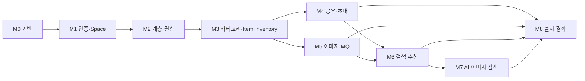

# 구현 로드맵

> 상태: 검토 완료
> 역할: 1차·2차 MVP를 구현 마일스톤과 완료 조건으로 나눈 실행 로드맵
> 범위 원본: 제품 단계와 기능 범위는 [운영](operations.md)의 로드맵을 따릅니다. 이 문서는 구현 순서, 의존성, 완료 조건만 정의합니다.
> 관련 문서: [제품 사양](product-spec.md), [아키텍처](architecture.md), [계약](contracts.md), [운영](operations.md), [ADR-014](decisions/ADR-014-generated-docs-draft.md)

## 1. 목적

이 문서는 문서 단계에서 구현 단계로 넘어갈 때 필요한 작업 순서를 고정합니다.

- 각 마일스톤은 백엔드, 프론트엔드, 테스트, 계약 문서를 함께 끝냅니다.
- 테넌트 격리와 권한 검사는 첫 도메인 마이그레이션부터 포함합니다.
- 각 마일스톤 종료 시 OpenAPI, 이벤트 계약, 데이터 사전을 재생성하고 문서 검사를 통과합니다.
- 3차 범위는 이 로드맵에서 구현하지 않습니다.

## 2. 전제

- ADR-001~014의 결정이 승인되어 있습니다.
- M0에서 저장소와 빌드 기반을 완료했고, M1부터 도메인 코드를 추가합니다.
- 제품 범위와 단계 구분은 [운영](operations.md)의 9번 항목을 따릅니다.
- 버전은 착수 시점의 최신 안정판을 `gradle/libs.versions.toml`과 `package.json`에 고정합니다.
- 구현 중 결정이 바뀌면 ADR을 추가하거나 기존 ADR을 대체합니다.

## 3. 마일스톤 개요

| 마일스톤 | 이름 | 단계 | 핵심 결과 |
|---|---|---|---|
| M0 | 기반 부트스트랩과 계약 파이프라인 (완료) | 1차 | 빌드, 로컬 인프라, 테스트, CI, 계약 생성기, 디자인 시스템 |
| M1 | Identity, Space, 가입과 세션 (완료) | 1차 | 가입, 로그인, 세션, CSRF, 초대코드, Space 설정 |
| M2 | 계층과 권한 기반 | 1차 | Room, Shelf, Box, 이동, `effectivePermission` |
| M3 | 카테고리, Item, Inventory | 1차 | 마스터·재고, 오버라이드, 상태, 이동 이력 |
| M4 | 공유와 초대 | 1차 | 초대 전용 공유, Grant, ACL, 최소 감사 |
| M5 | 이미지와 MQ 기반 | 1차 | presign, 후처리 worker, Outbox, 대표 이미지 |
| M6 | 검색과 추천 | 1차 | 키워드 검색, 그룹 커서, 최근 검색, 자주 본 물건 |
| M7 | AI와 이미지 검색 | 2차 | 인식 job, 임베딩, 동기 이미지 검색 |
| M8 | 출시 경화와 운영 | 지속 | E2E, 보안, 성능, 백업, 배포, 생성기 완성 |

### 3.1 의존성

- M4와 M5는 M3 이후에 병렬로 진행할 수 있습니다.
- M6은 공유 범위와 이미지 ID 응답이 필요하므로 M4와 M5 이후에 시작합니다.
- M7은 M6의 검색 그룹핑과 M5의 이미지 파이프라인을 재사용합니다.

## 4. 마일스톤 상세

### M0. 기반 부트스트랩과 계약 파이프라인

> 상태: 완료 (2026-10-20). 검증 결과와 계획 대비 변경은 [PLAN-001 6번 항목](implementation/PLAN-001-foundation.md)을 따릅니다.

범위:

- Gradle Kotlin DSL 기반 백엔드와 pnpm 기반 프론트엔드 저장소 구조
- PostgreSQL + pgvector, RabbitMQ, MinIO, Mailpit 로컬 구성
- Spring Boot, MyBatis, Flyway, Testcontainers, Actuator 기반
- React, Vite, TypeScript, TanStack Query, Tailwind, shadcn/ui 기반
- UUIDv7 생성기, Clock, 설정 검증 같은 공통 기반
- 구조화 로그와 `request_id`, 로그 마스킹 기본
- OpenAPI·데이터 사전·이벤트 계약 생성기 골격
- OpenAPI에서 프론트엔드 API 타입을 생성하는 골격
- ktlint·detekt·ESLint·Prettier 기반 코드 품질
- 문서 검사와 CI

완료 조건:

- `docker compose -f infra/docker-compose.yml up -d`로 로컬 인프라가 뜹니다.
- `./gradlew test`가 Testcontainers 기반 스모크 테스트를 통과합니다.
- `./gradlew ktlintCheck detekt`가 통과합니다.
- `pnpm lint`, `pnpm test`, `pnpm build`가 통과합니다.
- `pnpm generate:api`가 OpenAPI 초안에서 타입을 생성합니다.
- `/actuator/health` liveness와 readiness가 동작합니다.
- `python3 scripts/docs_check.py`가 통과합니다.
- 생성기 명령이 실행되고, 각 마일스톤에서 재생성하는 절차가 문서화됩니다.
- CI의 docs, backend, frontend job이 통과합니다.

비목표:

- 인증, 도메인 테이블, API 비즈니스 로직, 이미지 업로드, AI

상세 계획: [PLAN-001 기반 부트스트랩](implementation/PLAN-001-foundation.md) · [PLAN-001 계약·CI·검증](implementation/PLAN-001-foundation-delivery.md)

### M1. Identity, Space, 가입과 세션

> 상태: 완료 (2026-10-21).
> 상세 계획: [PLAN-002-identity-space](implementation/PLAN-002-identity-space.md)

범위:

- `app_user`, `space`, `invite_code`, `invite_code_use`, `password_reset_token`
- Spring Session JDBC와 세션 쿠키
- `GET /auth/config`, `GET /auth/csrf`, 가입, 로그인, 로그아웃, 내 정보
- 초대코드 설정과 운영 CLI
- 비밀번호 재설정
- 메일 발송 포트와 템플릿 기반
- 로그인·초대코드 레이트리밋
- 표시 이름과 Space 이름 수정
- 로그인·가입·설정 화면

완료 조건:

- 초대코드가 필요한 환경과 아닌 환경이 설정으로 분리됩니다.
- 세션 회전, CSRF, 로그아웃, 비밀번호 재설정 후 세션 무효화가 테스트됩니다.
- 이메일 중복과 소프트 삭제 후 재사용 규칙이 테스트됩니다.
- 비밀번호 재설정 메일이 Mailpit 또는 테스트 SMTP로 발송됩니다.
- 메일 발송 실패가 회원가입·로그인 자체를 막지 않습니다.
- 교차 Space 접근을 막는 테스트 기반이 준비됩니다.
- OpenAPI, 데이터 사전이 재생성됩니다.

### M2. 계층과 권한 기반

> 상세 계획: [PLAN-003-hierarchy-permissions](implementation/PLAN-003-hierarchy-permissions.md)

범위:

- `room`, `shelf`, `box`
- `AccessService`의 기본 유효 권한 계산
- Room, Shelf, Box 생성·수정·삭제·이동
- `effectivePermission`, `isShared`
- 하위 리소스와 재고가 있을 때 삭제 차단
- 계층 트리와 상세 화면

완료 조건:

- 복합 FK로 교차 Space 참조가 차단됩니다.
- Shelf/Box 부모 이동이 소유자만 가능합니다.
- 삭제 차단과 soft delete 제외가 테스트됩니다.
- 계층 응답의 권한 필드가 UI와 일치합니다.
- OpenAPI, 데이터 사전이 재생성됩니다.

### M3. 카테고리, Item, Inventory

> 상세 계획: [PLAN-004-inventory](implementation/PLAN-004-inventory.md)

범위:

- `category`, `item`, `inventory`, `inventory_movement`
- Category 정규화와 병합
- Item 마스터 생성·수정과 영향 범위
- Inventory 생성, 오버라이드, 상태, `confirmDisposal`
- Room/Shelf/Box 직접 위치와 위치 이동
- 이동 이력 API
- 재고 목록·상세·편집 화면과 이동 UI
- 소유자 Item 생성과 첫 Inventory 생성 흐름
- 공유 `MANAGE`의 Inventory 추가·삭제·이동은 M4에서 연결

완료 조건:

- effective field와 오버라이드 해제가 테스트됩니다.
- 마스터 수정이 오버라이드 없는 Inventory에 반영됩니다.
- M3에서는 소유자 생성 흐름만 테스트하고, 공유 사용자의 Inventory 추가 흐름은 M4에서 테스트합니다.
- 위치 CHECK, 이동 이력, 같은 위치 no-op이 테스트됩니다.
- `version` 충돌과 `Idempotency-Key` 재생이 테스트됩니다.
- OpenAPI, 데이터 사전이 재생성됩니다.

### M4. 공유와 초대

> 상세 계획: [PLAN-005-sharing](implementation/PLAN-005-sharing.md)

범위:

- `share_invitation`, `share` 테이블과 `audit_log` 마이그레이션·기록
- 초대 생성·수락·거절·철회·만료
- Grant 상속과 최대 권한
- ACL 조회 조건과 공유 범위 판정 기반
- 공유 사용자의 기존 Item Inventory 추가·삭제·이동 연결
- 공유 초대 이메일
- 공유 관리, 받은 초대, 권한 배지 UI

완료 조건:

- 초대 수락 전 접근이 차단됩니다.
- 이메일 불일치, 중복 초대, 이미 활성 Grant인 경우가 테스트됩니다.
- Room/Shelf Grant 상속과 철회 후 즉시 차단이 테스트됩니다.
- 공유 `MANAGE`가 기존 Item에 Inventory를 추가·삭제·이동할 수 있고 마스터 수정은 차단됩니다.
- Share 변경 감사 기록이 남습니다.
- OpenAPI, 이벤트 계약, 데이터 사전이 재생성됩니다.

### M5. 이미지와 MQ 기반

> 상세 계획: [PLAN-006-media-messaging](implementation/PLAN-006-media-messaging.md)

범위:

- `image`의 `UPLOADING`, `DRAFT`, `PENDING`, `PROCESSING`, `READY`, `FAILED`, `DELETED`
- presign, complete, 다운로드 URL, 대표 이미지, 배치 URL
- S3/MinIO 버킷과 객체 키
- 이미지 후처리 worker와 worker 실행 프로필: 재인코딩, EXIF 제거, 썸네일, 해시
- Transactional Outbox와 RabbitMQ `image.process`
- S3/MinIO health indicator와 로컬 통합 테스트
- 업로드 만료와 soft delete 정리 job
- 이미지 갤러리와 업로드 UI

완료 조건:

- Item 이미지는 OWNER, Inventory 이미지는 EDIT 이상만 수정합니다.
- 매직 바이트 검증과 재인코딩이 테스트됩니다.
- presign `UPLOADING` 행과 complete 전이가 테스트됩니다.
- 대표 이미지 자동 승격과 대상별 최대 10장이 테스트됩니다.
- Outbox 발행, 재시도, DLQ가 테스트됩니다.
- OpenAPI, 이벤트 계약, 데이터 사전이 재생성됩니다.

### M6. 검색과 추천

> 상세 계획: [PLAN-007-search](implementation/PLAN-007-search.md)

범위:

- `pg_trgm` 검색, effective field, 위치 검색
- Item 그룹 커서 페이지네이션
- 상태·위치·카테고리·공유 범위·소유자·사진 유무 필터
- 정렬 5종
- 최근 검색, 자주 본 물건, 검색 제안
- 조회 기록 디바운스
- 공유 ACL 조건과 후보 overfetch
- 검색 성능 측정용 시드 데이터와 p95 기준
- 검색·추천 UI

완료 조건:

- `DISPOSED` 기본 제외와 명시 포함이 테스트됩니다.
- 그룹당 Inventory 5개, `inventoryCount`, `hasMoreInventories`가 테스트됩니다.
- 공유 결과의 출처와 접근 범위가 테스트됩니다.
- 검색 p95 목표와 인덱스 실행 계획을 확인합니다.
- OpenAPI, 데이터 사전이 재생성됩니다.

### M7. AI와 이미지 검색

> 상세 계획: [PLAN-008-ai-image-search](implementation/PLAN-008-ai-image-search.md)

범위:

- `ai_job`, AI 인식 요청·상태·취소·재시도
- DRAFT 이미지와 저장 시 연결
- AI 인식 결과 스키마와 폼 자동 채움
- Gemini 임베딩, `item.embedding`, `inventory.effective_embedding`
- 재임베딩 fan-out, 모델·버전 필터, 모델 변경용 백필·인덱스 교체 절차
- 동기 이미지 검색 5초 타임아웃
- Space 단위 AI 캐시와 비용·품질 기록
- 테스트용 AI provider stub/fake와 비용 한도 설정
- AI 결과 확인 UI

완료 조건:

- AI 실패가 Inventory 저장을 막지 않습니다.
- job 멱등성, 취소 후 저장 금지, DLQ 재처리가 테스트됩니다.
- 임베딩 모델 간 fallback이 없고 검색이 모델·버전으로 필터링됩니다.
- 이미지 검색 ACL과 5초 타임아웃이 테스트됩니다.
- OpenAPI, 이벤트 계약, 데이터 사전이 재생성됩니다.

### M8. 출시 경화와 운영

> 상세 계획: [PLAN-009-release-hardening](implementation/PLAN-009-release-hardening.md)

범위:

- Playwright 핵심 흐름 E2E
- 교차 테넌트, 권한, 이미지, 검색, AI 회귀 테스트
- PWA 설치 요건과 접근성 점검
- 부하·슬로우 쿼리 점검
- 백업·복구 훈련
- 배포·롤백·헬스 체크
- 관측 대시보드, Sentry, 알림
- 의존성 취약점 검사와 비밀 스캔
- OpenAPI 하위 호환성 검사
- 생성기 완성 및 generated 문서 자동화
- 1차·2차 출시 체크리스트

완료 조건:

- [운영](operations.md)의 1차·2차 종료 조건을 모두 충족합니다.
- PWA 설치 요건과 접근성 점검을 통과합니다.
- 복구 훈련과 보안·의존성 점검 결과가 기록됩니다.
- generated 문서가 코드에서 재생성됩니다.
- OpenAPI 호환성 검사가 CI gate로 동작합니다.
- 롤백 절차가 리허설됩니다.

## 5. 공통 작업 규칙

- 각 마일스톤은 `docs/index.yaml`의 `code_paths`에 따라 영향 문서를 갱신합니다.
- 각 마일스톤 종료 시 `python3 scripts/docs_check.py`를 통과합니다.
- API 변경은 OpenAPI, 이벤트 변경은 events, 스키마 변경은 데이터 사전에 반영합니다.
- API 변경 시 프론트엔드 타입을 재생성하고 `pnpm generate:api` 결과를 커밋합니다.
- generated 문서는 구현 착수 후 생성기로만 갱신합니다.
- 백엔드는 ktlint·detekt, 프론트엔드는 ESLint·Prettier를 통과합니다.
- 테넌트 격리 테스트는 마일스톤마다 유지합니다.
- 새 결정이 구조에 영향을 주면 ADR을 추가합니다.
- 3차 기능은 이 로드맵에 넣지 않습니다.

## 6. 로드맵 검토

초안을 작성한 뒤 의존성, 누락, 순서를 다시 검토했습니다.

### 6.1 발견한 문제

1. 검색을 이미지보다 먼저 두면 `hasImage`, `primaryImageId`, 이미지 배지가 미구현 상태로 남습니다.
2. 공유를 검색보다 뒤에 두면 검색의 공유 범위와 ACL 조건을 임시 구현해야 합니다.
3. Outbox와 RabbitMQ를 AI 단계까지 미루면 M5 이미지 후처리가 동기 처리로 임시 구현됩니다.
4. 가입 초대코드와 공유 초대를 같은 이름으로 다루면 M1과 M4의 테이블·API가 섞입니다.
5. M0에서 완성된 OpenAPI를 요구하면 컨트롤러가 없어 종료 조건을 만족할 수 없습니다.
6. 감사 로그를 M8까지 미루면 M4의 Share 변경 감사 요구를 충족하지 못합니다.
7. 프론트엔드를 마지막에 몰아서 구현하면 API 계약과 UI 상태가 늦게 검증됩니다.
8. 이미지 삭제·만료 정리를 M8로 미루면 M5의 저장소 비용과 고아 객체가 누적됩니다.
9. 이동 이력과 `confirmDisposal`을 공유·검색 이후로 미루면 M3의 종료 조건이 불명확해집니다.
10. M0의 Testcontainers 테스트가 인프라만 확인하고 애플리케이션 컨텍스트를 확인하지 않으면 초기 통합 위험이 큽니다.
11. M3에 공유 `MANAGE`의 Inventory 추가를 넣으면 아직 Grant가 없어 구현할 수 없습니다.
12. M4의 "공유 범위 검색 조건"은 M6 검색과 책임이 겹치므로 ACL 판정과 검색 조건을 분리해야 합니다.
13. OpenAPI만 만들고 프론트엔드 타입 생성을 빼면 API 계약과 UI 타입이 어긋납니다.
14. ktlint·detekt·의존성 스캔·비밀 스캔이 없으면 품질·보안 gate가 출시 직전으로 밀립니다.
15. UUIDv7, Clock, 설정 검증 같은 공통 기반이 없으면 M1·M3에서 중복 구현됩니다.
16. 메일 발송 기반을 M4로 미루면 M1의 비밀번호 재설정 흐름이 막힙니다.
17. PWA 설치 요건과 접근성 검증이 M8에 없으면 제품 형태 요구를 놓칩니다.
18. 모델 변경 백필과 벡터 인덱스 교체 절차가 없으면 M7 운영 중단 위험이 있습니다.

### 6.2 수정한 내용

- 순서를 `M4 공유 → M5 이미지 → M6 검색`으로 바꿨습니다.
- Outbox와 RabbitMQ를 M5로 당겼습니다.
- M1은 가입 초대코드, M4는 공유 초대로 이름과 책임을 분리했습니다.
- M0의 계약 종료 조건을 "생성기 골격과 재생성 절차"로 낮추고, 완성된 계약은 각 마일스톤에서 갱신하도록 했습니다.
- 최소 감사 기록을 M4에 넣었습니다.
- 프론트엔드 슬라이스를 M1부터 각 마일스톤에 포함했습니다.
- 이미지 만료·soft delete 정리를 M5에 넣었습니다.
- 이동 이력과 `confirmDisposal`을 M3 종료 조건에 넣었습니다.
- 공유 `MANAGE`의 Inventory 추가·삭제·이동을 M4로 옮겼습니다.
- M4는 ACL 판정, M6은 검색 조건으로 책임을 분리했습니다.
- M0에 UUIDv7·Clock·설정 검증, ktlint·detekt, API 타입 생성, 로그 마스킹을 추가했습니다.
- M1에 메일 발송 포트와 템플릿 기반을 추가했습니다.
- M4에 감사 로그 마이그레이션을, M5에 worker 프로필과 S3 health를 추가했습니다.
- M6에 성능 측정용 시드와 p95 gate를, M7에 모델 백필·인덱스 교체 절차를 추가했습니다.
- M8에 PWA 설치 요건, 접근성, 의존성·비밀 스캔, OpenAPI 호환성 검사를 추가했습니다.
- M0 스모크 테스트에 Spring 컨텍스트, Flyway, MyBatis, RabbitMQ 연결을 포함했습니다.
- M0 상세 계획은 문서 길이 제한 때문에 기반 부트스트랩과 계약·CI·검증 두 문서로 분할했습니다.

### 6.3 검토 결론

- M0는 첫 번째 요소로 적합합니다. 인증이나 도메인보다 먼저 빌드·인프라·계약·테스트 기반을 고정해야 이후 마일스톤의 재작업을 줄일 수 있습니다.
- M0에 공통 기반, API 타입 생성, 품질 gate를 포함해 예상 규모를 6~7일로 조정합니다.
- M4와 M5는 병렬화할 수 있지만, M6은 두 마일스톤의 결과에 의존하므로 순차적으로 시작합니다.
- 1차 출시 범위는 M0~M6, 2차 범위는 M7, M8은 지속적 경화 작업으로 정의합니다.

## 7. 위험과 대응

| 위험 | 영향 | 대응 |
|---|---|---|
| 도구 버전 드리프트 | 빌드 재현성 저하 | 버전 카탈로그와 lockfile 고정 |
| Testcontainers 이미지 불일치 | 테스트 환경 차이 | `pgvector/pgvector:pg16` 등 고정 이미지 사용 |
| 계약 생성기 지연 | 문서와 코드 불일치 | M0에서 골격, 각 마일스톤에서 재생성 gate |
| Outbox 도입 지연 | 이미지 처리 신뢰성 저하 | M5에 Outbox와 DLQ 포함 |
| ACL 누락 | 데이터 노출 | 마일스톤별 교차 테넌트 테스트 |
| 프론트엔드 후행 | UI 재작업 | 마일스톤별 vertical slice |
| 이미지 고아 객체 | 저장소 비용 | M5에 만료 정리 job 포함 |
| AI 비용·지연 | 출시 지연 | M7에서 timeout, cache, quota 먼저 구현 |

## 8. 다음 문서

- 첫 번째 요소 상세 계획: [PLAN-001 기반 부트스트랩](implementation/PLAN-001-foundation.md)
- M0 계약·CI·검증: [PLAN-001 후속 계획](implementation/PLAN-001-foundation-delivery.md)
- 제품 단계와 종료 조건: [운영](operations.md)
- API·이벤트 계약: [계약](contracts.md)
