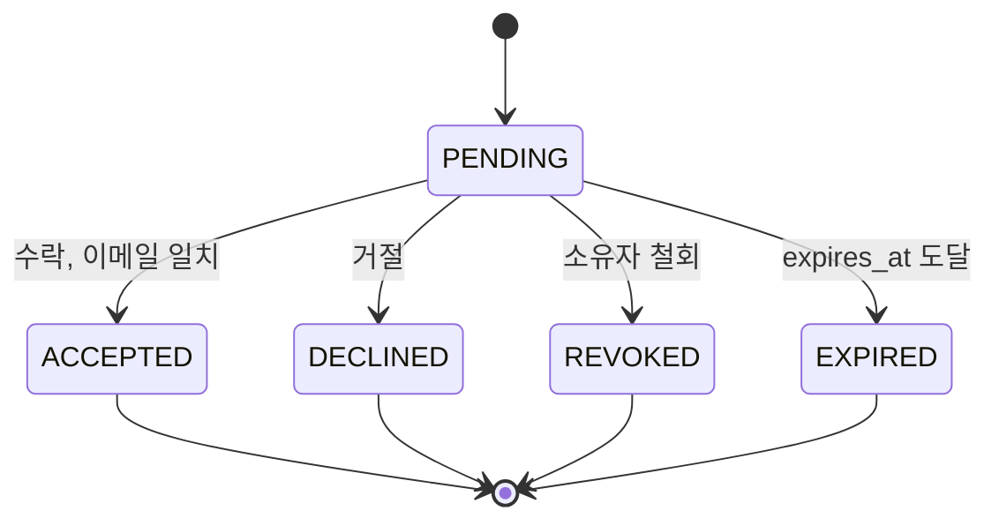

# PLAN-005: M4 공유와 초대 상세 구현 계획

> 상태: M4 핵심 구현 완료 (2026-10-21, 코드리뷰 수정·후속 보완 항목은 14번 참조)
> 역할: 구현 로드맵 M4의 스키마, 권한, API, 화면, 검증을 구현 가능한 단위로 고정
> 상위 문서: [구현 로드맵](../implementation-roadmap.md)
> 선행 계획: [PLAN-001 기반 부트스트랩](PLAN-001-foundation.md) · [PLAN-003 계층과 권한](PLAN-003-hierarchy-permissions.md)
> 관련 문서: [공유](../sharing.md), [도메인](../domain.md), [API와 이벤트 계약](../contracts.md), [화면과 흐름](../frontend.md), [검색](../search.md), [운영](../operations.md), [디자인 시스템](../design-system.md), [데이터 사전](../generated/data-dictionary.md), [OpenAPI](../generated/openapi.yaml), [이벤트 계약](../generated/events.yaml), [ADR-003](../decisions/ADR-003-permission-model.md), [ADR-010](../decisions/ADR-010-item-creation-permissions.md), [ADR-013](../decisions/ADR-013-invitation-only-sharing.md), [ADR-014](../decisions/ADR-014-generated-docs-draft.md), [ADR-016](../decisions/ADR-016-neo-brutal-design-system.md)

## 1. 목적

M4는 초대 전용 공유를 실제 접근 권한으로 연결합니다. 수락 전에는 어떤 재고도 보이지 않아야 하고, 수락 후에는 Grant 상속과 최대 권한으로 Room·Shelf·Box·Inventory·Item 접근이 일관되게 계산되어야 합니다. 이 문서는 마이그레이션, `AccessService` 확장, 초대 상태 기계, shared MANAGE 경계, API, 화면, 테스트를 구현 순서로 고정합니다.

제품 규칙은 [공유](../sharing.md), 스키마는 [데이터 사전](../generated/data-dictionary.md), API 규칙은 [계약](../contracts.md)을 단일 원본으로 사용합니다. 이 문서는 M4의 결정과 작업 순서만 추가합니다.

## 2. 범위와 비목표

### 2.1 포함

| 영역 | M4 산출물 |
|---|---|
| 데이터 | `share_invitation`, `share`, `audit_log`, 최소 `outbox_event` |
| 권한 | `GrantLookup` SQL 구현, 상속·최대 권한, ACL 목록 조건, 후보 overfetch 기반 |
| 초대 | 생성·수락·거절·철회·재발송·만료, 토큰 해시, 이메일 일치, 중복 방지 |
| 공유 | Grant 목록·권한 변경·철회, `GET /shared`, shared MANAGE Inventory 작업 |
| 감사 | Share·Invitation 변경 감사, 토큰·이메일 비노출 |
| 이메일 | 초대 템플릿, Outbox 적재, 재시도, 실패 시 재발송 |
| 화면 | SCR-015 공유 관리, SCR-016 공유 초대, SCR-019 받은 초대, 권한 배지 |
| 검증 | 수락 전 차단, 이메일 불일치, 중복, 철회 즉시 차단, 상속, shared MANAGE, 감사, 테넌트 격리, UI |

### 2.2 비목표

- 직접 공유 `POST /shares`와 즉시 효력 Grant. 1차에서는 제공하지 않고 3차에서 재검토합니다.
- 재공유, 링크·공개 공유, Box·Item·Inventory 단위 공유, 선반별 비공개 예외, 소유권 이전
- 그룹·조직 공유, 공유 사용자 초대 권한, `deny` 규칙, 권한 위임
- 인앱 알림 센터, 감사 로그 조회·내보내기 UI. 1차는 초대 이메일과 감사 기록만 제공합니다.
- 검색 랭킹·그룹 커서(M6), 이미지 presign·후처리(M5), AI(M7)

## 3. 선행 조건

| 선행 | M4가 사용하는 결과 | 없을 때 |
|---|---|---|
| M0 | Gradle·Testcontainers·Flyway·MyBatis, UUIDv7, `ClockProvider`, problem+json, `request_id`, 로그 마스킹 | M0 보완 |
| M1 | `app_user`, `space`, `space.owner_user_id`, `Actor`, `SpaceOwnership`, 세션·CSRF, 메일 포트·템플릿, 레이트리밋, `idempotency_record` | M1 보완, M4 중단 |
| M2 | `room`, `shelf`, `box`, `Permission`, `AccessService`, `AccessTarget`, `GrantLookup`, `NoGrantLookup`, `effectivePermission`, `resolveAll`, `isShared`, `PermissionBadge` | M2 완료 |
| M3 | `item`, `inventory`, `inventory_movement`, `version`, `GET /items`, `POST /inventories`, `DELETE /inventories/{id}`, `PATCH /inventories/{id}/location`, `GET /inventories/{id}/move-targets` | M3 완료 조건 |
| 계약 | `docs/generated/` 기록 모드와 재생성 명령. 미전환이면 [ADR-014](../decisions/ADR-014-generated-docs-draft.md)에 따라 수동 초안 갱신 | 착수 전 확인 |

- M2의 `NoGrantLookup`을 `ShareGrantLookup`으로 교체합니다. `AccessService` 호출부와 404·403 규칙은 유지합니다.
- M3의 공유 `MANAGE` Inventory 생성·삭제·이동 연결 지점은 M4에서 활성화합니다. M3는 소유자 흐름만 테스트합니다.
- M3 마지막 마이그레이션은 `V9__inventory_movement.sql`입니다. M4는 `V10`부터 시작하며 아래 표에 번호를 확정했습니다.
- `outbox_event`를 M4에 만들지 M5에 맡길지는 12.2번의 확인 필요 항목입니다. M4 메일 요구를 위해 최소 테이블과 알림 릴레이가 필요합니다.

## 4. 데이터 모델과 마이그레이션

컬럼 전체 목록과 타입은 [데이터 사전](../generated/data-dictionary.md)을 따릅니다. 이 문서는 M4에서 확정하거나 추가하는 제약·인덱스·상태 의미만 기록하고 DDL을 재정의하지 않습니다.

### 4.1 테이블과 마이그레이션

| 테이블 | 예시 파일 | M4 역할 | 데이터 사전 |
|---|---|---|---|
| `share_invitation` | `V10__share_invitation.sql` | 초대 상태·토큰·만료·이메일 | 공유 표 초안을 기준으로 제약 보강 |
| `share` | `V11__share.sql` | 수락 후 Grant, 철회 이력 | 공유 표 초안을 기준으로 인덱스 보강 |
| `audit_log` | `V12__audit_log.sql` | Share·Invitation 감사 | 이력과 알림 표 |
| `outbox_event` | `V13__outbox_event.sql` | 초대 메일·도메인 이벤트 적재 | 비동기와 AI 표 |

- Expand 단계만 수행합니다. 기존 테이블 변경 없이 신규 테이블·인덱스만 추가합니다.
- `share`와 `share_invitation`의 `space_id`는 공유 대상 리소스의 소유 Space입니다. 초대받은 사용자의 Space ID를 저장하지 않습니다.
- `(room_id, space_id)`, `(shelf_id, space_id)` 복합 FK로 같은 Space 참조를 강제합니다.
- `audit_log`와 `outbox_event`도 `space_id`를 가지며 초대 메일 알림은 대상 Space 기준으로 기록합니다.

### 4.2 `share_invitation` 확정 사항

| 항목 | 결정 |
|---|---|
| 상태 | `invitation_status`의 `PENDING`, `ACCEPTED`, `DECLINED`, `REVOKED`, `EXPIRED` |
| 대상 | `room_id` 또는 `shelf_id` 중 정확히 하나. 0개·2개는 422 |
| 이메일 | `invited_email citext NOT NULL`, trim·소문자 정규화, 최대 254자 |
| 사용자 연결 | `invited_user_id`는 nullable 캐시. 생성 시 가입자가 있으면 설정하고 수락 시 재검증 |
| 토큰 | 32바이트 CSPRNG, base64url 43자. 서버에는 SHA-256 hex 64자만 `token_hash`로 저장 |
| 토큰 수명 | 1회용. 수락·거절·철회·만료 후 재사용 불가. 재발송 시 교체 |
| 만료 | `expires_at = created_at + share.invitation.ttl`(기본 7일), `CHECK (expires_at > created_at)` |
| 상태 시각 | `ACCEPTED`는 `accepted_at`, `DECLINED`는 `declined_at`, `REVOKED`는 `revoked_at` 필수 |
| 중복 방지 | `(room_id, invited_email)`, `(shelf_id, invited_email)` 부분 유니크, `status = 'PENDING'` |
| 만료 인덱스 | `(status, expires_at)` 추가. 만료 job과 lazy 만료가 사용 |
| 목록 인덱스 | `(space_id, created_at DESC)` 추가 |
| `updated_at` | 두지 않습니다. 상태 시각과 감사 로그로 이력을 남깁니다 |

- 동시 생성의 부분 유니크 위반은 `409 INVITATION_ALREADY_PENDING`으로 변환합니다.
- 생성 전 같은 대상·이메일의 만료된 `PENDING`을 `EXPIRED`로 먼저 바꿉니다. 만료 job 지연으로 새 초대가 막히지 않게 합니다.
- 대상 Room/Shelf가 삭제되었으면 생성은 404, 수락도 404입니다.
- `invited_user_id`가 있어도 수락 시 이메일을 다시 비교합니다. 이메일을 바꾼 사용자는 기존 초대를 수락할 수 없습니다.

### 4.3 `share` 확정 사항

| 항목 | 결정 |
|---|---|
| 생성 시점 | 초대 수락 트랜잭션에서만 생성. 직접 생성 API 없음 |
| 필드 | `grantee_user_id`, `permission`, `granted_by`, `room_id` 또는 `shelf_id`, `created_at`, `revoked_at` |
| 철회 | 행을 삭제하지 않고 `revoked_at` 설정. ACL 조회에서 즉시 제외 |
| 중복 | `(room_id, grantee_user_id)`, `(shelf_id, grantee_user_id)` 부분 유니크, `revoked_at IS NULL` |
| 재초대 | 철회 후 같은 사용자·리소스에 새 Grant 생성 가능. 이전 행은 이력으로 유지 |
| 버전 | `version` 없음. 권한 변경은 마지막 쓰기 우선이며 감사로 추적 |
| 초대 연결 | `invitation_id` 없음. 감사 `metadata.invitationId`와 `share.created` 이벤트로 추적 |
| 목록 인덱스 | `(space_id, created_at DESC)` 추가 |
| 리소스 삭제 | Room/Shelf 삭제 시 Grant·PENDING 초대 처리 규칙은 12.2번 확인 필요 |

- `permission`은 `VIEW`, `EDIT`, `MANAGE`만 저장합니다. `OWNER`는 계산값입니다.
- 수락 시 부분 유니크 위반은 `409 SHARE_ALREADY_EXISTS`로 변환하고 초대를 `PENDING`으로 남깁니다. 같은 초대 재시도는 기존 Grant를 반환합니다.
- Room Grant와 Shelf Grant는 동시에 존재하며, 철회 시 나머지 Grant로 유효 권한을 다시 계산합니다.

### 4.4 `audit_log`와 `outbox_event`

- `audit_log.actor_user_id`는 NOT NULL입니다. 만료 job처럼 행위자가 없는 변경은 감사 대신 구조화 로그와 메트릭만 남깁니다. 시스템 actor 도입은 12.2번에서 확인합니다.
- 감사 `metadata`에는 `roomId`, `shelfId`, `permission`, `previousPermission`, `granteeUserId`, `invitationId`만 넣습니다. 토큰과 이메일 원문은 넣지 않습니다.
- `audit_log`에 `(space_id, resource_type, resource_id, created_at DESC)` 인덱스를 추가합니다.
- `outbox_event`는 M4에서 `notification.requested`만 알림 릴레이가 소비합니다. `share.*` 도메인 이벤트는 적재만 하고 발행은 M5가 맡습니다.
- `outbox_event`에 `(aggregate_type, aggregate_id)` 인덱스를 추가해 초대별 최신 발송 상태를 조회합니다.

### 4.5 데이터 사전 갱신

| 대상 | 델타 |
|---|---|
| `share_invitation` | `CHECK (expires_at > created_at)`, 상태 시각 CHECK, `(status, expires_at)`, `(space_id, created_at DESC)` |
| `share` | `(space_id, created_at DESC)` |
| `audit_log` | `(space_id, resource_type, resource_id, created_at DESC)` |
| `outbox_event` | `(aggregate_type, aggregate_id)`와 M4 소유 범위 주석 |

위 델타는 데이터 사전 생성기 또는 [ADR-014](../decisions/ADR-014-generated-docs-draft.md)에 따른 수동 초안으로 반영합니다. 이 문서에는 전체 `CREATE TABLE`을 두지 않습니다.

## 5. 도메인과 서비스 설계

### 5.1 구성 요소

구현 패키지는 `com.agolock.sharing.domain`(`Share`, `ShareInvitation`, `InvitationStatus`, `InvitationToken`), `sharing.access`(`AccessService`, `ShareGrantLookup`, `InventoryAccessTarget`), `sharing.service`(`ShareInvitationService`, `ShareService`, `ShareInvitationExpiryJob`), `sharing.repository`(`ShareMapper`, `ShareInvitationMapper`, `ShareAclMapper`), `sharing.api`(컨트롤러·DTO)로 나눕니다. 감사는 `common.audit`, Outbox·알림은 `messaging.outbox`와 `notification`에 두고, shared MANAGE는 M3의 `inventory.service.InventoryService`를 확장합니다. MyBatis XML은 `backend/src/main/resources/mapper/sharing/` 아래에 둡니다.

### 5.2 `AccessService` 확장

M2에서 구현한 `AccessTarget`, `effectivePermission(actor,target)`, `require`, `resolveAll`, `isShared`를 유지하고 다음을 추가합니다. M3는 소유자 target만 사용하며, M4가 `ShareGrantLookup`을 연결합니다.

| 추가 API | 용도 |
|---|---|
| `resolveInventory(actor, inventoryId)` | Inventory 위치의 Room/Shelf 조상 Grant 최대값 |
| `resolveItem(actor, itemId)` | 접근 가능한 Inventory가 하나 이상 있으면 그 최대 권한 |
| `requireManageLocation(actor, locationRef)` | shared MANAGE 생성·삭제·이동 대상 검사 |
| `accessibleRoomIds(actor)`, `accessibleShelfIds(actor)` | 이동 대상·필터 후보 조회 |

- 소유자면 항상 `OWNER`이고 Grant 조회를 생략합니다.
- `ShareGrantLookup`은 `GrantLookup.permissionFor(actor,target)`를 구현하고, 내부 `grantsFor(userId, roomIds, shelfIds)`로 활성 Grant를 한 번에 읽습니다. `resolveAll`은 대상별 N+1을 만들지 않습니다.
- 권한 비교는 `Permission.atLeast`(enum ordinal `NONE < VIEW < EDIT < MANAGE < OWNER`)로만 수행합니다. 여러 Grant는 최대 권한, 없으면 `NONE`입니다.
- `require`는 `NONE`이면 404, 보이지만 권한이 부족하면 403 `PERMISSION_DENIED`입니다. 공유 범위 밖과 다른 Space는 404로 통일합니다.
- 철회 즉시 차단을 위해 판정 결과를 캐시하지 않습니다.

### 5.3 Grant 상속

| 대상 | 적용 Grant | 비고 |
|---|---|---|
| Room | Room Grant | Shelf Grant는 Room 상세를 열지 않음 |
| Shelf | 부모 Room Grant + 자기 Shelf Grant | 최대 권한 |
| Box | 조상 Room Grant + 부모 Shelf Grant | Box 자체 Grant 없음 |
| Inventory | 위치가 Room이면 Room, Shelf이면 Room+Shelf, Box이면 Room+Shelf 조상 | 최대 권한 |
| Item | 접근 가능한 Inventory의 최대 권한 | 접근 Inventory가 없으면 404 |

- 공유 사용자의 `GET /shared`는 수락된 Grant가 있는 Room/Shelf만 반환하고 `permission`, `ownerDisplayName`을 포함합니다.
- Shelf Grant만 있는 사용자는 Room 상세를 404로 받지만 Shelf 응답의 `roomName`으로 브레드크럼을 표시할 수 있습니다.
- `/items/{itemId}/inventories`와 `inventoryCount`는 접근 가능한 Inventory만 셉니다.
- 거부 규칙은 없습니다. Room MANAGE와 Shelf VIEW가 있으면 Shelf에는 MANAGE가 적용됩니다.

### 5.4 ACL 조회 조건과 후보 overfetch

- 목록·검색은 행마다 권한을 계산하지 않고 SQL 조건으로 접근 범위를 좁힙니다.
- Inventory를 `resolved_inventory` CTE로 Room/Shelf 조상에 정규화합니다. 직접 Room은 `room_id`, 직접 Shelf는 `shelf.room_id`+`shelf_id`, Box는 `shelf.room_id`+`box.shelf_id`입니다.
- 접근 조건은 활성 Room Grant와 활성 Shelf Grant의 `EXISTS` 합집합에 `max(permission)`을 적용합니다. 소유자는 `space.owner_user_id`로 전량 접근합니다.
- 인덱스는 `share (grantee_user_id, permission) WHERE revoked_at IS NULL`, `(space_id, room_id)`, `(space_id, shelf_id)`를 사용합니다.
- 커서 조건과 ACL 조건을 같은 CTE에 넣어 필터 후 페이지 크기를 적용합니다. 페이지네이션 후 필터링하지 않습니다.
- 벡터·이미지 검색 후보 overfetch는 `limit * search.candidate-multiplier`(기본 5), 최대 `search.candidate-max`(기본 200)입니다. M4는 공통 SQL 조각과 테스트를 제공하고 M6이 소비합니다.
- 공통 조각은 `ShareAclMapper.xml`의 재사용 `sql` fragment로 두고 `RoomMapper`, `InventoryMapper`, `ItemMapper`가 include합니다.
- 목표는 로컬 시드 1만 Inventory에서 일반 목록 p95 100ms 이하입니다. `EXPLAIN (ANALYZE, BUFFERS)`로 인덱스 사용을 확인합니다.

### 5.5 초대 상태 기계



| 전이 | 행위자 | 조건 | 부수 효과 |
|---|---|---|---|
| PENDING → ACCEPTED | 초대받은 사용자 | 로그인, 이메일 일치, 만료 전, 활성 Grant 없음 | `share` 생성, 감사 2건, 이벤트 2건 |
| PENDING → DECLINED | 초대받은 사용자 | 로그인, 이메일 일치, 만료 전 | `declined_at`, 감사, 이벤트 |
| PENDING → REVOKED | Space 소유자 | 초대가 PENDING | `revoked_at`, 토큰 무효, 감사 |
| PENDING → EXPIRED | 시스템 | `expires_at <= now()` | 상태만 변경, 메트릭 |
| 그 외 | - | 409 `INVITATION_NOT_PENDING` 또는 `INVITATION_EXPIRED` | Grant 생성 없음 |

- 수락은 같은 사용자·같은 초대 재시도에 한해 200과 기존 Grant를 반환합니다. 다른 사용자의 토큰·ID는 404입니다.
- 거절은 같은 사용자 재시도에 204, 그 외 상태는 409입니다.
- 철회는 이미 REVOKED면 204, ACCEPTED면 409 `INVITATION_NOT_PENDING`입니다. 수락된 초대는 Grant 철회 API를 사용합니다.

### 5.6 수락 트랜잭션

1. 본문 토큰을 SHA-256으로 해시하거나 초대 ID로 `FOR UPDATE` 조회합니다.
2. 없으면 404, `PENDING`이 아니면 상태별 409를 반환합니다. `expires_at <= now()`이면 `EXPIRED`로 바꾸고 409를 반환합니다.
3. 로그인 사용자 이메일과 `invited_email`을 비교합니다. 불일치면 422 `INVITATION_EMAIL_MISMATCH`이며 오류에 초대 이메일을 노출하지 않습니다. `invited_user_id`가 없으면 현재 사용자로 설정하고, 있으면 같은 사용자인지 확인합니다.
4. 대상 Room/Shelf가 같은 Space에 있고 삭제되지 않았는지 확인합니다. 아니면 404입니다.
5. 같은 대상의 활성 Grant가 있으면 `409 SHARE_ALREADY_EXISTS`로 롤백합니다. 같은 초대의 이전 성공 응답이 있으면 그 Grant를 반환합니다.
6. `share`를 생성하고 초대를 `ACCEPTED`로 바꿉니다. 부분 유니크 위반은 5번과 같이 처리합니다.
7. 같은 트랜잭션에서 감사 2건(`SHARE_INVITATION_ACCEPTED`, `SHARE_CREATED`)과 Outbox 2건(`share.invitation.accepted`, `share.created`)을 기록하고, 커밋 후 200과 `Share`를 반환합니다. 메일 발송은 수락과 무관합니다.

잠금 순서는 초대 행 → Grant 유니크 인덱스입니다. 같은 대상·사용자에 대한 두 초대의 경합은 유니크 인덱스가 막습니다. 거절은 상태·감사·이벤트만 처리하고 Grant를 만들지 않습니다.

### 5.7 감사 기록

- 초대 관련 `SHARE_INVITATION_CREATED`, `_RESENT`, `_ACCEPTED`, `_DECLINED`, `_REVOKED`는 `resource_type=SHARE_INVITATION`, Grant 관련 `SHARE_CREATED`, `SHARE_PERMISSION_CHANGED`, `SHARE_REVOKED`는 `SHARE`로 기록합니다.
- `metadata`에는 `roomId`, `shelfId`, `permission`, `previousPermission`, `granteeUserId`, `invitationId`, `shareId`만 넣습니다. 토큰과 이메일 원문은 넣지 않습니다.
- 감사는 업무 변경과 같은 트랜잭션에 기록합니다. 감사 실패 시 Grant·초대 변경도 롤백합니다.
- 만료 job은 감사 대신 `share_invitation_expired_total` 메트릭과 구조화 로그를 남깁니다. 공유 사용자의 Inventory 변경은 `inventory_movement`와 구조화 로그로 추적합니다.

### 5.8 공유 MANAGE 재고 작업

| 작업 | OWNER | 공유 MANAGE | 공유 EDIT | 공유 VIEW |
|---|---|---|---|---|
| 기존 Item에 Inventory 생성 | O | O | X | X |
| Inventory 삭제 | O | O | X | X |
| Inventory 이동 | O | O | X | X |
| 오버라이드·상태·Inventory 사진 | O | O | O | X |
| 신규 Item 생성 | O | X | X | X |
| Item 마스터·Item 이미지 | O | X | X | X |
| Category 생성·수정·병합 | O | X | X | X |
| 계층 생성·이름·이동·삭제 | O | X | X | X |
| Share 관리 | O | X | X | X |

- `POST /inventories`에서 공유 사용자는 `itemId`가 필수입니다. Item은 접근 가능한 Inventory가 하나 이상 있어야 하고, 대상 위치에 `MANAGE`가 있어야 합니다.
- 공유 사용자는 새 Item과 새 Category를 만들 수 없습니다. `categoryIdOverride`는 접근 가능한 기존 Category만 허용합니다.
- `DELETE /inventories/{id}`는 위치의 `MANAGE`가 필요합니다. 마지막 Inventory를 지워도 Item은 남습니다.
- `PATCH /inventories/{id}/location`은 source와 target 모두 `MANAGE`가 필요합니다. 공유 범위 밖 target은 403입니다. 이동 후 가시성은 target 기준으로 재평가합니다.
- `GET /inventories/{id}/move-targets`는 현재 사용자가 `MANAGE`를 가진 위치만 반환합니다.
- 소유자 전용 작업은 `requireOwner` 또는 `SpaceOwnership`으로 서버에서 최종 차단합니다. UI 숨김은 보조 수단입니다.

### 5.9 초대 이메일 Outbox

- 초대 생성 트랜잭션은 `share_invitation` + 감사 + `share.invitation.created` + `notification.requested`를 함께 기록합니다.
- `notification.requested` payload에는 `recipientEmail`, `templateKey=SHARE_INVITATION`, `data.invitationId`, `data.inviterName`, `data.resourceType`, `data.resourceName`, `data.permission`, `data.acceptUrl`, `data.expiresAt`, `data.signupUrl`을 넣습니다.
- 메일 링크는 `https://{publicBaseUrl}/invitations#token={token}`입니다. 토큰을 fragment에 두어 서버 액세스 로그와 Referer에 남지 않게 하고, API 수락은 토큰을 본문으로 받습니다.
- 초대 생성 응답·감사·도메인 이벤트에는 토큰과 이메일 원문을 넣지 않습니다. `notification.requested`만 메일 조립에 필요한 토큰을 가집니다.
- 알림 릴레이는 `share.invitation.*`만 골라 `MailSender`로 보냅니다. 성공 시 `published_at`을 설정하고 payload를 `{"redacted":true}`로 바꿉니다. 실패는 지수 백오프로 최대 5회 재시도하고 `FAILED`로 남깁니다.
- Outbox payload는 민감 정보로 취급합니다. 로그에 남기지 않고, 발행 후 redact하며, 보관 기간을 24시간으로 제한합니다. DB 접근 권한도 최소화합니다.
- 메일 발송 실패는 초대 생성을 롤백하지 않습니다. 소유자 목록은 `deliveryStatus`(`PENDING`, `SENT`, `FAILED`)를 표시하고 실패 시 재발송을 제공합니다.
- 재발송은 PENDING 초대의 `token_hash`를 새 토큰으로 교체하고 `notification.requested`를 새로 적재합니다. 이전 링크는 즉시 404가 됩니다.
- 가입하지 않은 이메일에는 `signupUrl`을 함께 보냅니다. 스테이징 가입 초대코드는 공유 초대와 별개이며, 공유 초대 링크가 가입 초대코드를 우회하지 않습니다.
- 템플릿은 `backend/src/main/resources/templates/mail/share-invitation.html`과 텍스트 대체본을 두고 M1 메일 포트를 재사용합니다.
- M5는 같은 Outbox 테이블과 `notification.requested` 계약을 사용해 RabbitMQ 발행·DLQ로 대체합니다. M4 알림 릴레이는 M5에서 제거 가능한 어댑터로 둡니다.

## 6. API 계약

### 6.1 공통 규칙

- Base path는 `/api/v1`, JSON UTF-8, camelCase, ISO 8601 UTC, UUID 문자열입니다.
- 인증은 세션 쿠키, 상태 변경 요청은 `X-XSRF-TOKEN`이 필수입니다. 수락·거절도 POST이므로 CSRF를 적용합니다.
- 소유자 전용 API는 `OWNER`만 호출합니다. 다른 Space 리소스는 403이 아니라 404입니다.
- 접근 범위 밖 리소스는 404, 보이지만 작업 권한이 부족하면 403입니다.
- 토큰과 이메일 원문은 응답·로그·감사에 넣지 않습니다.
- 컬렉션은 `items`와 `nextCursor`를 반환하고 커서는 `(createdAt, id)`를 opaque base64로 인코딩합니다. 기본 `limit` 20, 최대 100입니다.
- 생성 응답은 201과 `Location`, 삭제는 204입니다. 초대 생성·재발송은 `Idempotency-Key`를 지원합니다.

### 6.2 엔드포인트

| Method | Path | 권한 | 설명 | 주요 응답 |
|---|---|---|---|---|
| GET | `/shared` | 인증 | 수락된 공유 Room/Shelf 목록 | `items`, `nextCursor` |
| GET | `/shares` | OWNER | Grant 목록, `roomId`·`shelfId` 필터 | `items`, `nextCursor` |
| PATCH | `/shares/{shareId}` | OWNER | 권한 변경, JSON Merge Patch | 200 `Share` |
| DELETE | `/shares/{shareId}` | OWNER | Grant 철회, 멱등 | 204 |
| GET | `/share-invitations` | OWNER | 보낸 초대 목록, `status`·대상 필터 | `items`, `nextCursor` |
| POST | `/share-invitations` | OWNER | 초대 생성 | 201 `ShareInvitation`, `Location` |
| POST | `/share-invitations/{invitationId}/resend` | OWNER | 토큰 교체·메일 재발송 | 202 `deliveryStatus` |
| DELETE | `/share-invitations/{invitationId}` | OWNER | PENDING 초대 철회 | 204 |
| GET | `/share-invitations/received` | 인증 | 내 이메일의 받은 초대, 기본 PENDING | `items`, `nextCursor` |
| POST | `/share-invitations/received/{invitationId}/accept` | 인증 | 받은 초대 수락 | 200 `Share` |
| POST | `/share-invitations/received/{invitationId}/decline` | 인증 | 받은 초대 거절 | 204 |
| POST | `/share-invitations/accept` | 인증 | 이메일 링크 토큰 수락 | 200 `Share` |
| POST | `/share-invitations/decline` | 인증 | 이메일 링크 토큰 거절 | 204 |

- 이메일 링크용 수락·거절은 본문 `{ "token": "..." }`을 받습니다. 초안 OpenAPI의 `/share-invitations/{token}/accept` 경로는 토큰이 액세스 로그에 남으므로 M4에서 본문 방식으로 교체합니다.
- 받은 초대 목록은 `invitationId`를 반환하고, 화면 동작은 `/received/{invitationId}/accept`를 사용합니다. 이메일 링크는 토큰 본문 방식을 사용합니다.
- `POST /shares`는 만들지 않습니다. 재공유·링크 공유 엔드포인트도 만들지 않습니다.
- 공유 MANAGE Inventory 작업은 기존 `POST /inventories`, `DELETE /inventories/{id}`, `PATCH /inventories/{id}/location`, `GET /inventories/{id}/move-targets`의 권한 판정만 확장합니다.
- `GET /items`는 `scope=ALL|OWNED|SHARED`(기본 `ALL`)를 지원하고, 공유 사용자에게는 접근 가능한 Inventory가 있는 Item만 반환합니다.

### 6.3 요청·응답 예시

```http
POST /api/v1/share-invitations
{ "roomId": "018f7f8e-...", "shelfId": null,
  "invitedEmail": "friend@example.com", "permission": "EDIT" }
```

201 응답은 `id`, `resourceType`, `resourceName`, `invitedEmail`, `permission`, `status`, `deliveryStatus`, `expiresAt`, `createdAt`을 포함합니다. 받은 초대 항목은 여기에 `roomName`, `ownerDisplayName`을 더합니다. 이메일 불일치 오류는 `422`와 `code=INVITATION_EMAIL_MISMATCH`, `detail`은 "로그인한 계정의 이메일과 초대 이메일이 일치하지 않습니다."만 사용합니다.

### 6.4 오류 코드

| 상태 | 코드 | 상황 |
|---|---|---|
| 400 | `VALIDATION_FAILED`, `INVALID_CURSOR` | 형식·커서 오류 |
| 401 | `UNAUTHORIZED` | 세션 없음·만료 |
| 403 | `PERMISSION_DENIED` | 소유자 아님, 공유 범위 밖 작업, shared EDIT의 MANAGE 작업 |
| 404 | `RESOURCE_NOT_FOUND` | 대상·초대·Grant 없음, 다른 Space, 수락 전 접근 |
| 409 | `INVITATION_ALREADY_PENDING` | 같은 대상·이메일의 PENDING 초대 존재 |
| 409 | `SHARE_ALREADY_EXISTS` | 같은 대상·사용자의 활성 Grant 존재 |
| 409 | `INVITATION_NOT_PENDING` | 이미 수락·거절·철회된 초대 |
| 409 | `INVITATION_EXPIRED` | 만료된 초대 수락·철회 |
| 409 | `IDEMPOTENCY_KEY_REUSED` | 같은 키로 다른 본문 |
| 422 | `INVITATION_EMAIL_MISMATCH` | 계정 이메일과 초대 이메일 불일치 |
| 422 | `CANNOT_INVITE_SELF` | 자기 자신 또는 Space 소유자 이메일 초대 |
| 422 | `VALIDATION_FAILED` | 대상 0개·2개, 잘못된 권한·이메일 |
| 429 | `RATE_LIMITED` | 초대 생성·재발송 한도 초과 |

`CANNOT_INVITE_SELF`와 `RATE_LIMITED`는 [계약](../contracts.md) 오류 표에 추가합니다. 409는 상태·중복 충돌, 422는 의미·이메일 검증 실패입니다. 오류 `detail`에 초대 이메일, 토큰, 다른 사용자 존재 여부를 넣지 않습니다.

### 6.5 멱등성·CSRF·페이지네이션

- 초대 생성은 `Idempotency-Key` 재생 시 이전 201 응답을 반환하고 새 메일을 보내지 않습니다.
- 재발송도 `Idempotency-Key`를 지원해 중복 메일을 막습니다.
- 수락·거절은 초대 상태로 멱등성을 보장합니다. 같은 사용자의 반복 수락은 200, 반복 거절은 204입니다.
- `DELETE /shares/{id}`와 `DELETE /share-invitations/{id}`는 이미 철회된 경우 204입니다.
- `PATCH /shares/{id}`는 JSON Merge Patch이며 `permission`은 필수입니다. `version`은 받지 않습니다.
- 목록 정렬은 `createdAt DESC, id DESC`입니다. `status` 필터는 보낸 초대에 `PENDING|ACCEPTED|DECLINED|REVOKED|EXPIRED|ALL`, 받은 초대에 `PENDING|EXPIRED|ALL`을 허용합니다.
- 초대 생성·재발송은 사용자당 시간당 20회로 제한하고 429를 반환합니다.

### 6.6 기존 API 변경

- `GET /shared`를 M4에서 구현합니다. 응답에 `resourceType`, `roomId`/`shelfId`, `name`, `ownerDisplayName`, `permission`을 포함합니다.
- `Share`, `ShareInvitation`, `ShareList`, `ShareInvitationList`에 `resourceType`, `resourceName`, `granteeDisplayName`, `deliveryStatus`, `revokedAt`, `nextCursor`를 추가합니다.
- `CreateShareInvitationRequest`에 대상 정확히 1개 검증을 추가합니다.
- `Permission` enum은 M2의 `OWNER` 추가를 전제로 합니다.
- OpenAPI `info.version`을 올리고 기존 필드를 제거하지 않습니다. 단, 초안의 토큰 path 파라미터 경로는 본문 방식으로 대체합니다.

## 7. 프론트엔드

### 7.1 화면과 라우트

| 화면 | 라우트 | 파일 |
|---|---|---|
| SCR-015 공유 관리 | `/sharing` | `frontend/src/features/sharing/sharing-page.tsx` |
| SCR-016 공유 초대 | `/sharing/invitations` | `frontend/src/features/sharing/invitation-page.tsx` |
| SCR-019 받은 초대 | `/invitations` | `frontend/src/features/sharing/received-invitations-page.tsx` |
| 이메일 링크 착지 | `/invitations#token=...` | `frontend/src/features/sharing/invitation-token-page.tsx` |

- `frontend/src/app/router.tsx`의 `sharing` placeholder를 교체하고 `/invitations` 라우트를 추가합니다.
- `/sharing`은 "공유 중"과 "보낸 초대" 탭으로 나눕니다. `OWNER`가 아니면 초대 버튼과 관리 액션을 렌더링하지 않고 읽기 전용 안내를 표시합니다.
- `/sharing/invitations`는 대상 Room/Shelf 선택, 이메일, 권한 `VIEW|EDIT|MANAGE`를 입력합니다. 생성 후 보낸 초대 목록으로 이동하고 `deliveryStatus`를 표시합니다.
- `/invitations`는 받은 초대 카드 목록입니다. 수락·거절 후 목록과 `/shared`를 무효화합니다.
- `/invitations#token=...`는 해시에서 토큰을 읽고 즉시 `history.replaceState`로 URL에서 제거합니다. 로그인 전이면 토큰을 `sessionStorage`에만 임시 보관하고 `/login?returnTo=/invitations`로 이동합니다. `localStorage`에는 저장하지 않습니다.
- `returnTo`는 허용된 내부 경로만 받아 open redirect를 막습니다.

### 7.2 컴포넌트와 쿼리

- `frontend/src/features/sharing/components/share-list.tsx`, `share-row.tsx`, `share-permission-dialog.tsx`, `share-revoke-dialog.tsx`, `invitation-form.tsx`, `sent-invitation-list.tsx`, `received-invitation-card.tsx`, `permission-badge.tsx`
- `frontend/src/features/sharing/api.ts`, `queries.ts`, `types.ts`, `error-messages.ts`
- M2의 `frontend/src/features/hierarchy/components/permission-badge.tsx`를 `frontend/src/shared/ui/permission-badge.tsx`로 승격하고 계층·재고·공유 화면이 함께 사용합니다. `OWNER`, `공유 · VIEW`, `공유 · EDIT`, `공유 · MANAGE`를 텍스트로 표시합니다.
- Query key는 `["shares", filters]`, `["share-invitations", filters]`, `["share-invitations", "received", filters]`, `["shared-resources"]`로 고정합니다.
- 권한 변경·철회·수락·거절·재발송 성공 시 관련 목록과 `/shared`, Item/Inventory 목록을 무효화합니다. 낙관적 갱신은 사용하지 않습니다.
- 409는 목록 재조회와 안내 토스트, 422 `INVITATION_EMAIL_MISMATCH`는 "다른 계정으로 로그인" 안내, 404는 SCR-018로 전환합니다.
- 메일 발송 실패는 보낸 초대 행에 `FAILED` 배지와 "다시 보내기"를 표시합니다. `PENDING`은 "발송 대기", `SENT`는 "발송됨"입니다.

### 7.3 상태·반응형·접근성

- 로딩은 목록 스켈레톤과 제출 중 버튼 비활성으로 처리합니다. 빈 공유는 "아직 공유한 공간이 없습니다"와 초대 CTA, 빈 받은 초대는 "받은 초대가 없습니다"를 표시합니다.
- 403은 소유자 전용 안내와 액션 숨김, 404는 삭제·철회된 초대 안내와 목록 복귀, 409는 기존 초대 강조와 목록 재조회, 429는 재시도 시각 안내입니다.
- 422 `INVITATION_EMAIL_MISMATCH`는 현재 계정 이메일과 로그아웃 안내만 표시하고 초대 이메일은 노출하지 않습니다. 네트워크 오류는 재시도와 온라인 복구 재조회를 제공합니다.
- 모바일 390px은 카드 1열, 데스크톱 1280px은 대상·초대 대상·권한·상태·만료·액션 열의 표를 사용합니다.
- 상태·권한은 색만으로 구분하지 않고 텍스트 배지를 함께 표시합니다. 터치 대상은 44px 이상, 대화상자는 포커스 트랩·ESC·`aria-labelledby`를 사용합니다.
- 표에는 `caption`과 `scope="col"`을 제공하고, 토스트는 `aria-live="polite"`로 알립니다. 초대 링크 화면은 `Referrer-Policy: no-referrer`를 적용하고 토큰을 분석 이벤트·콘솔·에러 리포트에 넣지 않습니다.

## 8. 작업 분해

| 순서 | 작업 | 주요 파일 | 검증 |
|---|---|---|---|
| 1 | M1~M3 인터페이스·마이그레이션 head 확인, 확인 필요 항목 확정 | 문서, `com.agolock.tenancy`, `com.agolock.sharing.access` | 컴파일, 기존 테스트 green |
| 2 | 4개 테이블 마이그레이션과 데이터 사전 델타 | `backend/src/main/resources/db/migration`, `docs/generated/data-dictionary.md` | `ShareSchemaMigrationTest`, `docs_check.py` |
| 3 | `Permission`, `Share`, `ShareInvitation`, 토큰 해시·만료 도메인 | `backend/src/main/kotlin/com/agolock/sharing/domain` | `InvitationTokenTest`, `InvitationStateTest` |
| 4 | `ShareGrantLookup`, `AccessService` 확장, ACL SQL·overfetch | `sharing/access`, `mapper/sharing/ShareAclMapper.xml` | `AccessServiceTest`, `ShareInheritanceTest`, `AccessScopeSqlTest` |
| 5 | 초대 생성·수락·거절·철회·재발송·만료 서비스와 감사 | `sharing/service`, `common/audit` | `ShareInvitationServiceTest`, `ShareAuditTest` |
| 6 | Outbox 적재·알림 릴레이·초대 메일 템플릿 | `messaging/outbox`, `notification`, `templates/mail` | `ShareInvitationOutboxTest`, Mailpit 수동 확인 |
| 7 | API 컨트롤러·DTO·오류 매핑·OpenAPI 갱신 | `sharing/api`, `common/error`, `docs/generated/openapi.yaml` | `ShareApiTest`, `ShareApiContractTest` |
| 8 | shared MANAGE Inventory 연결, `GET /shared`, `GET /items?scope` | `inventory/service`, `inventory/api`, `hierarchy` | `SharedManageInventoryTest`, `SharedResourceApiTest` |
| 9 | SCR-015·016·019, 권한 배지, 라우트·쿼리 | `frontend/src/features/sharing`, `shared/ui/permission-badge.tsx`, `app/router.tsx` | `pnpm lint`, `pnpm test`, `pnpm build`, Playwright |
| 10 | 계약·이벤트·문서·CI·관측 갱신, M4 완료 검증 | `docs`, `scripts`, `.github/workflows` | `docs_generate.sh`, `generate:api`, `docs_check.py`, CI |

```bash
./gradlew :backend:test
./gradlew :backend:ktlintCheck :backend:detekt
pnpm lint && pnpm test && pnpm build
pnpm exec playwright test frontend/e2e/sharing.spec.ts
bash scripts/docs_generate.sh all
pnpm generate:api
python3 scripts/docs_check.py
python3 scripts/docs_impact.py
```

- 1인 기준 9~11일, 백엔드·프론트엔드 병렬 시 7~8일을 예상합니다.
- 2~6번은 백엔드, 9번은 프론트엔드가 병렬로 진행할 수 있지만 API 타입은 7번 계약 확정 후 생성합니다.
- 각 단계는 이전 단계 테스트가 통과한 뒤 진행합니다. 4번의 ACL SQL은 5번 서비스보다 먼저 고정합니다.

## 9. 테스트

| 구분 | 테스트 | 확인 내용 |
|---|---|---|
| 초대 수락 | `ShareInvitationAcceptanceTest` | 수락 전 접근 404, 이메일 불일치 422, 만료 409, 철회 409, 같은 사용자 재수락 200, 동시 수락 시 Grant 1건 |
| 초대 생성 | `ShareInvitationCreationTest` | 비소유자 403, 중복 PENDING 409, 활성 Grant 409, 자기 초대 422, 다른 Space 대상 404, 만료 PENDING 교체 |
| 상속 | `ShareInheritanceTest` | Room VIEW + Shelf EDIT = EDIT, Room MANAGE + Shelf VIEW = MANAGE, Box·Inventory 상속, Grant 철회 후 재계산 |
| 철회 | `ShareRevocationTest` | 철회 직후 다음 요청 404, `/shared`·목록 제외, 초대 토큰 무효, 재초대 허용 |
| shared MANAGE | `SharedManageInventoryTest` | 기존 Item Inventory 생성 201, 삭제 204, 범위 내 이동 200, 범위 밖 이동 403, 신규 Item·마스터·Category·계층 변경 403 |
| 감사 | `ShareAuditTest` | 초대·Grant action과 actor, 같은 트랜잭션 롤백, metadata에 토큰·이메일 없음 |
| 테넌트 격리 | `ShareTenantIsolationTest` | 다른 Space shareId 404, 제3자 토큰 404, Grant의 `space_id`가 소유자 Space, 초대받은 사용자의 Space 데이터 불변 |
| 만료 | `ShareInvitationExpiryJobTest` | PENDING만 EXPIRED, 다른 Space 영향 없음, 만료 후 재초대 가능 |
| Outbox | `ShareInvitationOutboxTest` | 생성과 같은 트랜잭션 적재, 메일 실패가 초대를 막지 않음, 발행 후 redact, 재발송 토큰 교체 |
| ACL SQL | `AccessScopeSqlTest` | 상속 조건 일치, 페이지네이션 전 필터, 후보 overfetch 상한, 인덱스 사용 |
| 계약 | `ShareApiContractTest` | operationId·상태 코드·오류 코드, `POST /shares` 부재, 토큰 path 부재 |
| UI | `sharing-page.test.tsx`, `invitation-form.test.tsx`, `received-invitations-page.test.tsx`, `permission-badge.test.tsx` | 목록·빈 상태·403/404/409/422, 대상 정확히 1개, 배지 텍스트, 수락·거절 후 무효화 |
| E2E | `frontend/e2e/sharing.spec.ts` | 초대 생성 → Mailpit 링크 → 수락 → `/shared` 노출 → 철회 → 접근 차단 |

- 백엔드 테스트는 Testcontainers PostgreSQL과 실제 MyBatis SQL을 사용합니다. 메일은 `MailSender` fake 또는 Mailpit API를 사용합니다.
- 공유 테스트는 소유자·초대 사용자·제3자를 분리하고, 각 테스트마다 독립 Space를 만듭니다.
- 프론트 테스트는 `features/sharing/api.ts`를 모킹하고 QueryClient 래퍼를 사용합니다.

## 10. 계약·이벤트·문서·CI·관측·메일 실패

### 10.1 OpenAPI와 이벤트

- OpenAPI에 6.2번 엔드포인트, 6.3번 스키마, 6.4번 오류를 반영합니다. 초안의 토큰 path 방식은 제거합니다.
- `share.invitation.created`, `share.invitation.accepted`, `share.invitation.declined`, `share.created`, `share.revoked`를 M4에서 적재합니다. 권한 변경과 초대 철회는 감사만 남기고, 소비자가 필요해지면 M5/M6에서 이벤트를 추가합니다.
- `notification.requested`는 `recipientEmail`을 허용하고 `templateKey=SHARE_INVITATION`, `data`를 추가합니다. 가입 전 사용자는 `userId`가 없으므로 둘 중 하나를 요구합니다.
- 공통 필드(`eventId`, `eventType`, `spaceId`, `occurredAt`, `schemaVersion`)를 유지하고 payload에 토큰·이메일을 넣지 않습니다. 메일 조립용 `notification.requested`만 예외로 토큰을 포함하고 발행 후 redact합니다.
- 변경은 `docs/generated/events.yaml`에 반영하고 `schemaVersion`을 올립니다.

### 10.2 문서

- [공유](../sharing.md) 4번 항목에 재발송·lazy 만료·토큰 전달 방식을 추가합니다. 제품 규칙이 바뀌지 않는 한 다른 절은 링크만 유지합니다.
- [계약](../contracts.md)의 엔드포인트·오류 표에 `INVITATION_NOT_PENDING`, `CANNOT_INVITE_SELF`, `RATE_LIMITED`, 본문 토큰 방식을 반영합니다.
- [화면과 흐름](../frontend.md)에 SCR-015·016·019의 세부 상태와 이메일 링크 흐름을 추가합니다.
- [운영](../operations.md)에 초대 메일 재시도·redact·보관 기간, `share.invitation.ttl`, 레이트리밋을 반영합니다.
- [아키텍처](../architecture.md)에 `common/audit`와 M4 Outbox 범위를 반영합니다.
- 데이터 사전, OpenAPI, 이벤트 계약을 재생성하고 `docs/index.yaml`에 `PLAN_005`를 등록한 뒤 `last_verified_commit`을 갱신합니다.
- `python3 scripts/docs_impact.py`로 영향 문서를 확인하고 `python3 scripts/docs_check.py`를 통과합니다.

### 10.3 CI

- backend: `./gradlew :backend:test`, `ktlintCheck`, `detekt`
- frontend: `pnpm lint`, `pnpm test`, `pnpm build`, 필요 시 Playwright
- contract: `docs_generate.sh`, `python3 scripts/contract_validation.py`, `pnpm generate:api` 후 diff 없음
- docs: `python3 scripts/docs_check.py`
- Mailpit 의존 E2E는 nightly 또는 별도 job으로 분리할 수 있습니다.

### 10.4 관측과 메일 실패

- 메트릭은 `share_invitation_created_total`, `share_invitation_accepted_total{result}`, `share_invitation_declined_total`, `share_invitation_expired_total`, `share_invitation_email_total{result}`, `share_acl_query_seconds`, `outbox_pending{event_type}`입니다.
- 로그에는 `request_id`, `space_id`, `user_id`, `invitation_id`, `share_id`, `result`만 넣고 토큰·이메일 원문은 금지합니다.
- 알림 기준은 초대 메일 실패율 급증, `outbox_event` FAILED 증가, ACL 403 급증, 만료 job 지연입니다.
- 생성 직후 201과 `deliveryStatus=PENDING`을 반환합니다. 일시 오류는 지수 백오프로 최대 5회 재시도하고, 최종 실패는 `FAILED`와 "다시 보내기"를 표시하며 재발송 시 토큰을 교체합니다.
- 메일이 중단되어도 초대 생성·수락은 계속 동작하고 PENDING 적체만 알립니다. 메일 실패는 초대 생성·수락 트랜잭션을 롤백하지 않으며, 반송 처리와 수신 거부는 M8에서 다룹니다.

## 11. 완료 체크리스트

| M4 완료 조건 | 증거 |
|---|---|
| `share_invitation`, `share`, `audit_log` 마이그레이션 | `ShareSchemaMigrationTest`, 데이터 사전 재생성 |
| 초대 생성·수락·거절·철회·재발송·만료 | `ShareInvitationServiceTest`, `ShareInvitationExpiryJobTest` |
| Grant 상속과 최대 권한 | `ShareInheritanceTest` |
| ACL 조회 조건과 후보 overfetch 기반 | `AccessScopeSqlTest`, 목록 API 통합 테스트 |
| 공유 MANAGE의 기존 Item Inventory 추가·삭제·이동 | `SharedManageInventoryTest` |
| 공유 MANAGE의 마스터·계층·카테고리 변경 차단 | 같은 테스트의 403 케이스 |
| 수락 전 접근 차단 | `ShareInvitationAcceptanceTest` |
| 이메일 불일치·중복 초대·활성 Grant | `ShareInvitationAcceptanceTest`, `ShareInvitationCreationTest` |
| 철회 후 즉시 차단 | `ShareRevocationTest` |
| Share·Invitation 감사 | `ShareAuditTest` |
| 초대 이메일 발송과 실패 처리 | `ShareInvitationOutboxTest`, Mailpit 확인 |
| SCR-015·016·019와 권한 배지 | Vitest, `frontend/e2e/sharing.spec.ts` |
| OpenAPI·이벤트·데이터 사전 재생성 | `docs_generate.sh`, `generate:api`, `docs_check.py` |
| 직접 공유·재공유 부재 | `ShareApiContractTest`, 라우트·버튼 부재 확인 |

## 12. 위험, 확인 필요, M5·M6 연결

### 12.1 위험

| 위험 | 영향 | 대응 |
|---|---|---|
| ACL 조건 누락·상속 오류 | 다른 Space·비공유 재고 노출 | 단일 SQL 조각, `ShareInheritanceTest`, 교차 테넌트 테스트 |
| 초대 토큰·Outbox payload 노출 | 링크 재사용·DB·로그 유출 | fragment 링크, 본문 토큰, 해시 저장, 발행 후 redact, 24시간 보관 |
| 동시 수락·만료 지연 | Grant 중복, 새 초대 409 | 초대 행 잠금, 부분 유니크, lazy 만료, `(status, expires_at)` 인덱스 |
| 메일 실패·오타 | 초대 전달 실패 | `deliveryStatus`, 재발송, 가입 링크 |
| Grant 철회 후 캐시 | 접근 지속 | 판정 캐시 금지, 철회 즉시 무효화 |
| 공유 리소스 삭제 | 고아 Grant·초대 | 12.2번 결정에 따라 철회·만료 |
| 목록 성능 저하·감사 PII | 사용자 이탈, 개인정보 노출 | 복합 인덱스·`EXPLAIN`, 이메일·토큰 제외 |

### 12.2 확인 필요와 권장안

| 항목 | 권장안 | 상태 |
|---|---|---|
| `outbox_event` 소유 시점 | M4에서 최소 테이블·알림 릴레이, M5가 RabbitMQ 발행으로 대체 | 확인 필요 (권장) |
| 초대 메일 토큰 전달 | fragment 링크 + API 본문 토큰 + Outbox redact. 보안 검토가 어려우면 결정적 HMAC 토큰으로 대체 | 확인 필요 (권장) |
| 받은 초대 수락 경로 | `received/{invitationId}/accept`와 본문 토큰 수락을 함께 제공 | 확인 필요 (권장) |
| 재발송 API | M4 포함. 토큰 교체, 기존 만료 시각 유지 | 확인 필요 (권장) |
| Room/Shelf 삭제와 Grant | 삭제 트랜잭션에서 활성 Grant·PENDING 초대 철회, 감사 기록. 삭제 차단은 하지 않음 | 확인 필요 (권장) |
| 권한 변경 동시성 | `version` 없이 마지막 쓰기 우선, 감사로 추적. UI에 409가 필요하면 M5 이후 도입 | 확인 필요 (권장) |
| 만료 job 감사 | 시스템 actor 없이 메트릭·로그만 기록. 필요하면 `actor_type` 도입 | 확인 필요 (권장) |
| 스테이징 가입 초대코드 | 공유 초대 링크가 가입 초대코드를 우회하지 않음 | 확인 필요 (권장) |
| 감사 metadata 이메일 | 저장하지 않고 `invitedUserId`만 기록 | 확인 필요 (권장) |

### 12.3 ADR과 M5·M6 연결

- M4 착수 전에 "초대 토큰 전달과 메일 발송 경로"를 ADR로 확정합니다. fragment 링크, 본문 토큰, Outbox redact, 재발송 토큰 교체를 한 결정으로 묶고 번호는 기존 ADR 목록과 충돌하지 않게 착수 시 확정합니다.
- "공유 리소스 삭제 시 Grant·초대 처리"는 제품 규칙과 정합성에 영향을 주므로 별도 ADR 후보입니다. 12.2번 권장안을 기본으로 검토합니다.
- [ADR-013](../decisions/ADR-013-invitation-only-sharing.md)의 초대 전용·토큰 해시·중복 규칙은 유지합니다. M4는 구현 세부만 추가하고 결정을 뒤집지 않습니다.

| 마일스톤 | M4가 넘기는 것 | 후속 작업 |
|---|---|---|
| M5 이미지·MQ | `outbox_event` 테이블, `notification.requested` 계약, 알림 릴레이 어댑터 | RabbitMQ 발행·DLQ·재시도로 릴레이 대체, 이미지 ACL에 `AccessService` 재사용 |
| M6 검색·추천 | `ShareAclMapper` SQL 조각, 후보 overfetch 상수, `scope` 필터 | 검색 쿼리에 ACL 조건 삽입, 공유 출처·`inventoryCount` 표시, p95 측정 |
| M7 AI | 접근 가능 Inventory·Item 판정 | 이미지 검색 후보 필터에 같은 ACL 적용 |
| M8 출시 경화 | 감사·관측·E2E, 메일 실패 메트릭 | 감사 로그 UI·내보내기, 반송 처리, 접근성·부하 검증 |

M5는 M4의 `notification.requested` payload와 `share.*` 이벤트 타입을 유지하고 스키마 변경은 하위 호환으로만 합니다. M6은 M4 ACL SQL을 복사하지 않고 include하며, 성능 문제가 있으면 materialized view를 검토하되 판정 규칙은 바꾸지 않습니다. M4 종료 후 [구현 로드맵](../implementation-roadmap.md)의 M4 상태와 완료 조건을 갱신하고, M5·M6 착수 체크리스트에 이 문서의 12.3번 표를 연결합니다.


## 13. 현재 코드 기준 실행 확정

이 절은 2026-10-21 M2 구현과 코드리뷰 하드닝 이후 M4 계획을 다시 고정한 것이다.

| 항목 | 확정 |
|---|---|
| 시작 마이그레이션 | M3 `V9` 다음 `V10__share_invitation.sql`, `V11__share.sql`, `V12__audit_log.sql`, `V13__outbox_event.sql` |
| 권한 진입점 | `AccessService.effectivePermission(actor, AccessTarget)`와 `require(actor, target, minimum)` |
| Grant 구현 | `NoGrantLookup`을 `ShareGrantLookup`으로 교체하되 `GrantLookup.permissionFor(actor,target)` 계약 유지 |
| 상속 | target의 `roomId`/`shelfId`를 사용해 Room Grant와 Shelf Grant의 최대 권한을 계산 |
| isShared | `NONE`/`OWNER`가 아닌 유효 권한이면 true |
| 목록 ACL | `resolveAll`의 batch 구현과 SQL EXISTS/최대 권한 조건을 사용하고 행별 N+1을 만들지 않음 |
| M3 연결 | Inventory 위치 target, `inventoryCount`, `HierarchyDeleteGuard` 재고 차단을 M4가 확장 |
| 계약 | M4는 preview 모드를 유지하고 `docs/generated` 초안을 수동 갱신한 뒤 `build/contracts`와 비교 |

### 13.1 M4 작업 순서

1. `V10`~`V13` 마이그레이션과 데이터 사전 델타를 확정하고 `ShareGrantLookup` SQL·인덱스를 먼저 만든다.
2. `AccessTarget` 기반 M4 `resolveAll`/`accessibleRoomIds`/`accessibleShelfIds`를 구현하고 owner·Room Grant·Shelf Grant 상속 테스트를 먼저 통과시킨다.
3. 초대 상태 기계·토큰·이메일 일치·중복·만료를 구현하고 수락 트랜잭션에서 Grant·감사·Outbox를 원자적으로 기록한다.
4. `GET /shared`, Grant 목록/권한 변경/철회, 받은 초대 API를 연결하고 shared MANAGE Inventory 작업을 M3 서비스에 연결한다.
5. SCR-015·016·019와 초대 토큰 착지 화면을 구현하고, 로그인 전 토큰은 sessionStorage만 사용한다.
6. 감사·Outbox·알림 릴레이·메일 실패 재시도와 운영 메트릭을 연결한다.
7. OpenAPI·데이터 사전·이벤트·문서를 갱신하고 preview/contract test를 통과시킨다.

### 13.2 M4 착수 전에 남은 결정

- 초대 수락 후 Grant 철회와 Room/Shelf 삭제의 순서·감사 규칙
- `outbox_event`를 M4에 최소 도입할지 M5로 미룰지
- 초대 만료 job의 실행 주기와 lazy 만료 중 우선 순위
- 공유 사용자의 마지막 Inventory 삭제 후 Item 가시성
- `GET /items`의 `scope`와 `inventoryCount`의 DISPOSED 포함 여부

이 결정은 M4 착수 전에 ADR 또는 계획 부록으로 고정하고, 구현 중 임의로 바꾸지 않는다.


## 14. M4 핵심 구현 결과와 후속

| 영역 | 결과 |
|---|---|
| 스키마 | `V10__share_invitation.sql`, `V11__share.sql`, `V12__audit_log.sql`, `V13__outbox_event.sql` |
| 권한 | `ShareGrantLookup`으로 Room/Shelf Grant 최대 권한 조회, 공유 Room의 Shelf·Box 목록과 Inventory scope 조회 |
| 초대 | 토큰 수락·거절·철회·재발송, deliveryStatus, 이메일 인증 V16, 탐색 차단, `/invitations` handoff |
| Grant | 목록·권한 변경·철회, 철회 즉시 `/shared`에서 제외 |
| 감사 | Share/Invitation 생성·수락·거절·철회·권한 변경 감사 기록 |
| Outbox | 초대 생성 시 `notification.requested` 적재, V14 lease/claim 기반 릴레이 |
| 화면 | `/sharing`에서 Room 초대·수락·거절·권한 변경·철회 |
| 검증 | backend 63, frontend 17, E2E 6, docs 41 |

### 14.1 후속 보완

- 기존 목록 API의 공유 항목 노출(`/shared`는 별도 경로)
- Outbox deliveryStatus 노출
- 초대 재발송·필터·cursor
- 초대 재발송·deliveryStatus·필터·cursor·Idempotency-Key
- 초대 재발송·deliveryStatus·필터·cursor·Idempotency-Key
