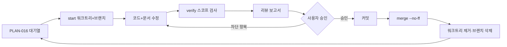

# PLAN-016: 항목 단위 작업 루프와 대기열

> 상태: 규약 확정, INV-02·INV-01 실행 대기 (2026-10-24)
> 역할: 항목 1건을 독립 워크트리에서 수정·검증·리뷰·병합하는 8단계 루프와 17건 대기열(그중 이번 배치 개선 항목 15건)의 단일 기준
> 상위 문서: [PLAN-015](PLAN-015-current-status-and-followups.md), [구현 로드맵](../implementation-roadmap.md)
> 검증 기준: [CI](../../.github/workflows/ci.yml), [운영](../operations.md), [AGENTS.md 3번 항목](../../AGENTS.md)
> 실행 도구: `scripts/item_flow.sh`

## 1. 목적과 적용 범위

`main`을 항상 검증 가능한 상태로 남기기 위해 한 번에 항목 1건만 다룹니다. 항목마다 워크트리와 브랜치를 분리하고, 병합 전에 같은 HEAD의 전체 검증 기록과 코드리뷰 보고를 남깁니다.

| 구분 | 내용 |
|---|---|
| 포함 | 워크트리·브랜치 생성, 영향 범위·전체 검증, 코드리뷰 보고, 승인·재계획, `--no-ff` 병합, 사후 정리 |
| 제외 | 원격 push·CI 트리거, REL-07 VPS 배포, REL-08 운영 릴리스, M7 AI 기능, `main` 이력 재작성 |
| 단위 | 항목 1건 = 워크트리 1개 = 브랜치 1개(`item/<slug>`) = `main` 병합 커밋 1개 |
| 기록 | 검증 원본 로그·상태 JSON은 저장소 밖, 사람이 읽는 요약만 이 문서 6번 항목에 기록 |

워크트리 경로는 메인 체크아웃 루트 기준 `../agolock-worktrees/<slug>`입니다. 상태·로그는 `../agolock-worktrees/.state/`에 두며 저장소에 커밋하지 않습니다.

### 1.1 부트스트랩 메모

이 문서와 `scripts/item_flow.sh`는 루프를 시작하기 위한 초기 설정이므로 `main`에 직접 반영합니다. INV-02부터는 예외 없이 2번 항목의 루프를 사용하며, 루프 도구가 없는 상태에서 항목을 먼저 시작하지 않습니다.

## 2. 루프 8단계

| 단계 | 실행 내용 | 산출물 |
|---|---|---|
| 1. 시작 | `main`이 clean인지 확인하고 `scripts/item_flow.sh start <slug>`를 실행합니다. 메인 체크아웃 루트에서 워크트리, 브랜치, 상태 파일을 만듭니다. | 워크트리 `../agolock-worktrees/<slug>`, 브랜치 `item/<slug>`, 상태 파일 `../agolock-worktrees/.state/<slug>.json`의 `base_sha` |
| 2. 수정 | 워크트리에서 코드를 고치고 `python3 scripts/docs_impact.py`로 영향 문서를 확인해 함께 갱신합니다. | 변경 diff, 갱신 문서, `docs_check.py` 통과 |
| 3. 검증 | 항목 영향 범위를 먼저 검사하고, 병합 전에 `verify --scope full`을 실행합니다. | 로그 `../agolock-worktrees/.state/logs/<slug>-<시각>-<pid>.log`, 상태 파일 `verifications[]`의 `scope`·`head`·`result`·`log`·`finished_at` |
| 4. 리뷰 | 5번 항목의 체크리스트로 코드리뷰를 수행하고 보고서를 터미널에 출력합니다. | 리뷰 보고서, 발견사항의 심각도·파일:줄·조치안 |
| 5. 승인 | 사용자 승인을 기다립니다. 차단 발견이 있으면 지적사항 기준으로 재계획하고 2단계로 돌아갑니다. | 승인 또는 재계획 판정 |
| 6. 커밋 | 지적사항 해소를 확인하고 항목 브랜치에 커밋합니다. HEAD가 바뀌면 전체 검증을 다시 실행합니다. | 항목 커밋과 현재 HEAD의 `pass` 검증 기록 |
| 7. 병합 | `main` 작업 디렉터리에서 `scripts/item_flow.sh merge`를 실행합니다. | `merge: <ID> <요약>` 병합 커밋, 워크트리 제거, `item/` 브랜치 삭제, 상태 `merged_sha` |
| 8. 다음 항목 | 갱신된 `main`에서 다음 대기열 항목의 워크트리를 만듭니다. | 새 워크트리·브랜치, 새 상태 파일 |



루프 규칙은 다음과 같습니다.

- `main` 이력은 항목당 병합 커밋 1개이며, 항목 브랜치의 커밋은 보존합니다. `main`에서 rebase·squash로 이력을 다시 쓰지 않습니다.
- 검증 없이 병합하는 경로를 두지 않습니다. 증거가 없거나 HEAD SHA가 다르면 병합하지 않습니다(fail-closed).
- 한 항목이 병합되기 전에 다음 항목의 워크트리를 만들지 않습니다. 8단계는 항상 갱신된 `main`에서 시작합니다.
- 항목 종료 시 `python3 scripts/docs_impact.py`로 영향 문서를 확인하고, 갱신 → `docs_check.py` 통과 → `docs/index.yaml`의 `last_verified_commit` 갱신까지 수행합니다.

## 3. 게이트와 실행 도구

### 3.1 CLI

```text
scripts/item_flow.sh start <slug> [--base main]
scripts/item_flow.sh verify [--scope docs|contract|backend|frontend|e2e|full]
scripts/item_flow.sh status [<slug>]
scripts/item_flow.sh merge [<slug>] [--keep] [--message "<text>"] [--partial "<이유>"]
```

| 명령 | 전제 | 동작과 거부 조건 |
|---|---|---|
| `start` | `main` 작업 디렉터리, `main` clean, 같은 slug의 워크트리·브랜치 없음 | 워크트리와 `item/<slug>` 브랜치를 만들고 상태 파일을 초기화합니다. dirty이거나 이미 있으면 exit 1이며 아무것도 바꾸지 않습니다. |
| `verify` | `item/` 브랜치 워크트리 안 | `--scope` 기본값은 `full`입니다. 스코프 명령을 순서대로 실행하고 각 종료 코드를 로그에 남기며, 전체 결과와 HEAD SHA를 상태 파일에 기록합니다. 결과는 `pass`, `fail`(코드·테스트 실패), `blocked`(환경 실패 보류) 중 하나입니다. |
| `status` | 없음 | 상태 파일을 읽어 브랜치·검증 결과·HEAD SHA·병합 SHA를 출력합니다. slug를 생략하면 전체 상태를 출력합니다. slug는 `start`와 같은 규칙으로 검증합니다. |
| `merge` | `main` 작업 디렉터리, 게이트 4종 통과 | `git merge --no-ff` 후 워크트리를 제거하고 `item/` 브랜치를 삭제합니다. 게이트는 ① 워크트리 clean ② 현재 HEAD의 `scope full` + `result pass` 기록 ③ `main` clean ④ 현재 `main` 이후 커밋 존재입니다. `--keep`은 정리만 생략하고, `--message "<text>"`는 병합 커밋 메시지를 대체하며, `--partial "<이유>"`는 환경상 `full`을 실행할 수 없을 때만 쓰는 예외입니다. slug를 생략하면 워크트리가 남아 있는 항목을 자동 선택합니다. |

### 3.2 상태 파일

`../agolock-worktrees/.state/<slug>.json`

```json
{
  "item": "inv-02-test-suite-green",
  "branch": "item/inv-02-test-suite-green",
  "worktree": "<절대 경로>/agolock-worktrees/inv-02-test-suite-green",
  "base": "main",
  "base_sha": "<40자 SHA>",
  "verifications": [
    {
      "scope": "full",
      "head": "<40자 SHA>",
      "result": "pass",
      "log": "<절대 경로>/agolock-worktrees/.state/logs/inv-02-20261024T101500-12345.log",
      "finished_at": "2026-10-24T10:15:00+09:00"
    },
    {
      "scope": "full",
      "head": "<40자 SHA>",
      "result": "blocked",
      "log": "<절대 경로>/agolock-worktrees/.state/logs/inv-02-20261024T103000-12360.log",
      "finished_at": "2026-10-24T10:30:00+09:00",
      "reason": "Docker를 사용할 수 없어 testcontainers 백엔드 테스트를 실행할 수 없습니다"
    }
  ],
  "merged_sha": null,
  "partial_reason": null,
  "partial_head": null,
  "cleanup_pending": null
}
```

`result`는 셋 중 하나입니다. `pass`는 모든 명령이 성공한 경우, `fail`은 코드·테스트·계약 검사가 실패한 경우, `blocked`는 도구 부재·의존성 미설치·포트 점유·컨테이너 미기동처럼 환경이 원인인 경우입니다. `blocked`에는 `reason`을 함께 남기며, 환경 문제를 코드 수정으로 덮지 않습니다.

`merge`는 ① 워크트리 clean ② 현재 HEAD에 대한 `scope: full` + `result: pass` 검증 기록 존재 ③ `main` clean ④ 현재 `main` 이후 커밋 존재를 모두 만족할 때만 병합합니다. 하나라도 어긋나면 병합하지 않고 이유를 출력합니다. `blocked`와 `fail`은 ②를 만족하지 않으며, 부분 스코프 `pass`만으로는 병합하지 않습니다.

`merge --partial "<이유>"`는 환경상 `full`을 실행할 수 없을 때만 쓰는 예외입니다. 이유가 비어 있으면 거부하고, 이유가 있으면 현재 HEAD의 `pass` 기록(scope 무관)을 요구하면서 경고를 출력하고 `partial_reason`·`partial_head`를 기록합니다. 이 예외를 쓴 항목은 사유를 6번 항목 기록에 그대로 옮기고, 사유가 해소되면 `full`을 다시 실행합니다.

`merged_sha`는 병합 커밋, `cleanup_pending`은 병합 뒤 워크트리·브랜치 정리가 끝나지 않은 경로입니다. `status`는 `cleanup_pending`이 있으면 `병합 <sha> (워크트리 정리 미완: <경로>)`로, `partial_reason`만 있으면 `병합 <sha> (부분 검증: <사유>)`로 표시합니다.

`clean` 판정은 추적 파일 기준입니다(`git status --porcelain --untracked-files=no`). 커밋하지 않은 untracked 파일은 경고만 남기고 진행합니다. 상태 파일은 사람이 읽는 `<slug>.json` 외에 구현용 `<slug>.meta`(기본 정보)와 `<slug>.verify.jsonl`(검증 기록 원본)을 함께 쓰며, 세 파일 모두 저장소 밖에서만 관리합니다. `worktree`와 `log` 값은 절대 경로로 기록합니다.

### 3.3 verify 스코프와 명령

| scope | 실행 명령 |
|---|---|
| `docs` | `python3 scripts/docs_check.py` |
| `backend` | `./gradlew :backend:ktlintCheck :backend:detekt :backend:test` |
| `frontend` | `pnpm install --frozen-lockfile`(워크트리에 `node_modules` 없을 때) → `pnpm generate:api` → `git diff --exit-code frontend/src/shared/api/schema.d.ts` → `pnpm lint` → `pnpm format:check` → `pnpm test` → `pnpm build` |
| `contract` | `./gradlew :backend:generateOpenApiPreview` → `python3 scripts/normalize_openapi.py` → `python3 scripts/export_events.py` → `python3 scripts/docs_check.py` |
| `e2e` | `pnpm install --frozen-lockfile`(워트리에 `node_modules` 없을 때) → `pnpm exec playwright install chromium`(브라우저 없을 때) → `pnpm test:e2e` |
| `full` | 위 5개 전부. 병합 전 필수(환경상 불가능하면 `merge --partial "<이유>"`) |

각 스코프는 명령 실행 전에 환경 사전 조건을 확인합니다. `pnpm`·`java`·`python3`·`./gradlew`가 없거나, `pnpm install`·Playwright 브라우저 설치가 실패하거나, `backend`에서 Docker를 사용할 수 없거나, `e2e`에서 `127.0.0.1:5173`이 점유되어 있으면 명령을 실행하지 않고 `result: blocked`로 기록한 뒤 `환경 실패(보류): <이유> — 코드 실패가 아닙니다`를 출력하고 exit 1합니다.

### 3.4 도구 경로와 사전 조건

- 스크립트는 `dirname "$(git rev-parse --path-format=absolute --git-common-dir)"`로 메인 체크아웃 루트를 찾아 그쪽 `scripts/env.sh`를 source합니다. `--git-common-dir`가 돌려주는 값은 공통 `.git` 디렉터리이므로 그대로 루트로 쓰지 않습니다. 워크트리에는 `.tools`, `.gradle-user`, `.python-packages`, `.playwright-browsers`가 없기 때문입니다.
- `GRADLE_USER_HOME`, `NPM_CONFIG_CACHE`, `PYTHONPATH`, `PLAYWRIGHT_BROWSERS_PATH`는 메인 체크아웃 기준으로 고정합니다. `node_modules`는 워크트리마다 설치합니다.
- 검증 전에 `python3 -c "import yaml"`이 성공하는지 확인합니다. 실패하면 검증을 시작하지 않습니다.
- `verify --scope e2e` 전에 `127.0.0.1:5173` 점유를 확인합니다. 점유되어 있으면 다른 서버를 재사용하지 않고 `blocked`(보류)로 기록하며 자동으로 종료하지 않습니다.
- 컨테이너·Mailpit·가입 설정처럼 환경이 원인인 실패는 코드 실패와 구분해 `blocked`(보류)로 기록합니다. 환경 문제를 코드 수정으로 덮지 않습니다.
- `scripts/item_flow.sh`는 `bash`와 `set -euo pipefail`만 사용하며 파이썬 패키지나 외부 유틸 의존을 새로 추가하지 않습니다.

## 4. 대기열

### 4.1 17건

대기열에는 17건이 등록되어 있습니다. 그중 이번 배치에서 다루는 개선 항목은 15건(INV-01~08, REL-01~06, REL-09)이며, REL-07과 REL-08은 개선이 아니라 VPS·도메인·시크릿 선행이 필요한 신규 작업이므로 대기열에 등록만 하고 이번 범위에서는 제외합니다.

표의 브랜치 슬러그는 `item/<slug>`의 `<slug>`입니다. 병합 SHA는 실제로 병합된 항목만 채웁니다.

| ID | 브랜치 슬러그 | 의존 항목 | 완료 조건 | 병합 SHA |
|---|---|---|---|---|
| INV-01 | `inv-01-live-inventory-e2e` | INV-02 | 최신 API·독립 DB·별도 포트에서 모킹 없이 소유/공유 MANAGE 등록·빈 설명·0원 편집·이동이 데스크톱과 모바일에서 통과 | — |
| INV-02 | `inv-02-test-suite-green` | — | 동일 커밋의 깨끗한 환경에서 전체 백엔드·계약·프론트·브라우저 검사를 단일 실행으로 통과하고 로그를 보존 | — |
| INV-03 | `inv-03-inventory-command-types` | INV-02 | HTTP의 생략/null 의미를 유지하면서 내부 명령을 유지/설정의 명시적 타입으로 바꾸고 기존 API·회귀 테스트 통과 | — |
| INV-04 | `inv-04-inventory-permission-types` | INV-02 | 승인 구현 스키마에 맞춰 Item 권한·공유 필드를 필수 타입으로 정리하고 누락 응답·권한 UI를 검증 | — |
| INV-05 | `inv-05-inventory-response-assembler` | INV-02 | 조회와 순수 응답 계산을 분리하고 단건·목록의 상속/null/빈 문자열/위치 의미가 같음을 검증 | — |
| INV-06 | `inv-06-query-cost-measurement` | INV-02 | 재고·위치·카테고리 증가에 따른 SQL 횟수·메모리·초기 화면 지연을 측정하고 필요한 곳만 개선 | — |
| INV-07 | `inv-07-v25-migration-rehearsal` | INV-02 | 기존 데이터 복사본에서 V25 충돌 ID 보고·무변경 중단·명시적 병합 후 재실행을 검증하고 자동 병합은 하지 않음 | — |
| INV-08 | `inv-08-frontend-bundle-split` | INV-02 | 실제 로딩을 측정해 화면별 코드 분할 필요 여부를 결정하고 경고 임계값 상향으로 해결하지 않음 | — |
| REL-01 | `rel-01-recent-search-retention` | INV-02 | 최근 검색 30일 보관·만료 조회·정리를 구현하고 경계 시각·사용자 격리를 검증 | — |
| REL-02 | `rel-02-search-suggestions` | REL-01 | 검색 제안에 최근 추가·최근 공유 목록을 연결하고 빈 기본값을 실제 데이터로 대체 | — |
| REL-03 | `rel-03-shared-owner-name` | INV-02 | 계층·공유 응답의 ownerName과 내/공유 표시 규칙을 결정하고 `/shared` 계약·화면·테스트를 정합 | — |
| REL-04 | `rel-04-contract-generation` | INV-04 | 기록 모드 전환, 0채널 이벤트 exporter 보완, 전체 schema·계약의 코드 정합성과 호환성 검사 마감 | — |
| REL-05 | `rel-05-image-pipeline-e2e` | INV-02 | 실제 저장소·MQ로 실패·만료·재시도·중단 복구·중복 전달과 대표 이미지·접근권한 E2E를 통과 | — |
| REL-06 | `rel-06-ui-accessibility-devices` | INV-01, REL-03 | 403/404/409/offline·이미지 상태를 시각 확인하고 실기기 스크린리더·모바일 키보드·다크 상태를 검증 | — |
| REL-07 | `rel-07-vps-staging` | INV-02, REL-04 | VPS + Compose로 서버 접속·도메인·TLS·시크릿·서비스를 설정하고 remote/CI 연결과 서버 배포 단계를 완료 | — |
| REL-08 | `rel-08-operations-release` | INV-07, REL-07 | 실제 등록·검색·이미지·공유 smoke, 복구·롤백 리허설, 모니터링·알림·부하·보안·PWA·파일럿/프리즈/태그를 완료 | — |
| REL-09 | `rel-09-main-integration` | INV-01~08 | INV-01의 실제 API 미검증 상태를 해소한 뒤 `main` 통합을 검토하고 원격 push/CI·릴리스 절차를 별도로 실행 | — |

### 4.2 이번 배치 순서

이번 배치는 **INV-02 → INV-01** 순서로 실행합니다. PLAN-015의 권장 순서(INV-01 → INV-02)를 뒤집는 이유는 병합 게이트가 현재 HEAD의 전체 검증 `pass`를 요구하기 때문입니다. 백엔드 전체 실행이 175개 중 169개 통과로 red인 상태에서는 어떤 항목도 병합할 수 없으므로, 먼저 INV-02로 게이트를 green으로 만든 뒤 INV-01을 진행합니다.

## 5. 리뷰와 승인

### 5.1 체크리스트

| 점검 항목 | 확인 내용 |
|---|---|
| 계약·불변식 | [AGENTS.md 4번 항목](../../AGENTS.md)의 불변식과 [아키텍처](../architecture.md)의 시스템 경계를 위반하지 않는가 |
| 테넌트 경계 | 모든 조회·조인·쓰기가 `space_id`로 제한되고 다른 Space의 리소스 ID를 받지 않는가 |
| 권한 누적 | `VIEW < EDIT < MANAGE` 최대 권한 적용과 소유자 전용 변경 규칙이 유지되는가 |
| PATCH 버전 규칙 | JSON Merge Patch의 생략/null/빈 값 구분과 버전 있는 리소스의 `version` 필수 검증이 지켜지는가 |
| HTTP 의미 | 생략·null·빈 문자열·0원·빈 목록의 의미가 계약과 구현에서 같은가 |
| 마이그레이션 안전성 | 적용된 마이그레이션을 수정하지 않았고, 신규 마이그레이션이 중단·재실행에 안전한가 |
| 에러 처리 | 실패 시 부분 저장·잠금 누수·잘못된 상태 전이가 없는가 |
| 문서 정합성 | 영향 문서가 갱신됐고 `docs_check.py`가 통과하며 계약·화면 서술이 실제와 같은가 |

### 5.2 보고서 형식

리뷰 보고서는 아래 순서로 작성해 터미널에 출력하고 6번 항목의 해당 항목 기록에 그대로 저장합니다.

1. 항목 목표와 범위
2. 변경 요약: `git diff --stat main...HEAD`
3. 검증 표: scope, 실행 명령, 결과, 로그 경로, HEAD SHA
4. 영향 문서: `docs_impact.py` 결과와 실제 갱신한 문서
5. 체크리스트 결과: 5.1번 표 기준
6. 발견사항: 심각도, 파일:줄, 내용, 조치안
7. 승인 요청: 차단 0건이면 "병합 가능", 있으면 "재계획 필요"

```text
### <ID> <제목> 리뷰 보고서
- 항목 목표:
- 변경 요약: <git diff --stat main...HEAD>
- 검증: | scope | 명령 | 결과 | 로그 | HEAD SHA |
- 영향 문서:
- 체크리스트: <5.1번 표 항목별 통과/해당 없음/위반>
- 발견사항: | 심각도 | 파일:줄 | 내용 | 조치안 |
- 승인 요청: 병합 가능 | 재계획 필요
```

심각도는 다음 셋으로만 분류합니다.

| 심각도 | 기준 | 처리 |
|---|---|---|
| 차단 | 불변식·테넌트·권한·계약 위반, 재현되는 결함, 검증 증거와 HEAD SHA 불일치 | 승인 불가. 재계획 후 수정·재검증·재보고 |
| 권장 | 지금 병합해도 되지만 같은 범위에서 고치는 편이 좋은 품질·일관성 문제 | 사용자가 요청하면 이번 항목에서 수정, 아니면 대기열에 기록 |
| 참고 | 후속 항목으로 넘길 관찰이나 범위 밖 개선 아이디어 | PLAN-015 또는 대기열에 남김 |

### 5.3 승인과 재계획 흐름

- 보고서에 차단이 0건이면 사용자에게 "병합 가능"으로 승인을 요청합니다.
- 차단이 있으면 사용자 승인을 받지 않고, 지적사항을 기준으로 원인·수정 범위·검증 계획을 다시 세운 뒤 2단계로 돌아갑니다.
- 승인 후에도 수정으로 HEAD가 바뀌면 `verify --scope full`을 다시 실행하고 보고서의 검증 표와 SHA를 갱신합니다.
- 승인 결과와 재계획 내역은 6번 항목의 해당 항목 기록에 남깁니다.
- 항목 상태는 `대기 → 진행 → 리뷰 → 승인 → 병합` 순서로만 갱신합니다. 검증 실패나 미해결 차단이 남아 있으면 `병합`으로 표시하지 않습니다.

## 6. 항목 기록

항목별 기록은 실행할 때 채웁니다. 아래 표는 필드 정의이며, `실행 시`·`기록`으로 표시한 값은 항목을 실행하며 실제 값으로 바꿉니다. 채워지지 않은 항목을 완료로 해석하지 않습니다.

### 6.1 INV-02 전체 검증 단일 실행 green

| 필드 | 기록 내용 |
|---|---|
| 상태 | 대기. 실행 시 `진행`·`리뷰`·`승인`·`병합`으로 갱신 |
| 브랜치·워크트리 | `item/inv-02-test-suite-green`, `../agolock-worktrees/inv-02-test-suite-green` |
| 기준 SHA | 항목 시작 시 `main` HEAD |
| 변경 요약 | 실행 시 `git diff --stat main...HEAD` 결과 |
| 검증 | scope·명령·결과·로그 경로·HEAD SHA를 실행 시 기록. 병합 전 `full` 필수이며, 환경상 불가하면 `--partial` 사유를 함께 기록 |
| 영향 문서 | `docs_impact.py` 결과와 실제 갱신 문서 |
| 리뷰 | 심각도별 발견사항과 파일:줄, 조치안 |
| 승인 | 승인 판정과 일시, 재계획 내역 |
| 병합 SHA | `main` 병합 후 기록 |

### 6.2 INV-01 실제 API 브라우저 편집 화면 타임아웃

| 필드 | 기록 내용 |
|---|---|
| 상태 | 대기. 실행 시 `진행`·`리뷰`·`승인`·`병합`으로 갱신 |
| 브랜치·워크트리 | `item/inv-01-live-inventory-e2e`, `../agolock-worktrees/inv-01-live-inventory-e2e` |
| 기준 SHA | 항목 시작 시 `main` HEAD |
| 변경 요약 | 실행 시 `git diff --stat main...HEAD` 결과 |
| 실행 조건 | API 포트·독립 DB·Mailpit·가입 설정·`VITE_API_TARGET`·5173 서버 상태 |
| 검증 | scope·명령·결과·로그 경로·HEAD SHA와 `desktop-chromium`·`mobile-chromium` trace 경로 |
| 영향 문서 | `docs_impact.py` 결과와 실제 갱신 문서 |
| 리뷰 | 심각도별 발견사항과 파일:줄, 조치안 |
| 승인 | 승인 판정과 일시, 재계획 내역 |
| 병합 SHA | `main` 병합 후 기록 |

## 7. 롤백과 충돌

### 7.1 병합 후 `main` 검증 실패

일반 병합은 7단계에서 워크트리와 `item/` 브랜치를 함께 제거하므로, 사후 수정은 남겨 둔 작업 공간을 쓰거나 병합 SHA에서 다시 만듭니다.

1. `main` 작업 디렉터리에서 `verify --scope full` 실패를 확인하고 로그 경로를 보존합니다.
2. 롤백 위험을 미리 알고 있었다면 병합할 때 `scripts/item_flow.sh merge --keep`을 실행해 워크트리와 `item/` 브랜치를 남깁니다. 남아 있으면 3번 항목을 건너뜁니다.
3. 작업 공간이 이미 제거됐다면 병합 SHA에서 항목 워크트리와 브랜치를 다시 만듭니다.

   ```bash
   git worktree add ../agolock-worktrees/<slug> -b item/<slug> <merge-sha>
   ```

4. 해당 워크트리에서 원인을 수정하고 `verify --scope full` 재검증과 리뷰 보고를 다시 수행한 뒤 `merge`로 다시 병합합니다.
5. 빠르게 수정할 수 없으면 `main` 작업 디렉터리에서 병합 커밋을 되돌려 마지막으로 검증된 상태로 돌립니다.

   ```bash
   git revert -m 1 <merge-sha>
   ```

6. 되돌린 뒤 `main`이 clean인지, `docs/index.yaml`의 `last_verified_commit`과 문서 서술이 되돌린 상태와 맞는지 확인하고 `python3 scripts/docs_check.py`를 실행합니다.
7. 되돌린 병합 SHA와 사유를 이 문서의 항목 기록에 남깁니다.

### 7.2 병합 충돌

1. `git merge --abort`로 병합을 중단합니다.
2. 항목 워크트리에서 최신 `main`을 반영하고 충돌을 해결합니다.
3. `verify --scope full`을 다시 실행하고 리뷰 보고서의 검증 표를 갱신합니다.
4. 다시 `merge`를 실행합니다. `main` 이력은 재작성하지 않습니다.

## 8. 기존 문서와의 관계

| 문서 | 관계 |
|---|---|
| [PLAN-015](PLAN-015-current-status-and-followups.md) | 남은 항목의 정의와 완료 조건의 원본. 이 문서는 실행 순서·게이트·기록만 정의 |
| [PLAN-014](PLAN-014-inventory-hardening.md) | 물건·재고 개선의 반영 결과와 검증 근거 |
| [AGENTS.md](../../AGENTS.md) | 문서 갱신 절차와 불변식. 항목 작업은 이 문서의 루프를 따름 |
| [CI](../../.github/workflows/ci.yml) | `verify` 명령의 기준. CI와 같은 명령을 로컬에서 실행 |
| [운영](../operations.md) | 테스트·배포·릴리스 단계의 상위 기준 |

완료한 항목만 4.1번 표의 병합 SHA를 채우고, 남은 항목의 우선순위나 완료 조건이 바뀌면 PLAN-015를 먼저 갱신한 뒤 이 문서의 대기열을 맞춥니다.
