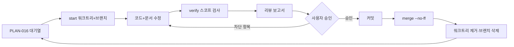

# PLAN-016: 항목 단위 작업 루프와 대기열

> 상태: 규약 확정, 이번 배치 INV-02(`09121d0`)·INV-01(`298a2cb`) 병합 완료, 다음 항목 INV-03 대기 (2026-10-24)
> 역할: 항목 1건을 독립 워크트리에서 수정·검증·리뷰·병합하는 8단계 루프와 17건 대기열(그중 이번 배치 개선 항목 15건)의 단일 기준
> 상위 문서: [PLAN-015](PLAN-015-current-status-and-followups.md), [구현 로드맵](../implementation-roadmap.md)
> 검증 기준: [CI](../../.github/workflows/ci.yml), [운영](../operations.md), [AGENTS.md 3번 항목](../../AGENTS.md)
> 실행 도구: `scripts/item_flow.sh`

## 1. 목적과 적용 범위

`main`을 항상 검증 가능한 상태로 남기기 위해 한 번에 항목 1건만 다룹니다. 항목마다 워크트리와 브랜치를 분리하고, 병합 전에 같은 HEAD의 전체 검증 기록과 코드리뷰 보고를 남깁니다.

| 구분 | 내용 |
|---|---|
| 포함 | 워크트리·브랜치 생성, 영향 범위·전체 검증, 코드리뷰 보고, 승인·재계획, `--no-ff` 병합, 사후 정리 |
| 제외 | 원격 push·CI 트리거, REL-07 VPS 배포, REL-08 운영 릴리스, M7 AI 기능, `main` 이력 재작성 |
| 단위 | 항목 1건 = 워크트리 1개 = 브랜치 1개(`item/<slug>`) = `main` 병합 커밋 1개 |
| 기록 | 검증 원본 로그·상태 JSON은 저장소 밖, 사람이 읽는 요약만 이 문서 6번 항목에 기록 |

워크트리 경로는 메인 체크아웃 루트 기준 `../agolock-worktrees/<slug>`입니다. 상태·로그는 `../agolock-worktrees/.state/`에 두며 저장소에 커밋하지 않습니다.

### 1.1 부트스트랩 메모

이 문서와 `scripts/item_flow.sh`는 루프를 시작하기 위한 초기 설정이므로 `main`에 직접 반영합니다. INV-02부터는 예외 없이 2번 항목의 루프를 사용하며, 루프 도구가 없는 상태에서 항목을 먼저 시작하지 않습니다.

## 2. 루프 8단계

| 단계 | 실행 내용 | 산출물 |
|---|---|---|
| 1. 시작 | `main`이 clean인지 확인하고 `scripts/item_flow.sh start <slug>`를 실행합니다. 메인 체크아웃 루트에서 워크트리, 브랜치, 상태 파일을 만듭니다. | 워크트리 `../agolock-worktrees/<slug>`, 브랜치 `item/<slug>`, 상태 파일 `../agolock-worktrees/.state/<slug>.json`의 `base_sha` |
| 2. 수정 | 워크트리에서 코드를 고치고 `python3 scripts/docs_impact.py`로 영향 문서를 확인해 함께 갱신합니다. | 변경 diff, 갱신 문서, `docs_check.py` 통과 |
| 3. 검증 | 항목 영향 범위를 먼저 검사하고, 병합 전에 `verify --scope full`을 실행합니다. | 로그 `../agolock-worktrees/.state/logs/<slug>-<시각>-<pid>.log`, 상태 파일 `verifications[]`의 `scope`·`head`·`result`·`log`·`finished_at` |
| 4. 리뷰 | 5번 항목의 체크리스트로 코드리뷰를 수행하고 보고서를 터미널에 출력합니다. | 리뷰 보고서, 발견사항의 심각도·파일:줄·조치안 |
| 5. 승인 | 사용자 승인을 기다립니다. 차단 발견이 있으면 지적사항 기준으로 재계획하고 2단계로 돌아갑니다. | 승인 또는 재계획 판정 |
| 6. 커밋 | 지적사항 해소를 확인하고 항목 브랜치에 커밋합니다. HEAD가 바뀌면 전체 검증을 다시 실행합니다. | 항목 커밋과 현재 HEAD의 `pass` 검증 기록 |
| 7. 병합 | `main` 작업 디렉터리에서 `scripts/item_flow.sh merge`를 실행합니다. | `merge: <ID> <요약>` 병합 커밋, 워크트리 제거, `item/` 브랜치 삭제, 상태 `merged_sha` |
| 8. 다음 항목 | 갱신된 `main`에서 다음 대기열 항목의 워크트리를 만듭니다. | 새 워크트리·브랜치, 새 상태 파일 |



루프 규칙은 다음과 같습니다.

- `main` 이력은 항목당 병합 커밋 1개이며, 항목 브랜치의 커밋은 보존합니다. `main`에서 rebase·squash로 이력을 다시 쓰지 않습니다.
- 검증 없이 병합하는 경로를 두지 않습니다. 증거가 없거나 HEAD SHA가 다르면 병합하지 않습니다(fail-closed).
- 한 항목이 병합되기 전에 다음 항목의 워크트리를 만들지 않습니다. 8단계는 항상 갱신된 `main`에서 시작합니다.
- 항목 종료 시 `python3 scripts/docs_impact.py`로 영향 문서를 확인하고, 갱신 → `docs_check.py` 통과 → `docs/index.yaml`의 `last_verified_commit` 갱신까지 수행합니다.

## 3. 게이트와 실행 도구

### 3.1 CLI

```text
scripts/item_flow.sh start <slug> [--base main]
scripts/item_flow.sh verify [--scope docs|contract|backend|frontend|e2e|full]
scripts/item_flow.sh status [<slug>]
scripts/item_flow.sh merge [<slug>] [--keep] [--message "<text>"] [--partial "<이유>"]
```

| 명령 | 전제 | 동작과 거부 조건 |
|---|---|---|
| `start` | `main` 작업 디렉터리, `main` clean, 같은 slug의 워크트리·브랜치 없음 | 워크트리와 `item/<slug>` 브랜치를 만들고 상태 파일을 초기화합니다. dirty이거나 이미 있으면 exit 1이며 아무것도 바꾸지 않습니다. |
| `verify` | `item/` 브랜치 워크트리 안 | `--scope` 기본값은 `full`입니다. 스코프 명령을 순서대로 실행하고 각 종료 코드를 로그에 남기며, 전체 결과와 HEAD SHA를 상태 파일에 기록합니다. 결과는 `pass`, `fail`(코드·테스트 실패), `blocked`(환경 실패 보류) 중 하나입니다. |
| `status` | 없음 | 상태 파일을 읽어 브랜치·검증 결과·HEAD SHA·병합 SHA를 출력합니다. slug를 생략하면 전체 상태를 출력합니다. slug는 `start`와 같은 규칙으로 검증합니다. |
| `merge` | `main` 작업 디렉터리, 게이트 4종 통과 | `git merge --no-ff` 후 워크트리를 제거하고 `item/` 브랜치를 삭제합니다. 게이트는 ① 워크트리 clean ② 현재 HEAD의 `scope full` + `result pass` 기록 ③ `main` clean ④ 현재 `main` 이후 커밋 존재입니다. `--keep`은 정리만 생략하고, `--message "<text>"`는 병합 커밋 메시지를 대체하며, `--partial "<이유>"`는 환경상 `full`을 실행할 수 없을 때만 쓰는 예외입니다. slug를 생략하면 워크트리가 남아 있는 항목을 자동 선택합니다. |

### 3.2 상태 파일

`../agolock-worktrees/.state/<slug>.json`

```json
{
  "item": "inv-02-test-suite-green",
  "branch": "item/inv-02-test-suite-green",
  "worktree": "<절대 경로>/agolock-worktrees/inv-02-test-suite-green",
  "base": "main",
  "base_sha": "<40자 SHA>",
  "verifications": [
    {
      "scope": "full",
      "head": "<40자 SHA>",
      "result": "pass",
      "log": "<절대 경로>/agolock-worktrees/.state/logs/inv-02-20261024T101500-12345.log",
      "finished_at": "2026-10-24T10:15:00+09:00"
    },
    {
      "scope": "full",
      "head": "<40자 SHA>",
      "result": "blocked",
      "log": "<절대 경로>/agolock-worktrees/.state/logs/inv-02-20261024T103000-12360.log",
      "finished_at": "2026-10-24T10:30:00+09:00",
      "reason": "Docker를 사용할 수 없어 testcontainers 백엔드 테스트를 실행할 수 없습니다"
    }
  ],
  "merged_sha": null,
  "partial_reason": null,
  "partial_head": null,
  "cleanup_pending": null
}
```

`result`는 셋 중 하나입니다. `pass`는 모든 명령이 성공한 경우, `fail`은 코드·테스트·계약 검사가 실패한 경우입니다. `blocked`는 3.3번 항목의 사전 조건 목록에 스크립트가 걸렸을 때만 기록하며 `reason`을 함께 남깁니다. 그 밖의 환경 문제(컨테이너가 기동한 뒤 실패, Mailpit·가입 설정 문제 등)는 스크립트가 구분하지 못하므로 `fail`로 기록되며, 코드 실패인지 환경 문제인지는 로그를 근거로 판단합니다. 어느 경우든 환경 문제를 코드 수정으로 덮지 않습니다.

`merge`는 ① 워크트리 clean ② 현재 HEAD에 대한 `scope: full` + `result: pass` 검증 기록 존재 ③ `main` clean ④ 현재 `main` 이후 커밋 존재를 모두 만족할 때만 병합합니다. 하나라도 어긋나면 병합하지 않고 이유를 출력합니다. `blocked`와 `fail`은 ②를 만족하지 않으며, 부분 스코프 `pass`만으로는 병합하지 않습니다.

`merge --partial "<이유>"`는 환경상 `full`을 실행할 수 없을 때만 쓰는 예외입니다. 이유가 비어 있으면 거부하고, 이유가 있으면 현재 HEAD의 `pass` 기록(scope 무관)을 요구하면서 경고를 출력하고 `partial_reason`·`partial_head`를 기록합니다. 이 예외를 쓴 항목은 사유를 6번 항목 기록에 그대로 옮기고, 사유가 해소되면 `full`을 다시 실행합니다.

`merged_sha`는 병합 커밋, `cleanup_pending`은 병합 뒤 워크트리·브랜치 정리가 끝나지 않은 경로입니다. `status`는 `cleanup_pending`이 있으면 `병합 <sha> (워크트리 정리 미완: <경로>)`로, `partial_reason`만 있으면 `병합 <sha> (부분 검증: <사유>)`로 표시합니다. `--partial`이 아닌 병합은 `--keep`을 쓰더라도 병합 직후 이전 `partial_reason`·`partial_head`를 지웁니다. `cleanup_pending`은 워크트리·브랜치 정리에 성공한 경우에만 지우므로, `--keep` 병합 뒤에는 실제로 정리될 때까지 남습니다.

`clean` 판정은 추적 파일 기준입니다(`git status --porcelain --untracked-files=no`). 커밋하지 않은 untracked 파일은 경고만 남기고 진행합니다. 상태 파일은 사람이 읽는 `<slug>.json` 외에 구현용 `<slug>.meta`(기본 정보)와 `<slug>.verify.jsonl`(검증 기록 원본)을 함께 쓰며, 세 파일 모두 저장소 밖에서만 관리합니다. `worktree`와 `log` 값은 절대 경로로 기록합니다.

### 3.3 verify 스코프와 명령

| scope | 실행 명령 |
|---|---|
| `docs` | `python3 scripts/docs_check.py` |
| `backend` | `./gradlew :backend:ktlintCheck :backend:detekt :backend:cleanTest :backend:test`(`:backend:cleanTest`가 이전 테스트 결과를 지워 `:backend:test`가 `UP-TO-DATE`로 건너뛰지 않게 함) |
| `frontend` | `pnpm install --frozen-lockfile`(워크트리에 `node_modules` 없을 때) → `pnpm generate:api` → `git diff --exit-code frontend/src/shared/api/schema.d.ts` → `pnpm lint` → `pnpm format:check` → `pnpm test` → `pnpm build` |
| `contract` | `./gradlew :backend:generateOpenApiPreview` → `python3 scripts/normalize_openapi.py` → `python3 scripts/export_events.py` → `python3 scripts/docs_check.py` |
| `e2e` | `pnpm install --frozen-lockfile`(워트리에 `node_modules` 없을 때) → `pnpm --filter @agolock/frontend exec playwright install chromium`(브라우저 없을 때, `playwright`는 `frontend` 패키지 의존이므로 루트 `pnpm exec`로는 실행되지 않음) → `pnpm test:e2e` |
| `full` | 위 5개 전부. 병합 전 필수(환경상 불가능하면 `merge --partial "<이유>"`) |

각 스코프는 명령 실행 전에 환경 사전 조건을 확인합니다. `pnpm`·`java`·`python3`·`./gradlew`가 없거나 `python3`의 `yaml` 모듈을 불러올 수 없거나, `pnpm install`·Playwright 브라우저 설치가 실패하거나, `backend`에서 Docker를 사용할 수 없거나, `e2e`에서 `127.0.0.1:5173`이 점유되어 있으면 명령을 실행하지 않고 `result: blocked`로 기록한 뒤 `환경 실패(보류): <이유> — 코드 실패가 아닙니다`를 출력하고 exit 1합니다. 아래 목록이 `blocked`로 기록하는 사전 조건의 단일 기준이며, 목록에 없는 실패는 코드·테스트 실패와 같은 `fail`로 기록되므로 로그를 근거로 판단합니다.

### 3.4 도구 경로와 사전 조건

- 스크립트는 `dirname "$(git rev-parse --path-format=absolute --git-common-dir)"`로 메인 체크아웃 루트를 찾아 그쪽 `scripts/env.sh`를 source합니다. `--git-common-dir`가 돌려주는 값은 공통 `.git` 디렉터리이므로 그대로 루트로 쓰지 않습니다. 워크트리에는 `.tools`, `.gradle-user`, `.python-packages`, `.playwright-browsers`가 없기 때문입니다.
- `GRADLE_USER_HOME`, `NPM_CONFIG_CACHE`, `PYTHONPATH`, `PLAYWRIGHT_BROWSERS_PATH`는 메인 체크아웃 기준으로 고정합니다. `node_modules`는 워크트리마다 설치합니다.
- 검증 전에 `python3 -c "import yaml"`이 성공하는지 확인합니다. 실패하면 `blocked`(보류)로 기록하고 검증을 시작하지 않습니다.
- `verify --scope e2e` 전에 `127.0.0.1:5173` 점유를 확인합니다. 점유되어 있으면 다른 서버를 재사용하지 않고 `blocked`(보류)로 기록하며 자동으로 종료하지 않습니다. 점유 확인은 `ss -ltn`을 우선 쓰고, `ss`가 없으면 2초 제한 연결로 수행해 확인 자체가 멈추지 않게 하며 `5173 포트 확인: <결과> (<경과>)`를 출력합니다.
- 스크립트가 확인하는 사전 조건(3.3번 목록)만 `blocked`(보류)입니다. 컨테이너가 기동한 뒤 실패하거나 Mailpit·가입 설정이 문제인 경우처럼 목록 밖의 환경 문제는 `fail`로 기록되므로 로그를 근거로 판단합니다. 환경 문제를 코드 수정으로 덮지 않습니다.
- `scripts/item_flow.sh`는 `bash`와 `set -euo pipefail`만 사용하며 파이썬 패키지나 외부 유틸 의존을 새로 추가하지 않습니다.

## 4. 대기열

### 4.1 17건

대기열에는 17건이 등록되어 있습니다. 그중 이번 배치에서 다루는 개선 항목은 15건(INV-01~08, REL-01~06, REL-09)이며, REL-07과 REL-08은 개선이 아니라 VPS·도메인·시크릿 선행이 필요한 신규 작업이므로 대기열에 등록만 하고 이번 범위에서는 제외합니다.

표의 브랜치 슬러그는 `item/<slug>`의 `<slug>`입니다. 병합 SHA는 실제로 병합된 항목만 채웁니다.

| ID | 브랜치 슬러그 | 의존 항목 | 완료 조건 | 병합 SHA |
|---|---|---|---|---|
| INV-01 | `inv-01-live-inventory-e2e` | INV-02 | 최신 API·독립 DB·별도 포트에서 모킹 없이 소유/공유 MANAGE 등록·빈 설명·0원 편집·이동이 데스크톱과 모바일에서 통과 | `298a2cb` |
| INV-02 | `inv-02-test-suite-green` | — | 동일 커밋의 깨끗한 환경에서 전체 백엔드·계약·프론트·브라우저 검사를 단일 실행으로 통과하고 로그를 보존 | `09121d0` |
| INV-03 | `inv-03-inventory-command-types` | INV-02 | HTTP의 생략/null 의미를 유지하면서 내부 명령을 유지/설정의 명시적 타입으로 바꾸고 기존 API·회귀 테스트 통과 | — |
| INV-04 | `inv-04-inventory-permission-types` | INV-02 | 승인 구현 스키마에 맞춰 Item 권한·공유 필드를 필수 타입으로 정리하고 누락 응답·권한 UI를 검증 | — |
| INV-05 | `inv-05-inventory-response-assembler` | INV-02 | 조회와 순수 응답 계산을 분리하고 단건·목록의 상속/null/빈 문자열/위치 의미가 같음을 검증 | — |
| INV-06 | `inv-06-query-cost-measurement` | INV-02 | 재고·위치·카테고리 증가에 따른 SQL 횟수·메모리·초기 화면 지연을 측정하고 필요한 곳만 개선 | — |
| INV-07 | `inv-07-v25-migration-rehearsal` | INV-02 | 기존 데이터 복사본에서 V25 충돌 ID 보고·무변경 중단·명시적 병합 후 재실행을 검증하고 자동 병합은 하지 않음 | — |
| INV-08 | `inv-08-frontend-bundle-split` | INV-02 | 실제 로딩을 측정해 화면별 코드 분할 필요 여부를 결정하고 경고 임계값 상향으로 해결하지 않음 | — |
| REL-01 | `rel-01-recent-search-retention` | INV-02 | 최근 검색 30일 보관·만료 조회·정리를 구현하고 경계 시각·사용자 격리를 검증 | — |
| REL-02 | `rel-02-search-suggestions` | REL-01 | 검색 제안에 최근 추가·최근 공유 목록을 연결하고 빈 기본값을 실제 데이터로 대체 | — |
| REL-03 | `rel-03-shared-owner-name` | INV-02 | 계층·공유 응답의 ownerName과 내/공유 표시 규칙을 결정하고 `/shared` 계약·화면·테스트를 정합 | — |
| REL-04 | `rel-04-contract-generation` | INV-04 | 기록 모드 전환, 0채널 이벤트 exporter 보완, 전체 schema·계약의 코드 정합성과 호환성 검사 마감 | — |
| REL-05 | `rel-05-image-pipeline-e2e` | INV-02 | 실제 저장소·MQ로 실패·만료·재시도·중단 복구·중복 전달과 대표 이미지·접근권한 E2E를 통과 | — |
| REL-06 | `rel-06-ui-accessibility-devices` | INV-01, REL-03 | 403/404/409/offline·이미지 상태를 시각 확인하고 실기기 스크린리더·모바일 키보드·다크 상태를 검증 | — |
| REL-07 | `rel-07-vps-staging` | INV-02, REL-04 | VPS + Compose로 서버 접속·도메인·TLS·시크릿·서비스를 설정하고 remote/CI 연결과 서버 배포 단계를 완료 | — |
| REL-08 | `rel-08-operations-release` | INV-07, REL-07 | 실제 등록·검색·이미지·공유 smoke, 복구·롤백 리허설, 모니터링·알림·부하·보안·PWA·파일럿/프리즈/태그를 완료 | — |
| REL-09 | `rel-09-main-integration` | INV-01~08 | INV-01의 실제 API 미검증 상태를 해소한 뒤 `main` 통합을 검토하고 원격 push/CI·릴리스 절차를 별도로 실행 | — |

### 4.2 이번 배치 순서

이번 배치는 **INV-02 → INV-01** 순서로 실행합니다. PLAN-015의 권장 순서(INV-01 → INV-02)를 뒤집는 이유는 병합 게이트가 현재 HEAD의 전체 검증 `pass`를 요구하기 때문입니다. 백엔드 전체 실행이 175개 중 169개 통과로 red였던 상태에서는 어떤 항목도 병합할 수 없으므로, 먼저 INV-02로 게이트를 green으로 만든 뒤 INV-01을 진행합니다.

두 항목 모두 병합했습니다: INV-02 `09121d0`(부모 `2e1a55b`·`74104e8`), INV-01 `298a2cb`(부모 `09121d0`·`8144073`). 기록은 6.1·6.2번 항목입니다.

### 4.3 후속 항목

INV-02·INV-01을 실행하며 남긴 개선 후보입니다. 4.1번 표에 새 ID를 만들지 않고, 다음에 대기열을 편성할 때 승격 여부를 정합니다.

| 후속 후보 | 발견 경위 | 완료 조건 |
|---|---|---|
| `item_flow.sh verify`가 더러운 작업 트리를 구분하지 않음 | 항목 HEAD에 커밋하지 않은 수정이 있는 상태로 검증하면 `verifications[].head`가 직전 커밋 SHA로 기록되어, 실제로 실행한 내용과 다른 커밋에 `pass`가 붙습니다. INV-01의 실제 API 실행은 이 상태로 수행했습니다(수정 내용은 이후 `d160837`으로 커밋) | `git status --porcelain`이 비어 있지 않으면 검증을 거부하거나 `dirty: true`를 상태 파일에 남기고, `merge`는 `dirty` 기록이 있는 `pass`를 인정하지 않음 |
| `main`에서 검증할 수 있는 경로 부재 | `verify`는 `item/` 브랜치 워크트리에서만 동작하므로 병합 뒤 `main` 전체 검증은 명령을 손으로 조합해야 합니다(이번 배치 마감이 그 예) | `verify --main`(또는 `verify-main`) 경로를 추가해 `main` 작업 디렉터리에서도 같은 스코프 명령·상태 기록을 사용 |
| `DirtyLeave` 이동 진행 동작의 단위 테스트 부재 | INV-02에서 `dirty-leave.tsx`에 `blocker.proceed()` 효과를 넣었지만, 이를 직접 검증하는 테스트는 저장 흐름 테스트(`inventory-edit-page.test.tsx`)의 통과로만 간접 확인됩니다 | 이탈 차단과 `dirty` 해제 뒤 이동 진행을 각각 단언하는 단위 테스트 추가 |
| Hikari `initialization-fail-timeout` 경화 미실시 | INV-02는 fail-fast 기동 창을 6에서 1로 줄이는 것으로 마무리했고, `initialization-fail-timeout` 값은 바꾸지 않았습니다 | 운영·테스트 프로필의 커넥션 풀 기동 실패 기준을 정하고, 근거를 `docs/operations.md`에 남김 |
| `docs/index.yaml`의 `FRONTEND` `code_paths`가 `frontend/e2e/**`를 매핑하지 않음 | `docs_impact.py`가 `frontend/e2e/inventory-live.spec.ts`를 `PLAN_001_FOUNDATION`(`frontend/**`)으로만 매핑해 실제 관련 문서가 나오지 않았습니다 | 이번 배치 마감에서 `frontend/e2e/**`를 추가했고, 같은 파일이 `FRONTEND`·`PLAN_001_FOUNDATION` 두 문서로 매핑되는 것을 확인했습니다 |
| 저장 핸들러가 `await invalidateInventory()` 뒤에 `navigate()`를 호출 | INV-02 6.1.6번 항목의 ② 원인입니다. 재조회가 느리면 저장 뒤 화면 전환이 그만큼 늦어집니다 | 이동을 먼저 하고 재조회를 백그라운드로 돌리는 구조로 바꾸고, 늦은 재조회에서 입력이 덮이지 않는지 검증 |
| 실제 API 실행의 trace·로그가 임시 경로 | `frontend/test-results/`는 gitignore 대상이고 `/tmp` 로그는 세션과 함께 사라집니다 | 실행 뒤 trace·로그를 `../agolock-worktrees/.state/artifacts/<slug>/`로 복사하는 단계를 3번 항목에 추가 |

## 5. 리뷰와 승인

### 5.1 체크리스트

| 점검 항목 | 확인 내용 |
|---|---|
| 계약·불변식 | [AGENTS.md 4번 항목](../../AGENTS.md)의 불변식과 [아키텍처](../architecture.md)의 시스템 경계를 위반하지 않는가 |
| 테넌트 경계 | 모든 조회·조인·쓰기가 `space_id`로 제한되고 다른 Space의 리소스 ID를 받지 않는가 |
| 권한 누적 | `VIEW < EDIT < MANAGE` 최대 권한 적용과 소유자 전용 변경 규칙이 유지되는가 |
| PATCH 버전 규칙 | JSON Merge Patch의 생략/null/빈 값 구분과 버전 있는 리소스의 `version` 필수 검증이 지켜지는가 |
| HTTP 의미 | 생략·null·빈 문자열·0원·빈 목록의 의미가 계약과 구현에서 같은가 |
| 마이그레이션 안전성 | 적용된 마이그레이션을 수정하지 않았고, 신규 마이그레이션이 중단·재실행에 안전한가 |
| 에러 처리 | 실패 시 부분 저장·잠금 누수·잘못된 상태 전이가 없는가 |
| 문서 정합성 | 영향 문서가 갱신됐고 `docs_check.py`가 통과하며 계약·화면 서술이 실제와 같은가 |

### 5.2 보고서 형식

리뷰 보고서는 아래 순서로 작성해 터미널에 출력하고 6번 항목의 해당 항목 기록에 그대로 저장합니다.

1. 항목 목표와 범위
2. 변경 요약: `git diff --stat main...HEAD`
3. 검증 표: scope, 실행 명령, 결과, 로그 경로, HEAD SHA
4. 영향 문서: `docs_impact.py` 결과와 실제 갱신한 문서
5. 체크리스트 결과: 5.1번 표 기준
6. 발견사항: 심각도, 파일:줄, 내용, 조치안
7. 승인 요청: 차단 0건이면 "병합 가능", 있으면 "재계획 필요"

```text
### <ID> <제목> 리뷰 보고서
- 항목 목표:
- 변경 요약: <git diff --stat main...HEAD>
- 검증: | scope | 명령 | 결과 | 로그 | HEAD SHA |
- 영향 문서:
- 체크리스트: <5.1번 표 항목별 통과/해당 없음/위반>
- 발견사항: | 심각도 | 파일:줄 | 내용 | 조치안 |
- 승인 요청: 병합 가능 | 재계획 필요
```

심각도는 다음 셋으로만 분류합니다.

| 심각도 | 기준 | 처리 |
|---|---|---|
| 차단 | 불변식·테넌트·권한·계약 위반, 재현되는 결함, 검증 증거와 HEAD SHA 불일치 | 승인 불가. 재계획 후 수정·재검증·재보고 |
| 권장 | 지금 병합해도 되지만 같은 범위에서 고치는 편이 좋은 품질·일관성 문제 | 사용자가 요청하면 이번 항목에서 수정, 아니면 대기열에 기록 |
| 참고 | 후속 항목으로 넘길 관찰이나 범위 밖 개선 아이디어 | PLAN-015 또는 대기열에 남김 |

### 5.3 승인과 재계획 흐름

- 보고서에 차단이 0건이면 사용자에게 "병합 가능"으로 승인을 요청합니다.
- 차단이 있으면 사용자 승인을 받지 않고, 지적사항을 기준으로 원인·수정 범위·검증 계획을 다시 세운 뒤 2단계로 돌아갑니다.
- 승인 후에도 수정으로 HEAD가 바뀌면 `verify --scope full`을 다시 실행하고 보고서의 검증 표와 SHA를 갱신합니다.
- 승인 결과와 재계획 내역은 6번 항목의 해당 항목 기록에 남깁니다.
- 항목 상태는 `대기 → 진행 → 리뷰 → 승인 → 병합` 순서로만 갱신합니다. 검증 실패나 미해결 차단이 남아 있으면 `병합`으로 표시하지 않습니다.

## 6. 항목 기록

항목별 기록은 실행할 때 채웁니다. 아래 표는 필드 정의이며, `실행 시`·`기록`으로 표시한 값은 항목을 실행하며 실제 값으로 바꿉니다. 채워지지 않은 항목을 완료로 해석하지 않습니다.

### 6.1 INV-02 전체 검증 단일 실행 green

| 필드 | 기록 내용 |
|---|---|
| 상태 | 병합 (2026-10-24). 워크트리 `../agolock-worktrees/inv-02-test-suite-green`와 `item/` 브랜치를 제거했습니다 |
| 브랜치·워크트리 | `item/inv-02-test-suite-green`, `../agolock-worktrees/inv-02-test-suite-green` |
| 기준 SHA | `2e1a55b1240dcda004252ab2e9299ac3124cae93`(`main`) |
| 실행 환경 | `source scripts/env.sh`(메인 체크아웃 기준), JDK 21 `temurin-21.0.12+101.0.LTS`, Gradle 8.14.3, Docker 29.7.2 |
| 변경 요약 | `git diff --stat main...HEAD` 9개 파일(+222/−24). ① 테스트 인프라 `backend/src/test/kotlin/com/agolock/support/TestcontainersConfiguration.kt`(+87/−5) ② 루프 도구 `scripts/item_flow.sh`(+10/−4, `:backend:cleanTest`·워크스페이스 Playwright 설치) ③ 문서 3개(이 문서, [PLAN-015](PLAN-015-current-status-and-followups.md), `docs/operations.md`) ④ 프론트 수정 4개(6.1.6): `frontend/e2e/registration.spec.ts`·`frontend/e2e/inventory-images.spec.ts`·`frontend/src/features/inventory/inventory-edit-page.test.tsx`·`frontend/src/features/inventory/dirty-leave.tsx`. `backend/src/main/kotlin`, `backend/build.gradle.kts`, `application-test.yml`은 바꾸지 않았습니다 |
| 검증 | 6.1.3. HEAD `75cbaac`에서 5개 스코프가 모두 `pass`이고, 항목 HEAD `74104e8`에서 `full` pass(4분 0초)를 확인했습니다. 병합 게이트 조건(`full` pass)을 충족했습니다 |
| 영향 문서 | `docs/operations.md` 6.5(테스트 컨테이너 수명)·6.4(검증 명령), 이 문서 6.1, [PLAN-015](PLAN-015-current-status-and-followups.md) 2·3번 항목. 제품 동작·계약·스키마 변경이 없어 `docs/frontend.md`·`docs/architecture.md`·`docs/contracts.md`·`docs/generated/*`는 갱신하지 않았습니다 |
| 리뷰 | 6.1.7번 항목의 리뷰 보고서. 차단 0건·권장 3건·참고 4건입니다 |
| 승인 | 승인 (2026-10-24). 차단 0건 판정을 받았고, 권장 3건은 이번 배치 마감에서 반영했습니다 |
| 병합 SHA | `09121d0baf385bea7cb40096344e275261a9ed63`(`--no-ff`, 부모 `2e1a55b`·`74104e8`) |

#### 6.1.1 진단과 원인

17개 `@SpringBootTest` 클래스는 클래스 속성·프로필 조합에 따라 application context 6개를 만듭니다. 변경 전 `TestcontainersConfiguration`은 컨테이너를 `@Bean @ServiceConnection`으로 선언했으므로 context마다 Postgres·RabbitMQ 한 쌍이 새로 기동했습니다. `docker events --filter type=container --filter event=create` 측정값은 run당 14개(pgvector 6, RabbitMQ 6, MinIO 1, Ryuk 1)였고 생성 시각은 +1초에서 +77초까지 흩어졌습니다.

169/175 서명의 원인은 다음 조합으로 설명됩니다. `backend/src/main/resources/application.yml`의 `hikari.connection-timeout: 3000`과 Hikari `initializationFailTimeout` 기본값 1ms 때문에 context 기동 중 한 번의 연결 거부만으로 커넥션 풀 생성이 즉시 실패합니다. Spring TestContext는 로드에 실패한 context를 캐시하지 않으므로, 그 context를 만들던 클래스의 테스트가 모두 실패하고 같은 키를 쓰는 다음 클래스는 새 컨테이너로 context를 다시 만들어 통과합니다. 그래서 일시적 거부 한 번이 "한 클래스 6건만 실패"로 나타납니다.

| 후보 | 판정 | 근거 |
|---|---|---|
| (a) 컨테이너 수명·context별 재사용 | 원인 | 컨테이너가 context 스코프 빈이라 context마다 기동합니다. 정적 싱글턴·`withReuse` 없음. 생성 14개/run 실측 |
| (b) 테스트 포크·병렬 실행 | 배제 | `tasks.test`에 `useJUnitPlatform { excludeTags(...) }`만 있고 `maxParallelForks`·`forkEvery`·`junit-platform.properties`·`@Execution`이 없습니다(단일 fork·순차) |
| (c) 포트·자원 고갈 | 배제 | 모든 컨테이너가 랜덤 포트, `port is already allocated` 0건, OOM 0건, 새 컨테이너 포트 accept 11ms·DB ready 1.1초 |
| (d) `application-test.yml` 부재 | 배제 | 파일은 `backend/src/main/resources/application-test.yml`에 있습니다. 테스트 리소스에 프로필 파일이 없는 것이 정상이며, 설정 자체는 175/175 실행으로 정상 동작을 확인했습니다 |

트리거는 아직 확정하지 못했습니다. 기준 `main`에서도 전체 실행 3회가 모두 175/175로 통과해 일시적 거부를 재현하지 못했습니다. 이 머신에는 docker 데몬·WSL 재시작으로 컨테이너가 유실된 전례(`digital-board-mysql-1`이 `Exited (255)`)가 있습니다. 그래서 이 항목의 값은 재현되는 결함의 수정이 아니라 **구조적 위험 감소**(fail-fast 기동 창 6 → 1, 전체 실행 148초 → 41~54초)와 같은 커밋의 단일 실행 green 증거입니다.

#### 6.1.2 변경 내용

- `object SharedTestcontainers`가 테스트 JVM마다 pgvector(`pgvector/pgvector:0.8.7-pg16`) 1개와 RabbitMQ(`rabbitmq:3.13.7-management`) 1개를 `init`에서 한 번만 기동하고, 모든 context가 같은 인스턴스를 받습니다.
- 컨테이너를 빈으로 등록하지 않고 `JdbcConnectionDetails`·`RabbitConnectionDetails` 빈으로 연결 정보만 노출합니다. 두 타입은 `Startable`이 아니므로 `TestcontainersLifecycleBeanPostProcessor`가 context 종료 시 컨테이너를 닫지 않습니다. 컨테이너를 `@ServiceConnection` 빈으로 유지하면 첫 context 정리에서 공유 컨테이너가 종료되어 종료 시점에 `Unexpected error occurred in scheduled task` ERROR가 남고(중간 형태에서 3~84줄), `@DirtiesContext`가 실행 중 컨테이너를 죽이는 경로가 열립니다.
- context마다 빈 데이터베이스 `test_<uuid>`를 하나 만들어 스키마를 분리합니다. 한 스키마를 공유하면 `@EnableScheduling`이 켜진 모든 context의 `OutboxRelayService`(5초 주기)가 테넌트 구분 없이 `PENDING` 행을 가져가고 `NotificationRequestedHandler`가 가져간 context의 `FakeMailPort`로 메일을 보내, 초대 메일을 기다리는 다른 context의 테스트가 실패할 수 있습니다. 만든 데이터베이스는 명시적으로 삭제하지 않으며 컨테이너와 함께 사라집니다.
- `withReuse(true)`는 쓰지 않습니다. JVM 사이에 상태가 남아 격리가 깨질 수 있으므로 JVM 안 싱글턴만 사용합니다.
- KDoc에 실제 수명(테스트 JVM당 1회 기동, Spring `Startable` 미관여, Ryuk이 프로세스 종료 뒤 정리)을 적었습니다.

#### 6.1.3 검증

| scope | 명령 | 결과 | 로그 | HEAD SHA |
|---|---|---|---|---|
| `docs` | `python3 scripts/docs_check.py` | pass, 51개 인덱스 문서·53개 Markdown | `.state/logs/inv-02-test-suite-green-20261024T200500-321567.log` | `d853143` |
| `backend` | `./gradlew :backend:cleanTest` 뒤 `./gradlew :backend:ktlintCheck :backend:detekt :backend:test` | pass, 46클래스·175테스트·실패 0·오류 0·스킵 0, 46초 | `.state/logs/inv-02-test-suite-green-20261024T200523-322984.log` | `d853143` |
| `contract` | `./gradlew :backend:generateOpenApiPreview` → `python3 scripts/normalize_openapi.py` → `python3 scripts/export_events.py` → `python3 scripts/docs_check.py` | pass, OpenAPI 60 path·이벤트 0채널(기존 생성기 한계), 19초 | `.state/logs/inv-02-test-suite-green-20261024T200620-325639.log` | `d853143` |
| `docs` | `python3 scripts/docs_check.py` | pass, 51개 인덱스 문서·53개 Markdown, 0.7초 | `.state/logs/inv-02-test-suite-green-20261024T201113-336024.log` | `b2677da` |
| `backend` | `./gradlew :backend:ktlintCheck :backend:detekt :backend:cleanTest :backend:test` | pass, 46클래스·175테스트·실패 0·오류 0·스킵 0, 51초(`:backend:cleanTest` 실행으로 실제 테스트 실행 확인) | `.state/logs/inv-02-test-suite-green-20261024T201116-336243.log` | `b2677da` |
| `frontend` | `pnpm install --frozen-lockfile` → `pnpm generate:api` → `git diff --exit-code frontend/src/shared/api/schema.d.ts` → `pnpm lint` → `pnpm format:check` → `pnpm test` | fail: 앞 단계는 모두 통과, `pnpm test`에서 50개 중 1개 실패(`inventory-edit-page.test.tsx` "재고값을 직접 입력해 오버라이드를 저장한다"), 29초 | `.state/logs/inv-02-test-suite-green-20261024T201214-338518.log` | `b2677da` |
| `e2e` | `pnpm --filter @agolock/frontend exec playwright install chromium` → `pnpm test:e2e` | fail: 28개 통과·2개 스킵·4개 실패(`registration.spec.ts:117` "등록했어요." 미표시, `inventory-images.spec.ts:141` "준비됨" 미표시가 데스크톱·모바일 각각), 2분 48초 | `.state/logs/inv-02-test-suite-green-20261024T201246-340277.log` | `b2677da` |
| `full` | 위 5개 순서 | fail: `docs`·`backend` 통과 뒤 `frontend`의 `pnpm test`에서 중단되어 `contract`·`e2e`는 실행하지 않음, 1분 22초 | `.state/logs/inv-02-test-suite-green-20261024T201541-346619.log` | `b2677da` |
| `frontend` | `pnpm install --frozen-lockfile` → `pnpm generate:api` → `git diff --exit-code frontend/src/shared/api/schema.d.ts` → `pnpm lint` → `pnpm format:check` → `pnpm test` → `pnpm build` | pass, 17개 파일·50개 테스트 전부 통과, 34초 | `.state/logs/inv-02-test-suite-green-20261024T203825-390242.log` | `75cbaac` |
| `e2e` | `pnpm --filter @agolock/frontend exec playwright install chromium` → `pnpm test:e2e` | pass, 32개 통과·2개 스킵·0개 실패(수정 전 28/2/4), 2분 25초 | `.state/logs/inv-02-test-suite-green-20261024T203902-392309.log` | `75cbaac` |
| `full` | `docs` → `backend` → `frontend` → `contract` → `e2e` 순서로 위 5개 스코프 전부 | pass, 3분 51초. 병합 게이트 조건 충족 | `.state/logs/inv-02-test-suite-green-20261024T204130-397156.log` | `75cbaac` |
| `full` | `scripts/item_flow.sh verify --scope full`(위 5개 스코프를 순서대로 실행) | pass, 4분 0초. 문서 커밋 뒤 항목 HEAD에서 다시 실행해 병합 게이트 기록을 확정 | `.state/logs/inv-02-test-suite-green-20261024T204625-407989.log` | `74104e8` |

`b2677da`의 `frontend`·`e2e`·`full` 실패는 6.1.6번 항목의 원인 세 건으로 설명되며, 수정한 `75cbaac`에서 세 스코프 모두 `pass`로 바뀌었습니다. `0d07206`에서도 같은 수정 코드로 `frontend`·`e2e`가 `pass`였고(커밋 전 상태), 커밋 뒤 `75cbaac`에서 다시 실행해 기록을 갱신했습니다. 수정 뒤 테스트 수는 늘거나 줄지 않았습니다(`frontend` 17파일·50테스트 유지, `e2e` 32+2 유지).

로그 경로는 `../agolock-worktrees/.state/logs/` 아래이며 상태 파일 `inv-02-test-suite-green.json`의 `verifications[]`에 같은 값이 기록됩니다. `backend` 로그의 `grep -c ERROR`는 0이고 `HierarchyIntegrationTest`는 6건 모두 통과했습니다(1.271초). 커밋 전 같은 코드로 `./gradlew :backend:cleanTest :backend:test`를 두 번 연속 실행해 46클래스·175테스트·실패 0을 확인했고 로그는 `/tmp/inv02-fix-run1.log`·`/tmp/inv02-fix-run2.log`에 남겼습니다(세션 임시 경로). `./gradlew :backend:ktlintCheck :backend:detekt --rerun-tasks`도 통과했습니다.

이 환경에서 `compileKotlin`·`compileTestKotlin`이 Kotlin 데몬 RMI 연결로 수 분 멈추는 경우가 있어 컴파일이 필요하면 `-Pkotlin.compiler.execution.strategy=in-process`를 붙입니다. 테스트 동작은 바뀌지 않고 컴파일 위치만 달라집니다.

`verify --scope backend`는 Gradle 증분 판정을 그대로 따르므로, 직전 실행의 테스트 결과가 살아 있으면 `:backend:test`가 `UP-TO-DATE`로 끝나 테스트를 다시 실행하지 않고도 `pass`를 기록했습니다. 이 구멍은 `scripts/item_flow.sh`가 `:backend:cleanTest`를 함께 실행하도록 고쳐 닫았으므로(3.3번 표), 이후 기록은 항상 실제 테스트 실행을 근거로 남깁니다. 위 표의 `backend` 행은 수정 전 스크립트로 실행한 이력이라 `cleanTest`를 별도 명령으로 적었습니다.

#### 6.1.4 컨테이너 회계

| 구분 | pgvector | RabbitMQ | MinIO | Ryuk | 합계 |
|---|---|---|---|---|---|
| 변경 전 | 6 | 6 | 1 | 1 | 14 |
| 변경 후 | 1 | 1 | 1 | 1 | 4 |

컨테이너는 마지막 테스트가 끝난 뒤 JVM 종료와 함께 내려가고 Ryuk이 20~35초 뒤 정리합니다. 실행 직후가 아니라 35초 뒤 `docker ps -a`로 확인해야 남은 컨테이너가 없음을 확정할 수 있습니다. 회귀 감지는 `docker events --since <시작 epoch> --until <종료 epoch> --filter type=container --filter event=create --format '{{.Actor.Attributes.image}}' | sort | uniq -c`로 하며 합계가 4를 넘으면 공유가 깨진 것입니다.

#### 6.1.5 리뷰에서 확인할 위험

| 구분 | 내용 | 조치 |
|---|---|---|
| 참고 | 단일 실패 지점: JVM당 한 쌍이므로 실행 중 컨테이너가 유실되면 여러 클래스가 함께 실패합니다. 대신 fail-fast 기동 창은 6에서 1로 줄었습니다 | 컨테이너 유실이 다시 관측되면 원인을 docker 환경에서 찾고 테스트 설정으로 덮지 않습니다 |
| 참고 | 커넥션 여유: context 6개 × `maximum-pool-size: 10`이면 약 60커넥션이 Postgres 기본 `max_connections` 100에 걸립니다. 지금은 여유가 있지만 context 조합이 7~8개로 늘면 확인해야 합니다 | context를 늘리는 변경은 이 수치를 함께 확인합니다 |
| 참고 | `test_<uuid>` 데이터베이스는 지우지 않습니다. 컨테이너가 사라지면 함께 사라져 실행 간 상태가 남지 않고, 정리 코드를 넣으면 살아 있는 context와 경쟁할 수 있습니다 | 삭제 로직을 추가하지 않습니다 |
| 권장 | 로그 판정 기준: 공유 컨테이너를 빈으로 두던 중간 형태는 종료 시 ERROR를 남겼고 지금은 0줄입니다. 이후 테스트 로그는 `BUILD SUCCESSFUL`과 `backend/build/test-results/test/TEST-*.xml` 카운트로 판정합니다 | `docs/operations.md` 6.5에 같은 기준을 적었습니다 |
| 권장 | `verify --scope backend`는 Gradle 증분 판정을 그대로 따르므로 `:backend:test`가 `UP-TO-DATE`이면 테스트를 다시 실행하지 않고도 `pass`를 기록했습니다. 이 구멍은 닫았습니다: 스크립트가 `./gradlew :backend:ktlintCheck :backend:detekt :backend:cleanTest :backend:test`를 실행하고 테스트를 다시 실행한다는 줄을 출력합니다 | 3.3번 표와 `docs/operations.md` 6.4·6.5에 반영 |

#### 6.1.6 `frontend`·`e2e` 실패의 원인과 수정

`b2677da`의 `frontend`·`e2e`·`full` 실패는 `main`에 있던 세 건이며, 모두 테스트 하네스 또는 저장 뒤 화면 전환 경쟁이 원인이었습니다. 제품 계약·화면 동작·API는 바꾸지 않았고, 단언 완화·`skip`·시간 초과 상향은 쓰지 않았습니다.

| 실패 | 확정 원인 | 수정 |
|---|---|---|
| 단위 테스트 `inventory-edit-page.test.tsx` › "재고값을 직접 입력해 오버라이드를 저장한다" (`role="heading"`·`name="내 드릴"` 미발견) | 두 겹입니다. ① 그 테스트만 `inventoryApi.inventory`·`updateInventory`를 스텁하고 `item`·`categories`는 스텁하지 않아, 저장 뒤 `await invalidateInventory(queryClient)`가 `['item','detail','i1']`·`['category','list','i1']`을 실제 클라이언트로 다시 조회했고 jsdom에서 실패해 `retry: 1`(재시도 간격 1000ms)만큼 늦어졌습니다. ② 스텁을 채우자 드러난 제품 측 경쟁: `inventory-edit-page.tsx:126-136`은 `setSaved(true)` 직후 `await invalidateInventory()` 뒤 `navigate()`를 호출하는데, 저장 콜백은 React 이벤트 핸들러 밖이라 `saved` 커밋이 네트워크 왕복보다 늦습니다. 그래서 `DirtyLeave`의 `useBlocker`가 이전 렌더의 `dirty && !saved` 값을 그대로 보고 "입력을 취소할까요?" 다이얼로그를 띄워 이동을 막았습니다(프로브로 확인: `t=327ms`에 다이얼로그, `h1` 변화 없음) | 테스트: 실패한 테스트에 `item`·`categories` 스텁 추가(단언 유지). 제품: `dirty-leave.tsx:6-8`에 `dirty`가 false가 되면 대기 중인 이동을 `blocker.proceed()`로 진행하는 효과 추가. `docs/frontend.md:283`의 "저장하지 않은 변경이 있으면 화면 이탈을 확인합니다"와 일치시키는 수정이며, 같은 경쟁이 있던 `item-edit-page.tsx`도 함께 고쳐집니다 |
| mock e2e `registration.spec.ts:117` "등록했어요." 미표시 | 스펙이 `**/api/v1/auth/csrf`를 라우팅하지 않아 `apiFetch`(`src/shared/api/client.ts:132`)의 `refreshCsrf()` GET이 Vite 프록시(`localhost:8080`)로 나가 영원히 대기했습니다. 그래서 `POST /inventories`가 전송되지 않고 시트가 `등록 중…` 비활성 상태로 멈췄습니다(Playwright `error-context.md` 아리아 스냅숏으로 확인) | `smoke.spec.ts:41-48`과 같은 CSRF 라우팅(`set-cookie: XSRF-TOKEN=e2e-csrf; Path=/`)을 스펙에 추가 |
| mock e2e `inventory-images.spec.ts:141` "준비됨" 미표시 | 같은 원인입니다. presign·complete가 변경 요청이라 CSRF GET에서 멈춰 READY 이미지가 생기지 않았습니다 | 같은 CSRF 라우팅 추가 |

`e2e` 전체는 34건 중 28건 통과·2건 스킵·4건 실패에서 수정 뒤 **32건 통과·2건 스킵·0건 실패**가 됐고, `frontend`는 17개 파일·50개 테스트가 모두 통과합니다. 실패를 덮는 방식(`skip`, 단언 완화, `--partial`, 시간 초과 상향)은 쓰지 않았습니다.

이 수정은 같은 항목에서 처리했습니다. 근거는 INV-02의 완료 조건이 "백엔드·계약·프론트·브라우저 검사가 같은 커밋에서 한 번에 통과"이고, 병합 게이트가 `full`의 `pass`를 요구하기 때문입니다. 원래 3.3번 표와 계획의 파일 목록은 테스트 인프라만 예상했지만, 완료 조건이 우선합니다.

남은 후속(이번 항목에서 고치지 않음): 저장 핸들러가 `await invalidateInventory()` 뒤에 화면을 바꾸는 구조 자체는 그대로이므로, 관련 재조회가 느리면 저장 뒤 화면 전환이 그만큼 늦어집니다. 이동을 먼저 하고 재조회를 백그라운드로 돌리는 개선은 별도 항목으로 다룹니다.

#### 6.1.7 리뷰 보고서

5.2번 형식으로 남긴 항목 리뷰 결과입니다. 판정은 **차단 0건, 병합 가능**입니다.

| 항목 | 내용 |
|---|---|
| 항목 목표 | 동일 커밋의 깨끗한 환경에서 전체 백엔드·계약·프론트·브라우저 검사를 단일 실행으로 통과하고 로그를 보존 |
| 변경 요약 | 9개 파일 +222/−24(6.1번 표의 변경 요약과 같음). 제품 코드·마이그레이션·계약 파일은 포함되지 않고 테스트 인프라·테스트 하네스·테스트 스펙·문서만 바뀌었습니다 |
| 검증 | 6.1.3번 표. 5개 스코프 `pass`, 항목 HEAD `74104e8`의 `full` pass(4분 0초) |
| 영향 문서 | `docs/operations.md` 6.4·6.5, 이 문서 6.1, [PLAN-015](PLAN-015-current-status-and-followups.md) 2·3번 항목 |
| 체크리스트 | 계약·불변식: 변경 없음(테스트·문서만) / 테넌트 경계: 해당 없음 / 권한 누적: 해당 없음 / PATCH 버전 규칙: 해당 없음 / HTTP 의미: 해당 없음 / 마이그레이션 안전성: 해당 없음(마이그레이션 미변경) / 에러 처리: 공유 컨테이너 종료 시 ERROR 0줄 / 문서 정합성: `docs_check.py` 통과 |

| 심각도 | 파일:줄 | 내용 | 조치안 | 처리 |
|---|---|---|---|---|
| 권장 | 이 문서 6.1.3 | 항목 HEAD `74104e8`의 `full` pass 행이 빠져 있어 병합 게이트 기록이 표에 보이지 않았습니다 | 표에 `74104e8` 행 추가 | 이번 배치 마감에서 반영 |
| 권장 | `README.md:252` | "현재 상태"가 175개 중 169개 통과와 "단일 실행 증거 없음"을 그대로 서술해 현재 상태와 어긋났습니다 | 실제 기록(175/175 단일 실행, 두 번 연속 green)으로 교체 | 이번 배치 마감에서 반영 |
| 권장 | [PLAN-015](PLAN-015-current-status-and-followups.md) 2번 항목 | "원인을 확정해"라는 표현이 트리거까지 재현해 확정한 것처럼 읽혔습니다 | "구조 원인은 확정, 트리거는 미확정"으로 맞춤 | 이번 배치 마감에서 반영 |
| 참고 | 6.1.5번 표 | 컨테이너 유실·커넥션 여유·`test_<uuid>` 미삭제가 남은 위험입니다 | 컨테이너 유실이 재관측되면 docker 환경에서 원인을 찾음 | 6.1.5에 유지 |
| 참고 | `backend/src/main/resources/application.yml` | Hikari `initialization-fail-timeout` 상향은 하지 않고 fail-fast 기동 창을 6에서 1로 줄이는 방식으로 대응했습니다 | 설정 경화는 별도 항목으로 검토 | 4.3번 후속 항목 |
| 참고 | `frontend/src/features/inventory/dirty-leave.tsx` | `blocker.proceed()` 효과를 직접 검증하는 단위 테스트가 없습니다 | 이탈 차단·진행을 단위 테스트로 고정 | 4.3번 후속 항목 |
| 참고 | `frontend/src/features/inventory/inventory-edit-page.tsx` | 저장 뒤 `await invalidateInventory()`가 끝나야 화면이 바뀌는 구조가 남아 있습니다 | 이동을 먼저 하는 구조로 개선 | 4.3번 후속 항목 |

- 승인 요청: 차단 0건으로 **병합 가능**. 승인 뒤 `merge`로 `09121d0`을 만들었습니다.

### 6.2 INV-01 실제 API 브라우저 편집 화면 타임아웃

| 필드 | 기록 내용 |
|---|---|
| 상태 | 병합 (2026-10-24). 워크트리 `../agolock-worktrees/inv-01-live-inventory-e2e`와 `item/` 브랜치를 제거했습니다 |
| 브랜치·워크트리 | `item/inv-01-live-inventory-e2e`, `../agolock-worktrees/inv-01-live-inventory-e2e` |
| 기준 SHA | `09121d0baf385bea7cb40096344e275261a9ed63`(`main`, INV-02 병합 커밋) |
| 변경 요약 | 코드 1개 파일 `frontend/e2e/inventory-live.spec.ts`(+7/−2) + 문서 2개 파일(`docs/frontend.md` 신규 11번 항목, 이 문서 6.2), 합계 3개 파일 +121/−11. 제품 코드와 `frontend/playwright.config.ts`·`frontend/vite.config.ts`, 테스트 단계·단언, `test.setTimeout(120000)`은 바꾸지 않았습니다 |
| 실행 조건 | 6.2.2번 항목 |
| 검증 | 6.2.4번 항목. 실제 API 실행이 데스크톱·모바일 각 2회 모두 `pass`이고, 항목 HEAD `8144073`에서 `verify --scope full`이 pass(680초)입니다. 병합 게이트 조건을 충족했습니다 |
| 영향 문서 | 6.2.5번 항목 |
| 리뷰 | 6.2.7번 항목의 리뷰 보고서. 차단 0건·참고 5건이고, 리뷰어가 HEAD `8144073`에서 실제 API 시나리오를 독립 재실행해 2건 통과(18.3초)를 확인했습니다 |
| 승인 | 승인 (2026-10-24). 차단 0건 판정을 받았고, 이번 항목에서 재계획은 필요하지 않았습니다 |
| 병합 SHA | `298a2cb14154daccb6aeac43c781cfb11d039d26`(`--no-ff`, 부모 `09121d0`·`8144073`) |

#### 6.2.1 진단과 원인

수정 전 기준 실행(로그 `/tmp/inv01-baseline.log`, 560초 캡)은 `desktop-chromium`과 `mobile-chromium`이 모두 `frontend/e2e/inventory-live.spec.ts:66`의 `page.getByRole('checkbox', { name: /설명/ }).check()`에서 `Test timeout of 120000ms exceeded`로 끝났습니다(2건 실패, 약 4분 30초). 페이지는 정상 렌더됐고 `GET /api/v1/inventories/{id}`, `GET /api/v1/categories?itemId=…`, `POST /api/v1/inventories`가 모두 200/201이었습니다.

원인은 제품이 아니라 **테스트 로케이터**입니다. `frontend/src/shared/ui/choice.tsx:12-25`의 `Choice`는 `<label>` 안에 `<input type="checkbox" class="peer sr-only">`와 `<span aria-hidden="true" class="… size-[22px]">`를 두고, 1px로 클립된 입력 위를 22px 장식 `span`이 덮습니다. 이 사각 박스는 [디자인 시스템 3번 항목 R-15](../design-system.md)가 요구하는 규격입니다. Playwright의 `check()`는 입력 자체를 클릭하므로 `<span …> intercepts pointer events`로 229회 재시도한 뒤 테스트 시간 초과가 됩니다. 그 결과 `설명`·`가격` 오버라이드가 켜지지 않아 이어지는 `getByLabel('재고 설명')`·`getByLabel('재고 가격')`이 `disabled` 상태에서 대기했습니다. 실사용자는 `label`을 누르므로 제품 동작은 정상이고, 제품 코드는 고치지 않았습니다.

| 후보 | 판정 | 근거 |
|---|---|---|
| 체크박스 `check()`가 `sr-only` 입력을 클릭하려다 장식 `span`에 가로막힘 | 원인 | `choice.tsx:12-25`의 `sr-only` + 22px `span`, `design-system.md:65` R-15, Playwright call log 229회 재시도 |
| 페이지 미렌더·라우팅 실패 | 배제 | `error-context.md` 아리아 스냅숏에 `재고 편집` h1, 체크박스 4개, 설명·가격 필드가 모두 존재 |
| 아이템 상세·카테고리 API 오류, 세션·CSRF 실패 | 배제 | 상세 200, 카테고리 200, `POST /inventories` 201, `PATCH /inventories/{id}` 200 |
| 시드 데이터(방·선반·박스 체인) 부재 | 배제 | 스펙이 세 위치를 200/201로 만들고 `selectOption`이 성공한 뒤 66행에서 멈춤 |
| 빈 설명·0원 케이스의 클라이언트 검증 차단 | 배제 | `inventory-edit-page.tsx:86-91`은 `descriptionOn`/`priceOn`일 때 빈 문자열·0을 그대로 전송하고, 검증은 이름·가격 문자열만 봅니다 |
| `DirtyLeave`/`useBlocker`가 이동을 막음(INV-02 변경 영향) | 배제 | 저장 클릭 뒤 125ms 만에 URL이 바뀌었고 이동 차단 다이얼로그 0건 |
| 5173 서버가 다른 API를 봄 | 배제 | 5173 프로세스의 `/proc/<pid>/cwd`가 이 워크트리이고 `VITE_API_TARGET=http://127.0.0.1:8087`이며 프록시 `GET /api/v1/auth/csrf`가 200 |
| Mailpit·공유 플로우 문제 | 배제 | 초대 메일 3.9초 수신, 수락, 공유 `MANAGE` 재고 추가·이동까지 통과 |

#### 6.2.2 실행 조건

실제 API 시나리오는 `INVENTORY_LIVE=1`일 때만 실행되고 라우트를 가로채지 않습니다. 아래 순서로 준비합니다.

1. 인프라: `docker compose -f infra/docker-compose.yml up -d`로 `postgres`(pgvector, 5432)·`rabbitmq`(5672·15672)·`minio`(9000·9001)·`mailpit`(1025·8025)를 올립니다.
2. 독립 DB: 같은 Postgres 컨테이너에 `agolock_live` 데이터베이스를 만들고 `agolock` 데이터베이스는 쓰지 않습니다. API가 기동하며 Flyway 이력을 적용합니다.
3. API(포트 8087, 워크트리 산출물): `./gradlew :backend:bootJar`(JDK 21, `source scripts/env.sh`, 컴파일이 멈추면 `-Pkotlin.compiler.execution.strategy=in-process`) 뒤 아래 환경으로 `java -jar backend/build/libs/backend-0.1.0.jar`를 실행합니다. 기동 로그의 `Started AgolockApplicationKt`와 `curl -o /dev/null -w '%{http_code}' http://127.0.0.1:8087/api/v1/auth/csrf` = 200으로 준비를 판정합니다(`/actuator/health`는 로컬 프로필에서도 401이라 판정에 쓰지 않습니다).

   ```bash
   SPRING_PROFILES_ACTIVE=local SERVER_PORT=8087 APP_ENVIRONMENT=local \
   DATABASE_URL=jdbc:postgresql://localhost:5432/agolock_live DATABASE_USERNAME=agolock DATABASE_PASSWORD=agolock \
   RABBITMQ_HOST=localhost RABBITMQ_PORT=5672 RABBITMQ_USERNAME=agolock RABBITMQ_PASSWORD=agolock \
   MAIL_HOST=localhost MAIL_PORT=1025 MAIL_FROM=no-reply@agolock.local \
   S3_ENDPOINT=http://localhost:9000 S3_PUBLIC_ENDPOINT=http://localhost:9000 S3_BUCKET=agolock-local \
   S3_ACCESS_KEY=agolock S3_SECRET_KEY=agolock-local-secret \
   AUTH_SIGNUP_INVITE_REQUIRED=false PUBLIC_BASE_URL=http://127.0.0.1:5173 \
   java -jar backend/build/libs/backend-0.1.0.jar
   ```

4. 프론트엔드: 워크트리의 Vite를 **API 대상 고정**으로 직접 띄웁니다. `frontend/playwright.config.ts:14`의 `webServer.command`는 `VITE_API_TARGET`을 넘기지 않으므로 Playwright가 서버를 새로 띄우면 프록시가 `vite.config.ts:6`의 기본값 `http://localhost:8080`을 봅니다. 5173은 이 워크트리 서버가 단독으로 점유해야 하며 `/proc/<pid>/cwd`와 `VITE_API_TARGET`으로 확인합니다.

   ```bash
   VITE_API_TARGET=http://127.0.0.1:8087 node_modules/.bin/vite --host 127.0.0.1 --port 5173
   ```

5. 실행: 셸에 `CI=1`이 있으면 `reuseExistingServer: !process.env.CI`가 false가 되어 5173 점유만으로 실패합니다. `env -u CI`로 실행하고 `MAILPIT_URL`을 넘깁니다.

   ```bash
   env -u CI INVENTORY_LIVE=1 MAILPIT_URL=http://127.0.0.1:8025 \
     pnpm exec playwright test e2e/inventory-live.spec.ts --workers=1 --trace on --reporter=line
   ```

이 환경 기준값은 JDK 21(`temurin-21.0.12+101.0.LTS`)·Node 24.20.0·pnpm 10.34.7·Playwright 1.64.1이고, jar 기동은 4.7초였습니다. 이번 실행은 진단 단계에서 같은 커밋으로 만든 jar(20:58)를 재사용했습니다.

#### 6.2.3 수정 내용

`check()`는 `sr-only` 입력을 직접 클릭하려 하므로, 사용자가 하는 동작(label 클릭)으로 바꾸고 체크 상태를 명시적으로 단언합니다. 단계·단언은 줄이지 않았고 `toBeChecked()`가 추가되어 이전보다 엄격합니다.

```ts
const toggleOverride = async (name: RegExp) => {
  const box = page.getByRole('checkbox', { name })
  await box.locator('xpath=ancestor::label').click()
  await expect(box).toBeChecked()
}
await toggleOverride(/설명/)
await page.getByLabel('재고 설명').fill('')
await toggleOverride(/가격/)
await page.getByLabel('재고 가격').fill('0')
```

#### 6.2.4 검증

| 실행 | 명령 | 결과 | 로그·trace | HEAD SHA |
|---|---|---|---|---|
| 1회차 `desktop-chromium` | `env -u CI INVENTORY_LIVE=1 MAILPIT_URL=http://127.0.0.1:8025 pnpm exec playwright test e2e/inventory-live.spec.ts --project=desktop-chromium --workers=1 --trace on --reporter=line` | pass, 1건 통과, 7.3초(벽시계 8초). 수정 전에는 66행에서 120초 시간 초과 | `/tmp/inv01-fixed-desktop.log` | `d160837` |
| 1회차 `mobile-chromium` | 같은 명령에서 `--project=mobile-chromium` | pass, 1건 통과, 6.6초(벽시계 7초) | `/tmp/inv01-fixed-mobile.log` | `d160837` |
| 2회차 두 프로젝트 | 같은 명령에서 `--project` 없이 실행 | pass, 2건 통과, 16.8초(벽시계 17초) | `/tmp/inv01-fixed-run2.log` | `d160837` |
| trace | 2회차 산출물 | 두 프로젝트 모두 녹화 | `frontend/test-results/inventory-live-…-desktop-chromium/trace.zip`, `…-mobile-chromium/trace.zip`(gitignore 대상) | `d160837` |
| 리뷰어 재실행 | 위와 같은 명령(`desktop-chromium`·`mobile-chromium`) | pass, 2건 통과, 18.3초. 리뷰어가 HEAD에서 독립 재실행 | `/tmp/inv01-review-run.log`(리뷰 세션 임시 경로) | `8144073` |
| `verify --scope full` | `scripts/item_flow.sh verify --scope full`(docs → backend → frontend → contract → e2e) | pass, 13개 명령 종료 코드 0, 680초. `e2e`는 모킹 스코프라 실제 API 2건을 스킵(32 통과·2 스킵) | `.state/logs/inv-01-live-inventory-e2e-20261024T211935-463193.log` | `8144073` |

실제 API 실행 4회는 수정을 커밋하기 전에 돌렸으므로 그 시점의 HEAD는 `09121d0`이고, 실행한 작업 트리 내용이 `d160837`과 같습니다. 표의 SHA는 같은 내용의 커밋을 가리킵니다. trace와 `/tmp` 로그는 세션 임시 경로이거나 gitignore 대상입니다(4.3번 후속 항목).

네 번의 실행(데스크톱 2회, 모바일 2회)이 모두 통과해 일회성 통과가 아님을 확인했습니다. 시나리오는 그대로입니다: 가입 → 방·선반·박스 생성 → `/inventory` 등록 → `/inventory/{id}/edit` 빈 설명·0원 저장 → 위치 이동 → Mailpit 초대 수락 → 공유 `MANAGE` 재고 추가·이동. 모킹·`skip`·`--partial`·시간 초과 상향은 쓰지 않았습니다.

`verify --scope full`(docs·backend·frontend·contract·e2e)은 항목 HEAD `8144073`에서 pass(680초)입니다. 다만 그 `e2e` 스코프는 모킹 스모크이고 `INVENTORY_LIVE`를 설정하지 않으므로 실제 API 2건을 스킵합니다(32 통과·2 스킵). 그래서 이 항목의 실제 API 증거는 위 표의 라이브 실행 4회와 리뷰어 재실행이며, 모킹 `e2e` 통과를 대신 증거로 쓰지 않습니다.

#### 6.2.5 영향 문서

`python3 scripts/docs_impact.py`는 `frontend/e2e/inventory-live.spec.ts`를 [`PLAN-001`](PLAN-001-foundation.md)의 코드 경로에 매핑합니다. 그 문서의 `code_paths`가 `frontend/**`로 넓고 M0 부트스트랩 계획이라 이 파일 목록을 다루지 않으므로 내용은 고치지 않았습니다. 대신 실행자가 읽을 검증 절차를 [화면과 흐름 11번 항목](../frontend.md)에 넣고 이 문서 6.2를 갱신했습니다. 제품 동작·계약·스키마·디자인 규격 변경이 없어 `docs/generated/*`·`docs/contracts.md`·`docs/design-system.md`는 그대로입니다.

#### 6.2.6 리뷰에서 확인할 점

| 구분 | 내용 | 조치 |
|---|---|---|
| 참고 | 이 항목의 시간 초과는 제품 결함이 아니라 테스트 로케이터 결함이었습니다. 실제 사용자는 `label`을 눌러 정상 동작합니다 | 이후 `Choice`·`RadioCard`를 쓰는 스펙은 `check()` 대신 label 클릭 + `toBeChecked()`를 씁니다 |
| 참고 | 헬퍼가 `xpath=ancestor::label`에 의존합니다. `Choice`의 마크업에서 `label` 조상이 사라지면 이 헬퍼가 깨집니다 | `choice.tsx`를 바꿀 때 이 스펙을 함께 실행합니다 |
| 참고 | 실제 API 시나리오는 워크트리 Vite가 5173을 단독 점유해야 하고 `env -u CI`가 필요합니다. 그래서 `item_flow.sh verify --scope e2e`(모킹 스모크)와 동시에 돌릴 수 없습니다 | 실행 절차를 `docs/frontend.md` 11번 항목에 적었습니다 |
| 참고 | `frontend/playwright.config.ts:14`의 `webServer.command`가 `VITE_API_TARGET`을 넘기지 않습니다. Playwright가 서버를 새로 띄우는 환경에서는 기본값 `http://localhost:8080`을 봅니다 | 이번 항목에서는 설정을 바꾸지 않았습니다. CI에서 실제 API를 돌릴 때 검토할 항목으로 남깁니다 |
| 참고 | `docs/frontend.md`의 10번 항목 제목이 두 번 나옵니다(`구현 상태`, `물건·재고 변경과 충돌 복구`). 이번에 추가한 절은 다음 번호인 11번을 씁니다 | 번호 정리는 별도 문서 항목으로 미룹니다 |

#### 6.2.7 리뷰 보고서

5.2번 형식으로 남긴 항목 리뷰 결과입니다. 판정은 **차단 0건, 병합 가능**입니다.

| 항목 | 내용 |
|---|---|
| 항목 목표 | 최신 API·독립 DB·별도 포트에서 모킹 없이 소유/공유 `MANAGE` 등록·빈 설명·0원 편집·이동이 데스크톱과 모바일에서 통과 |
| 변경 요약 | 3개 파일 +121/−11(6.2번 표의 변경 요약과 같음). 코드는 테스트 스펙 1개뿐이고 제품 코드·설정·계약·스키마 변경이 없습니다 |
| 검증 | 6.2.4번 표. 라이브 실행 4회 pass, 리뷰어 재실행 2건 pass(18.3초), `verify --scope full` pass(680초) |
| 영향 문서 | [화면과 흐름 11번 항목](../frontend.md), 이 문서 6.2. `docs_impact.py`는 `PLAN-001`로 매핑하는데 내용을 고칠 필요가 없었습니다(6.2.5) |
| 체크리스트 | 계약·불변식: 변경 없음(테스트 스펙만) / 테넌트 경계: 해당 없음 / 권한 누적: 시나리오가 공유 `MANAGE`의 추가·이동을 실제 API로 확인 / PATCH 버전 규칙: 해당 없음(편집 화면이 보내는 필드만 단언) / HTTP 의미: 빈 설명·0원이 그대로 저장됨을 확인 / 마이그레이션 안전성: 해당 없음 / 에러 처리: 가입·초대·CSRF 실패 없이 완주 / 문서 정합성: `docs_check.py` 통과 |

| 심각도 | 파일:줄 | 내용 | 조치안 | 처리 |
|---|---|---|---|---|
| 참고 | `frontend/src/shared/ui/choice.tsx:12-25` | 이 항목의 시간 초과는 제품 결함이 아니라 이 마크업에 대한 테스트 로케이터 결함이었습니다 | 이후 `Choice`·`RadioCard` 스펙은 label 클릭 + `toBeChecked()` | `docs/frontend.md` 11번에 기록 |
| 참고 | `frontend/e2e/inventory-live.spec.ts:66-70` | 헬퍼가 `xpath=ancestor::label`에 의존합니다 | `choice.tsx`를 바꿀 때 이 스펙도 실행 | 대기열(REL-06)에서 확인 |
| 참고 | `frontend/playwright.config.ts:14` | `webServer.command`가 `VITE_API_TARGET`을 넘기지 않아 Playwright가 서버를 새로 띄우면 프록시가 `http://localhost:8080`을 봅니다 | CI에서 실제 API를 돌릴 때 서버 기동 방식을 명시 | 6.2.6에 유지 |
| 참고 | `frontend/test-results/` | trace와 스크린샷이 gitignore 대상이라 영구 증거로 남지 않습니다 | `.state/artifacts/<slug>/`로 복사 | 4.3번 후속 항목 |
| 참고 | `docs/frontend.md:283` 부근 | 10번 항목 제목이 두 번 나오는 번호 문제가 남아 있습니다 | 번호 정리 | 별도 문서 항목 |

- 승인 요청: 차단 0건으로 **병합 가능**. 승인 뒤 `merge`로 `298a2cb`를 만들었습니다. 진단 결과가 테스트 로케이터 결함이므로 제품 코드는 재계획 없이 그대로 두었습니다.

## 7. 롤백과 충돌

### 7.1 병합 후 `main` 검증 실패

일반 병합은 7단계에서 워크트리와 `item/` 브랜치를 함께 제거하므로, 사후 수정은 남겨 둔 작업 공간을 쓰거나 병합 SHA에서 다시 만듭니다.

1. `main` 작업 디렉터리에서 `verify --scope full` 실패를 확인하고 로그 경로를 보존합니다.
2. 롤백 위험을 미리 알고 있었다면 병합할 때 `scripts/item_flow.sh merge --keep`을 실행해 워크트리와 `item/` 브랜치를 남깁니다. 남아 있으면 3번 항목을 건너뜁니다.
3. 작업 공간이 이미 제거됐다면 병합 SHA에서 항목 워크트리와 브랜치를 다시 만듭니다.

   ```bash
   git worktree add ../agolock-worktrees/<slug> -b item/<slug> <merge-sha>
   ```

4. 해당 워크트리에서 원인을 수정하고 `verify --scope full` 재검증과 리뷰 보고를 다시 수행한 뒤 `merge`로 다시 병합합니다.
5. 빠르게 수정할 수 없으면 `main` 작업 디렉터리에서 병합 커밋을 되돌려 마지막으로 검증된 상태로 돌립니다.

   ```bash
   git revert -m 1 <merge-sha>
   ```

6. 되돌린 뒤 `main`이 clean인지, `docs/index.yaml`의 `last_verified_commit`과 문서 서술이 되돌린 상태와 맞는지 확인하고 `python3 scripts/docs_check.py`를 실행합니다.
7. 되돌린 병합 SHA와 사유를 이 문서의 항목 기록에 남깁니다.

### 7.2 병합 충돌

1. `git merge --abort`로 병합을 중단합니다.
2. 항목 워크트리에서 최신 `main`을 반영하고 충돌을 해결합니다.
3. `verify --scope full`을 다시 실행하고 리뷰 보고서의 검증 표를 갱신합니다.
4. 다시 `merge`를 실행합니다. `main` 이력은 재작성하지 않습니다.

## 8. 기존 문서와의 관계

| 문서 | 관계 |
|---|---|
| [PLAN-015](PLAN-015-current-status-and-followups.md) | 남은 항목의 정의와 완료 조건의 원본. 이 문서는 실행 순서·게이트·기록만 정의 |
| [PLAN-014](PLAN-014-inventory-hardening.md) | 물건·재고 개선의 반영 결과와 검증 근거 |
| [AGENTS.md](../../AGENTS.md) | 문서 갱신 절차와 불변식. 항목 작업은 이 문서의 루프를 따름 |
| [CI](../../.github/workflows/ci.yml) | `verify` 명령의 기준. CI와 같은 명령을 로컬에서 실행 |
| [운영](../operations.md) | 테스트·배포·릴리스 단계의 상위 기준 |

완료한 항목만 4.1번 표의 병합 SHA를 채우고, 남은 항목의 우선순위나 완료 조건이 바뀌면 PLAN-015를 먼저 갱신한 뒤 이 문서의 대기열을 맞춥니다.
