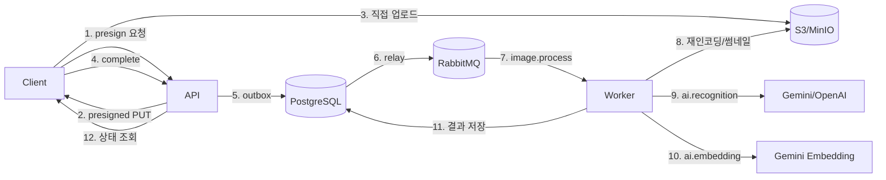

# 이미지·임베딩·AI·MQ

> 상태: 확정
> 역할: 이미지 저장, presigned URL, 임베딩, 이미지 검색, AI 인식, Outbox와 RabbitMQ의 단일 원본
> 관련 문서: [도메인](domain.md), [검색](search.md), [아키텍처](architecture.md), [API 계약](contracts.md), [ADR-005](decisions/ADR-005-rabbitmq-outbox.md), [ADR-007](decisions/ADR-007-embedding-model.md), [ADR-008](decisions/ADR-008-presigned-images.md), [ADR-009](decisions/ADR-009-ai-confirmation.md), [ADR-011](decisions/ADR-011-image-upload-lifecycle.md), [ADR-012](decisions/ADR-012-embedding-versioning.md)

## 1. 파이프라인 개요



- AI 인식은 `POST /ai/recognitions`로 명시적으로 요청할 때만 실행합니다.
- 이미지 검색은 예외적으로 API 요청 안에서 동기 임베딩을 수행합니다.

## 2. 이미지 모델

- Image는 Item, Inventory, 또는 임시 DRAFT 중 하나에 속합니다.
- 하나의 Item 또는 Inventory는 여러 Image를 가질 수 있습니다.
- 대표 사진은 `is_primary = true`인 Image입니다.
- 대표 사진은 대상별로 최대 1장입니다.
- 대상별 이미지는 최대 10장입니다.
- 첫 `READY` 이미지가 자동으로 대표가 됩니다.
- 대표 이미지가 삭제되거나 실패하면 가장 최근 `READY` 이미지를 자동 승격합니다.
- AI 인식과 임베딩은 대표 사진만 사용합니다.
- AI 입력용 DRAFT 이미지는 대상이 없으며 24시간 후 정리합니다.
- 사진별 임베딩은 3차 이후 검토합니다.
- 원본은 비공개 버킷에, 썸네일은 별도 키에 저장합니다.
- `UPLOADING`과 `DRAFT`는 24시간, `FAILED`는 7일, soft delete 후 30일이 지나면 물리 삭제합니다.

### 2.1 이미지 상태

```text
UPLOADING -> PENDING -> PROCESSING -> READY
UPLOADING -> DRAFT -> PENDING -> PROCESSING -> READY
                              -> PROCESSING -> FAILED -> 재시도
READY/FAILED/DRAFT -> DELETED
```

- `UPLOADING`: presign 후 객체 업로드 대기
- `DRAFT`: 대상 미지정, AI 입력 또는 저장 전 임시 이미지
- `PENDING`: 대상 연결 완료, 후처리 대기
- `PROCESSING`: 후처리 중
- `READY`: 노출 가능
- `FAILED`: 후처리 실패
- `DELETED`: soft delete

## 3. 이미지 업로드

### 3.1 클라이언트 처리

- 클라이언트는 이미지를 WebP로 변환합니다.
- 긴 변 기준 최대 2048px로 리사이즈합니다.
- 품질은 0.8 내외를 사용합니다.
- EXIF 제거는 서버에서 다시 수행합니다.
- 업로드 전 파일 크기와 형식을 확인합니다.
- HEIC 등 브라우저가 디코딩하지 못하는 형식은 안내 후 변환을 요청합니다.
- 업로드 중에는 취소할 수 있고, 실패하면 같은 파일로 재시도합니다.
- `PENDING`·`PROCESSING` 이미지는 2초 간격으로 상태를 갱신해 `READY`가 되면 표시합니다.

### 3.2 Presigned URL

1. 클라이언트가 `POST /images/presign`을 호출합니다.
2. 서버가 인증과 대상 권한을 확인합니다.
3. 서버가 허용 형식과 선언 크기를 검증합니다.
4. 서버가 `UPLOADING` 이미지 행과 객체 키를 생성합니다.
5. 서버가 5분짜리 presigned PUT URL을 발급합니다.
6. 클라이언트가 S3에 직접 업로드합니다.
7. 클라이언트가 `POST /images/{imageId}/complete`를 호출합니다.
8. 서버가 객체 존재, 크기, 매직 바이트를 확인합니다.
9. 서버가 실제 MIME, 크기, 해시를 기록하고 `PENDING`으로 전환합니다.
10. 서버가 이미지 후처리 job을 등록합니다.

대상별 권한:

| 대상 | 권한 |
|---|---|
| `ITEM` | `OWNER` |
| `INVENTORY` | `EDIT` 이상 |
| `DRAFT` | 인증된 사용자 본인의 Space |

객체 키 예:

```text
spaces/{spaceId}/inventory/{inventoryId}/{imageId}/original.webp
spaces/{spaceId}/inventory/{inventoryId}/{imageId}/thumb-512.webp
spaces/{spaceId}/item/{itemId}/{imageId}/original.webp
spaces/{spaceId}/item/{itemId}/{imageId}/thumb-512.webp
spaces/{spaceId}/draft/{imageId}/original.webp
spaces/{spaceId}/draft/{imageId}/thumb-512.webp
```

- 버킷은 비공개입니다.
- 공개 ACL을 사용하지 않습니다.
- 서버의 S3 SDK는 내부 `S3_ENDPOINT`를, 브라우저용 presigned URL은 `S3_PUBLIC_ENDPOINT`를 사용합니다.
- `S3_PUBLIC_ENDPOINT`는 브라우저에서 접근 가능한 HTTPS 주소여야 합니다.
- presigned URL은 로그에 남기지 않습니다.
- 업로드 최대 크기는 10MB입니다.
- `UPLOADING`과 `DRAFT` 이미지는 `upload_expires_at` 이후 정리 job이 삭제합니다.
- `complete`에서 `objectKey`가 presign 응답과 일치하는지 확인합니다.

### 3.3 서버 후처리

- 매직 바이트와 실제 디코딩을 확인합니다.
- 이미지를 서버에서 재인코딩합니다.
- EXIF와 메타데이터를 제거합니다.
- 512px 썸네일을 생성합니다.
- SHA-256 해시를 계산합니다.
- 너비, 높이, MIME, 크기를 저장합니다.
- `READY` 전 이미지는 외부에 노출하지 않습니다.
- 처리 실패 시 `FAILED`로 두고 재시도합니다.

### 3.4 DRAFT 이미지 연결

- AI 입력용 이미지는 `UPLOADING` 완료 후 `DRAFT`가 됩니다.
- 저장 시 새 Inventory 또는 Item에 연결하면서 `PENDING`으로 전환합니다.
- 연결은 이미지와 대상 리소스를 같은 트랜잭션에서 갱신합니다.
- 대상에 연결되지 않은 DRAFT는 24시간 후 물리 삭제합니다.
- 공유 Space의 새 Item 생성은 소유자만 가능하므로 DRAFT는 생성자의 개인 Space에서만 허용합니다.

## 4. 이미지 다운로드

1. 클라이언트가 `GET /images/{imageId}/url?variant=THUMB`를 호출합니다.
2. 서버가 이미지가 속한 Inventory 또는 Item의 접근 권한을 확인합니다.
3. 서버가 5분짜리 presigned GET URL을 발급합니다.
4. 클라이언트가 S3에서 직접 다운로드합니다.

- 목록 응답은 `primaryImageId`만 반환하고 presigned URL을 직접 포함하지 않습니다.
- 여러 이미지 URL이 필요하면 `POST /images/urls`로 최대 100개를 한 번에 발급합니다.
- `variant`는 `THUMB` 또는 `ORIGINAL`입니다.
- 공유 철회 후 새 URL은 발급하지 않습니다.
- 이미 발급된 URL은 TTL까지만 유효합니다.
- 즉시 회수가 필요하면 앱 프록시 또는 CloudFront signed URL을 사용합니다.
- 썸네일과 원본의 접근 권한은 동일합니다.

## 5. 임베딩

### 5.1 모델

- 이미지 임베딩은 Gemini 멀티모달 임베딩을 사용합니다.
- 1차 스키마는 1408차원과 단일 모델을 고정합니다.
- 모델, 차원, 버전을 함께 저장합니다.
- OpenAI 임베딩 API는 텍스트 전용이므로 이미지 임베딩에 사용하지 않습니다.
- 인식 provider와 임베딩 provider는 분리할 수 있습니다.
- 임베딩 provider 장애 시 같은 모델로 재시도하며 다른 모델로 fallback하지 않습니다.
- 임베딩 모델을 바꾸면 전체 재임베딩이 필요합니다.
- 검색은 현재 설정된 `embedding_model`, `embedding_version`과 일치하는 벡터만 사용합니다.

### 5.2 저장 위치

- `item.embedding`: Item 대표 사진의 임베딩
- `inventory.effective_embedding`: 재고 대표 사진이 있으면 재고 임베딩, 없으면 Item 임베딩
- `inventory.embedding_source`: `MASTER` 또는 `INVENTORY`
- `inventory.embedding_model`, `inventory.embedding_version`, `inventory.embedding_updated_at`
- `image.embedding`: 이미지별 원본 임베딩

### 5.3 재임베딩 트리거

- Inventory 대표 사진 추가·교체·삭제
- Item 대표 사진 추가·교체·삭제
- 임베딩 모델 변경
- 임베딩 차원 변경
- 이미지 후처리 완료
- 재임베딩 실패 후 수동 재시도

Item 대표 사진이 바뀌면 해당 Item의 Inventory 중 자체 대표 사진이 없는 재고의 `effective_embedding`을 갱신합니다.

### 5.4 fan-out과 경합

- 마스터 임베딩이 바뀌면 `embedding_source=MASTER`인 Inventory에 재임베딩 job을 등록합니다.
- Inventory 대표 사진이 바뀌면 해당 Inventory만 갱신합니다.
- Inventory 대표 사진이 삭제되면 마스터 임베딩으로 fallback하고 `embedding_source=MASTER`로 바꿉니다.
- job은 `embedding_updated_at` 또는 버전을 비교해 오래된 결과를 무시합니다.
- fan-out은 outbox 이벤트로 비동기 처리합니다.

### 5.5 모델·차원 변경

- 기존 벡터 컬럼을 직접 alter하지 않습니다.
- 새 임베딩 테이블 또는 새 컬럼을 만들고 백필합니다.
- 새 HNSW 인덱스를 만든 뒤 검색 설정을 전환합니다.
- 전환 중에는 이전 모델과 새 모델의 결과를 섞지 않습니다.
- 재임베딩 완료 전에는 이미지 검색을 비활성화하거나 이전 모델로 유지합니다.

### 5.6 벡터 인덱스

```sql
CREATE INDEX idx_inventory_effective_embedding
  ON inventory
  USING hnsw (effective_embedding vector_cosine_ops);
```

- 거리 함수는 cosine을 사용합니다.
- 기본 후보 수는 20입니다.
- 유사도 임계값은 초기 데이터로 보정합니다.
- ACL 필터를 함께 적용합니다.
- `limit * 5`, 최대 200개 후보를 가져온 뒤 필터링합니다.
- 필터로 후보가 부족하면 후보 수를 늘리거나 iterative scan을 사용합니다.
- 이미지 검색 결과는 Inventory 기준으로 조회하고 Item으로 그룹핑합니다.
- 검색용 이미지는 API가 multipart로 직접 수신해 임시 처리하고 저장하지 않습니다.
- 검색 이미지 임베딩은 동기로 생성하며 5초 타임아웃을 적용합니다.
- 검색 이미지 원본 보관이 필요하면 3차에서 별도 동의 후 저장합니다.

## 6. AI 인식

### 6.1 입력과 출력

입력:

- 대표 이미지
- 사용자 언어: 한국어
- 현재 카테고리 목록

출력 제안 필드:

- 이름
- 설명
- 카테고리 후보
- 브랜드
- 모델명
- 색상
- 재질
- 신뢰도

가격은 이미지에서 추출하지 않습니다.

`RecognitionResult` 예:

```json
{
  "name": "무선 이어폰",
  "description": "노이즈 캔슬링 무선 이어폰",
  "categoryCandidate": {
    "categoryId": "...",
    "name": "전자기기",
    "isNew": false
  },
  "brand": "Example",
  "modelName": "AB-100",
  "color": "흰색",
  "material": "플라스틱",
  "confidence": 0.87
}
```

### 6.2 결과 처리

- 인식은 `POST /ai/recognitions`로 명시적으로 요청합니다.
- 요청은 `mode=NEW_ITEM|INVENTORY_OVERRIDE`를 가집니다.
- `NEW_ITEM`은 소유자만 요청할 수 있고 DRAFT 이미지를 대상으로 합니다.
- `INVENTORY_OVERRIDE`는 대상 Inventory의 `EDIT` 이상이 요청할 수 있습니다.
- 결과는 `ai_job.result`에 제안으로 저장합니다.
- 사용자에게 폼 자동 채움 형태로 보여줍니다.
- 사용자가 확인·수정한 뒤 저장합니다.
- 자동 저장하지 않습니다.
- 카테고리를 자동 생성하지 않습니다.
- 기존 카테고리 후보 또는 "새 카테고리" 제안만 제공합니다.
- 새 Item 생성 시 제안은 마스터 필드에 채웁니다.
- 기존 Inventory 수정 시 제안은 재고 오버라이드에 채웁니다.
- 마스터 반영은 소유자만 선택할 수 있습니다.

### 6.3 Provider

- provider와 모델은 설정으로 선택합니다.
- OpenAI와 Gemini 중 비용·품질 벤치마크 후 기본값을 정합니다.
- 인식 장애 시 fallback provider를 사용할 수 있습니다.
- 임베딩은 모델 간 fallback을 허용하지 않습니다.
- provider, model, token usage, latency, cost를 기록합니다.
- 같은 이미지 해시와 같은 문맥의 결과는 캐시해 중복 호출을 줄입니다.
- 캐시 키는 Space, 이미지 SHA-256, 모델, 카테고리 집합 해시, 요청 모드를 포함합니다.
- Space 간 캐시를 재사용하지 않습니다.
- 캐시 TTL은 30일입니다.
- 사용자별 일일 호출 한도와 레이트리밋을 적용합니다.
- 이미지와 텍스트가 외부 provider로 전송됨을 개인정보 처리 방침에 명시합니다.

## 7. 비동기 처리

### 7.1 Outbox

- 재고·이미지 변경과 `outbox_event`를 같은 트랜잭션으로 저장합니다.
- 릴레이가 `FOR UPDATE SKIP LOCKED`로 이벤트를 읽어 RabbitMQ에 발행합니다.
- 발행 성공 후 `PUBLISHED`로 표시합니다.
- 실패 시 재시도하고 `last_error`를 기록합니다.
- 최대 재시도 횟수를 넘기면 `FAILED`로 표시하고 운영 알림을 발생시킵니다.
- 오래된 이벤트는 정리 job으로 삭제합니다.
- publisher confirm을 사용해 발행 결과를 확인합니다.

### 7.2 토폴로지

- exchange는 `agolock.events` topic exchange를 사용합니다.
- routing key는 이벤트 타입과 동일하게 사용합니다.
- 큐는 이벤트 타입 패턴을 바인딩합니다.
- DLX는 `agolock.dlx`를 사용합니다.

| 큐 | 바인딩 | 역할 | DLQ |
|---|---|---|---|
| `image.process` | `image.uploaded` | 재인코딩, EXIF 제거, 썸네일, 해시 | `image.process.dlq` |
| `ai.recognition` | `ai.recognition.requested` | 이미지 인식 | `ai.recognition.dlq` |
| `ai.embedding` | `ai.embedding.requested` | 이미지 임베딩 | `ai.embedding.dlq` |
| `notification` | `notification.requested` | 이메일, 3차 인앱 알림 | `notification.dlq` |
| `domain.events` | `inventory.*`, `share.*`, `ai.*.completed` | 검색·감사·알림 보조 | `domain.events.dlq` |

- 재시도는 지수 백오프를 사용합니다.
- 최대 재시도 횟수는 큐별로 설정합니다.
- DLQ 메시지는 운영 CLI 또는 관리자 전용 재처리 API로 다시 넣을 수 있습니다.
- 메시지에는 `eventId`, `eventType`, `spaceId`, `occurredAt`을 포함합니다.
- job 관련 메시지는 `jobId`를 추가로 포함합니다.
- `image.processed`/`image.deleted`는 소비자가 생길 때까지 발행하지 않습니다.
- 소비자는 `eventId` 또는 `jobId`로 멱등성을 보장합니다.

### 7.3 AI job 상태

```text
PENDING -> PROCESSING -> COMPLETED
                      -> FAILED -> 재시도 -> PROCESSING
PENDING/PROCESSING -> CANCELLED
```

- `ai_job`에 시도 횟수, 오류, provider, model, 결과, 비용을 저장합니다.
- API는 job 상태와 결과 요약을 반환합니다.
- UI는 1~2초 폴링을 사용합니다.
- 다중 인스턴스에서 SSE가 필요하면 Redis pub/sub 또는 별도 fan-out을 검토합니다.
- job은 사용자 취소가 가능합니다.
- 소비자는 결과 저장 직전에 job 상태가 `CANCELLED`인지 다시 확인합니다.
- 취소 후 늦게 도착한 결과는 저장하지 않습니다.

## 8. 장애 처리

- AI 인식 provider 장애 시 재시도 후 fallback provider를 사용합니다.
- 임베딩 provider 장애 시 같은 모델로만 재시도합니다.
- 이미지 후처리 실패 시 원본을 노출하지 않고 `FAILED`로 표시합니다.
- 임베딩 실패 시 이미지 검색에서만 제외하고 재고 저장은 허용합니다.
- 인식 실패 시 수동 입력을 계속할 수 있습니다.
- 이미지 검색 임베딩이 5초를 넘으면 `503 IMAGE_SEARCH_UNAVAILABLE`을 반환합니다.
- DLQ에 쌓인 메시지는 운영 알림을 발생시킵니다.
- 재처리 후에도 실패하면 사용자에게 재시도 버튼을 제공합니다.
- 비용 한도 초과 시 AI 기능만 비활성화하고 CRUD는 유지합니다.

## 9. 보안과 개인정보

- 이미지 버킷은 비공개입니다.
- presigned URL은 짧은 TTL을 사용합니다.
- 이미지 접근 전에 권한을 확인합니다.
- Item 이미지는 `OWNER`, Inventory 이미지는 `EDIT` 이상만 수정합니다.
- 업로드 파일의 매직 바이트를 검증합니다.
- 서버에서 재인코딩해 악성 파일을 무력화합니다.
- AI provider에 전송되는 데이터를 최소화합니다.
- `UPLOADING`과 `DRAFT` 이미지는 만료 후 정리합니다.
- soft delete된 이미지는 30일 후 원본과 썸네일을 물리 삭제합니다.
- AI 원본 응답과 presigned URL을 로그에 남기지 않습니다.
- AI 캐시는 Space 경계를 넘지 않습니다.

## 10. 데이터 사전

테이블과 컬럼의 단일 원본은 [데이터 사전](generated/data-dictionary.md)입니다. 이 문서에서 DDL을 재정의하지 않습니다.
