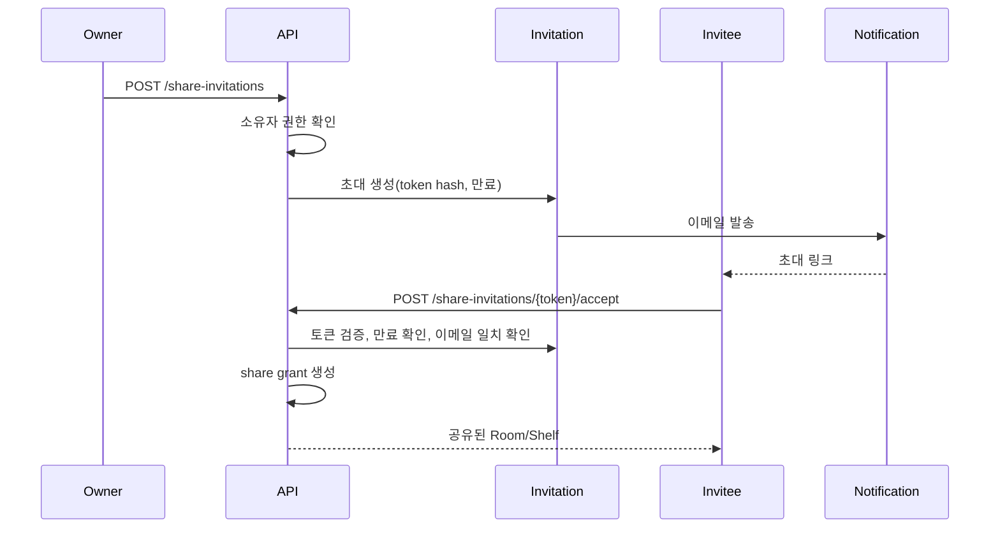

# 공유와 권한

> 상태: 확정
> 역할: Share, Grant, 초대, 권한 매트릭스, 상속·우선순위, ACL 조회 규칙의 단일 원본
> 관련 문서: [도메인](domain.md), [아키텍처](architecture.md), [검색](search.md), [API 계약](contracts.md), [ADR-003](decisions/ADR-003-permission-model.md), [ADR-010](decisions/ADR-010-item-creation-permissions.md), [ADR-013](decisions/ADR-013-invitation-only-sharing.md)

## 1. 공유 단위

공유는 Room과 Shelf에만 부여합니다.

| 대상 | 공유 가능 | 하위 범위 |
|---|---|---|
| Room | 예 | Room에 직접 위치한 Inventory, 하위 Shelf, Box, Inventory |
| Shelf | 예 | Shelf에 직접 위치한 Inventory, 하위 Box, Inventory |
| Box | 아니오 | MVP 제외 |
| Item | 아니오 | 공유는 위치 단위로만 |
| Inventory | 아니오 | 상위 위치 권한으로 접근 |

- 1차 공유는 초대 전용입니다.
- 직접 공유는 1차에서 지원하지 않고 3차에서 재검토합니다.
- Box 공유는 3차 이후 검토합니다.
- 재공유는 지원하지 않습니다.
- 링크 공유와 공개 공유는 지원하지 않습니다.
- 공유는 소유권을 이전하지 않습니다.

## 2. 권한 모델

권한은 누적 구조입니다.

```text
VIEW < EDIT < MANAGE < OWNER
```

| 권한 | 의미 | 포함 범위 |
|---|---|---|
| VIEW | 조회 | 재고, 마스터, 위치, 이미지 조회 |
| EDIT | 수정 | VIEW + 재고 오버라이드, Inventory 사진, 상태 수정 |
| MANAGE | 재고 관리 | EDIT + 기존 Item에 Inventory 추가·삭제·이동 |
| OWNER | 소유자 | 모든 권한 + 신규 Item, Item 사진, 계층, 마스터, 카테고리, 공유 관리 |

### 2.1 권한 매트릭스

| 작업 | VIEW | EDIT | MANAGE | OWNER |
|---|---|---|---|---|
| 접근 가능한 재고 조회 | O | O | O | O |
| 접근 가능한 마스터 조회 | O | O | O | O |
| 재고 오버라이드 수정 | X | O | O | O |
| Inventory 사진 추가·교체 | X | O | O | O |
| 재고 상태 변경 | X | O | O | O |
| 기존 Item에 재고 추가 | X | X | O | O |
| 신규 Item 생성 | X | X | X | O |
| Item 사진 추가·교체 | X | X | X | O |
| 재고 삭제 | X | X | O | O |
| 재고 이동 | X | X | O | O |
| 마스터 공통 필드 수정 | X | X | X | O |
| 계층 생성·이름 변경·이동·삭제 | X | X | X | O |
| 카테고리 관리 | X | X | X | O |
| 공유 초대·권한 변경·철회 | X | X | X | O |

- 공유 사용자는 접근 가능한 기존 Item만 선택해 Inventory를 추가할 수 있습니다.
- 공유 사용자는 새 Item이나 새 Category를 만들 수 없습니다.
- 공유 사용자는 자신이 접근할 수 있는 Item만 조회합니다.
- 공유 사용자는 Space 전체 Item 카탈로그를 탐색할 수 없습니다.
- Item 이미지와 Inventory 이미지의 권한은 서로 다릅니다.

## 3. Grant와 상속

### 3.1 Grant

- Grant는 `share` 테이블의 한 행입니다.
- Grant는 `room_id` 또는 `shelf_id` 중 정확히 하나를 가집니다.
- Grant는 `grantee_user_id`, `permission`, `granted_by`, `created_at`을 가집니다.
- Grant는 초대 수락 시 생성됩니다.
- 같은 리소스와 같은 사용자에 대해 하나의 활성 Grant만 허용합니다.
- Room Grant와 Shelf Grant는 동시에 존재할 수 있습니다.

### 3.2 상속

- Room Grant는 Room과 모든 하위 리소스에 적용됩니다.
- Shelf Grant는 Shelf와 모든 하위 리소스에 적용됩니다.
- Box는 상위 Shelf 또는 Room Grant로 접근합니다.
- Inventory는 자신이 위치한 노드와 조상 노드의 Grant를 모두 고려합니다.
- Item은 접근 가능한 Inventory를 통해 간접적으로 접근합니다.

### 3.3 유효 권한 계산

```text
effective_permission(user, resource):
  if user == space.owner:
    return OWNER

  grants = [
    grant for grant in active_grants(user)
    if grant.resource is resource or grant.resource is ancestor(resource)
  ]

  if grants is empty:
    return NONE

  return max(grant.permission for grant in grants)
```

- 여러 Grant가 있으면 가장 높은 권한을 적용합니다.
- Room VIEW와 Shelf EDIT가 있으면 Shelf에는 EDIT가 적용됩니다.
- Room EDIT와 Shelf VIEW가 있으면 Shelf에는 EDIT가 적용됩니다.
- Room MANAGE와 Shelf VIEW가 있으면 Shelf에는 MANAGE가 적용됩니다.
- 거부(deny) 규칙은 MVP에서 지원하지 않습니다.
- Grant 철회 시 남은 Grant로 유효 권한을 다시 계산합니다.
- 계층 API 응답은 `effectivePermission`과 `isShared`를 포함합니다.

### 3.4 예시

| Room Grant | Shelf Grant | Shelf 유효 권한 |
|---|---|---|
| 없음 | VIEW | VIEW |
| VIEW | 없음 | VIEW |
| VIEW | EDIT | EDIT |
| EDIT | VIEW | EDIT |
| MANAGE | VIEW | MANAGE |
| 없음 | MANAGE | MANAGE |

## 4. 초대와 수락



- 초대는 이메일로 발송합니다.
- 인앱 알림은 3차 범위이며 1차에서는 이메일만 사용합니다.
- 초대 토큰은 해시로 저장하고 1회 사용합니다.
- 초대 만료 기본값은 7일입니다.
- 수락 전에는 접근 권한이 없습니다.
- 수락하는 계정의 이메일은 초대 이메일과 일치해야 합니다.
- 이미 활성 Grant가 있으면 초대를 만들지 않습니다.
- 같은 리소스와 이메일에 대기 중인 초대가 있으면 중복 생성하지 않습니다.
- 초대받은 사용자는 초대를 거절할 수 있고 `DECLINED` 상태를 기록합니다.
- 초대를 철회할 수 있습니다.
- 자기 자신이나 Space 소유자를 초대할 수 없습니다.
- 가입하지 않은 이메일은 가입 링크를 포함한 초대로 처리합니다.
- 스테이징 가입 초대코드와 공유 초대는 별개입니다.
- 만료된 초대는 정리 job이 `EXPIRED`로 표시합니다.

## 5. 접근 범위와 검색

- 사용자의 검색 범위는 자신의 Space와 공유받은 Room/Shelf입니다.
- 공유 결과에는 소유자와 공유 출처를 표시합니다.
- 공유 사용자는 접근 가능한 Inventory에 연결된 Item과 Category만 볼 수 있습니다.
- `GET /items`의 `inventoryCount`는 접근 가능한 Inventory만 셉니다.
- 공유 사용자는 Space 전체 Category 목록을 조회하거나 관리할 수 없습니다.
- 재고 이동 후 가시성은 이동한 위치 기준으로 재평가합니다.
- 공유 범위 밖으로 이동한 재고는 공유 사용자의 검색과 목록에서 제외합니다.
- Grant 철회 후 새 요청은 즉시 차단합니다.
- 이미 발급된 이미지 presigned URL은 TTL까지만 유효합니다.

## 6. 소유자 전용 작업

다음 작업은 `OWNER`만 수행할 수 있습니다.

- 신규 Item 생성
- Item 마스터 공통 필드와 Item 대표 사진 수정
- Room, Shelf, Box 생성·이름 변경·이동·삭제
- Category 생성·수정·삭제·병합
- Share 초대·권한 변경·철회
- Space 설정 변경

공유 사용자가 새 Item이나 계층 변경이 필요하면 소유자에게 요청하는 흐름으로 안내합니다.

## 7. 경계 사례

### 7.1 이미 공유된 Shelf가 있는 Room 공유

- 기존 Shelf Grant를 삭제하지 않습니다.
- Room Grant를 추가로 생성합니다.
- 유효 권한은 두 Grant의 최대값입니다.
- Room Grant를 철회해도 Shelf Grant는 유지됩니다.
- Shelf Grant를 철회해도 Room Grant는 유지됩니다.

### 7.2 공유 중인 Room의 Shelf 이동

- Shelf 이동은 소유자만 가능합니다.
- 다른 Room으로 이동하면 기존 Room Grant의 적용을 받지 않습니다.
- Shelf 자체 Grant는 유지됩니다.
- 이동 전에 공유 사용자에게 미치는 영향을 확인합니다.
- 이동 후 검색 경로와 공유 가시성을 다시 계산합니다.

### 7.3 공유 사용자의 재고 추가

- `MANAGE` 권한이 필요합니다.
- 접근 가능한 기존 Item을 선택합니다.
- 새 Item과 새 Category는 만들 수 없습니다.
- 공유 사용자는 생성한 Inventory의 오버라이드와 상태를 수정할 수 있습니다.
- 마스터 공통 필드와 Item 이미지 수정은 소유자만 가능합니다.

### 7.4 공유 철회

- Grant를 비활성화하거나 삭제합니다.
- 이후 요청은 즉시 거부합니다.
- 검색 결과와 목록에서 제외합니다.
- 이미 발급된 presigned URL은 짧은 TTL 후 만료됩니다.
- 감사 로그에 철회자와 시각을 남깁니다.

### 7.5 초대 거절과 만료

- 초대받은 사용자는 수락 전에 거절할 수 있습니다.
- 거절된 초대는 `DECLINED`로 표시하고 Grant를 만들지 않습니다.
- 만료된 초대는 `EXPIRED`로 표시합니다.
- 거절·만료 후 다시 초대하려면 새 초대를 생성합니다.

## 8. ACL 조회 구현

- `AccessService`가 사용자와 리소스의 유효 권한을 계산합니다.
- 단건 조회는 리소스의 Space와 Grant를 확인합니다.
- 목록·검색은 접근 가능한 Room/Shelf/Inventory 조건을 SQL에 포함합니다.
- Room Grant와 Shelf Grant를 각각 조인해 최대 권한을 계산합니다.
- `EXISTS`와 인덱스를 사용해 권한 조건을 적용합니다.
- 계층 응답에는 `effectivePermission`, `isShared`를 포함합니다.
- 이동 대상은 접근 가능하고 `MANAGE`가 있는 위치만 반환합니다.
- 대량 데이터에서 성능 문제가 있으면 접근 가능 리소스 캐시 또는 materialized view를 검토합니다.
- 클라이언트가 보낸 권한이나 `space_id`를 신뢰하지 않습니다.
- 교차 Space 접근, 상속, 철회, 이동 후 가시성을 통합 테스트로 검증합니다.

## 9. 감사와 알림

- 1차에서 Share 초대·생성·권한 변경·철회와 초대 발송·수락·거절을 감사 로그에 남깁니다.
- 감사 로그 조회 UI와 데이터 내보내기는 3차 범위입니다.
- 1차 알림은 공유 초대 이메일만 제공합니다.
- 공유 사용자가 재고를 추가·삭제·이동할 때의 인앱 알림은 3차 범위입니다.
- 알림 문구와 템플릿 키는 [운영](operations.md)을 따릅니다.
